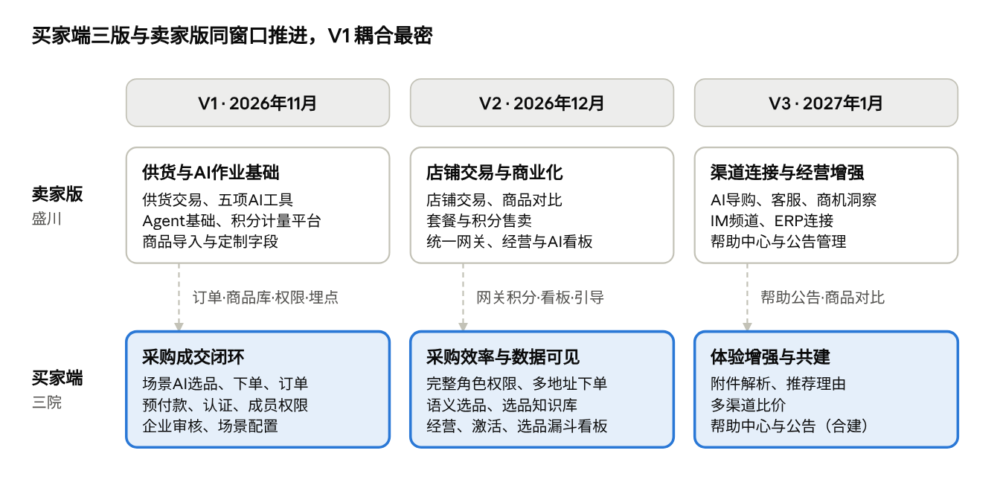

# 采发发Agent · 买家端产品版本规划（2026.11–2027.01）

Oct 31, 2026 · @sanyuan

## 结论

买家端按卖家版的三个版本窗口同步排期：11月打通春节福利采购成交闭环，12月提升采购效率并让经营数据可见，1月做体验增强并与卖家版共建帮助中心、公告。

- **V1 · 11月 · 采购成交闭环**：登录认证 → 预付款 → 场景内AI选品 → 下单 → 采购订单 → 售后；运营侧完成企业审核、汇款认账和场景配置。11-20 前全量上线，承接春节福利采购。

- **V2 · 12月 · 效率与数据**：完整角色权限、多地址下单、语义选品、选品知识库；经营、用户、激活和选品漏斗看板与卖家版看板同期上线。

- **V3 · 1月 · 体验增强与共建**：附件解析、推荐理由、多渠道比价（复用卖家版商品对比）；帮助中心、公告管理与卖家版合建一套。

关键耦合有三处：买家采购订单就是卖家供货订单的来源；权限模型需在 V1 交付最小版，供卖家版业务助手和资产检索使用；卖家侧「企业经营账户」目前没有 PD，而账户体系由你负责，需先明确归属。

依据：钉钉《采发发Agent & 分采通 Q4产品规划》「采发发agent」页（2026-10-31 15:16 版本）、[采发发Agent · 产品能力路线图](https://oss.elebuys.com/cdn/1/other/1793429533908_51e4741e.html#release-1)。

## 三院负责任务盘点

拆解表中 PD 含「三院」的子任务共 51 条：P0 31 条、P1 14 条、P2 5 条、P3 1 条；其中 9 条与盛川或 nico 共同负责。

| 范围   | 模块           | 任务                                                               | 子任务数 | P0 / P1 / P2 / P3 | 协同 PD      | TL                 |
|--------|----------------|--------------------------------------------------------------------|----------|-------------------|--------------|--------------------|
| 基础   | 数据清洗       | 商品数据清洗（3.0商品库 → agent商品库 + 同步机制）                 | 1        | 1 / 0 / 0 / 0     | —            | 侯局               |
| 基础   | 数据埋点       | 埋点体系（事件字典、AI专属事件、公共属性）、用户激活埋点           | 4        | 3 / 1 / 0 / 0     | nico（激活） | 巴韶&侯局          |
| 基础   | 数据看板       | 经营看板、用户看板、激活漏斗、选品漏斗                             | 4        | 0 / 4 / 0 / 0     | nico（激活） | 侯局               |
| 通用   | 客户端         | 多端载体（小程序/H5/PC，App，桌面版）                              | 3        | 1 / 0 / 2 / 0     | 盛川         | 巴韶               |
| 通用   | 用户体系       | 会员身份（注册流程优化、个人/企业两级）                            | 2        | 2 / 0 / 0 / 0     | Nico（注册） | 侯局               |
| 通用   | 员工权限       | 企业成员、角色权限、数据范围                                       | 3        | 1 / 2 / 0 / 0     | —            | 侯局               |
| 通用   | 账户体系       | 买家侧企业采购账户（预付款、账单中心、异常处理）                   | 3        | 3 / 0 / 0 / 0     | —            | 侯局               |
| 买家侧 | 智能选品       | 需求理解、召回过滤、排序推荐、多轮调整、比价、选品下单、知识与评测 | 16       | 10 / 3 / 3 / 0    | —            | 云程、老罗（下单） |
| 买家侧 | 资产库         | 采购订单（列表、详情、操作）                                       | 3        | 3 / 0 / 0 / 0     | —            | 老罗               |
| 运营侧 | 企业管理       | 企业列表详情、认证审核、汇款认账、冻结与黑名单                     | 4        | 4 / 0 / 0 / 0     | —            | 侯局               |
| 运营侧 | 内容管理       | 场景/频道配置、选品提示词话术、福利知识库问答                      | 3        | 2 / 1 / 0 / 0     | —            | 老罗               |
| 运营侧 | 买家侧内容运营 | 任务引导、应用案例、帮助中心、公告、上线培训                       | 5        | 1 / 3 / 0 / 1     | nico         | 老罗               |

表外提醒：「通用-账户体系-卖家侧企业经营账户」3 条子任务未填 PD、优先级和 TL，卖家版 V1 对账结算依赖它。

## 版本总览

版本总览 · 卖家版与买家端三版对照

上行为卖家版路线图，下行为买家端；虚线是各版必须两侧一起定的耦合项，详见「与卖家版的耦合点」。

## V1 · 2026年11月 · 采购成交闭环

目标：服务商和企业能在春节场景里用 AI 选完商品并下单，运营能审核企业、认款和上场景。覆盖你全部 31 条 P0，另加权限最小版。

| 模块                  | V1 交付范围                                                                                                                                                                               | 优先级                 | 依赖/备注                                                    |
|-----------------------|-------------------------------------------------------------------------------------------------------------------------------------------------------------------------------------------|------------------------|--------------------------------------------------------------|
| 商品数据              | 3.0商品库清洗至 agent 商品库，建立同步机制                                                                                                                                                | P0                     | 选品召回的前提；与卖家版平台商品库共用一套结构               |
| 埋点                  | 事件字典（浏览→对话→意图→方案→换品→导出→加购→下单→支付）、AI 专属事件、公共属性                                                                                                           | P0                     | 与盛川「AI 埋点」统一口径，写入「埋点口径」页                |
| 多端                  | PC 主站 + H5 + 小程序承载买家主链路                                                                                                                                                       | P0                     | 与盛川共同；容量不足时 PC 先行                               |
| 会员身份              | PC 未登录体验与注册、移动端资料完善与赠积分；个人可浏览不可下单，上传营业执照升级企业                                                                                                     | P0                     | 与 Nico 共同；卖家版复用同一账号体系                         |
| 员工权限              | 成员邀请（链接/手机号）、加入审核、移除、转让管理员；**权限最小版**：管理员/成员两角色，本人/全企业两档数据范围                                                                           | P0（最小版从 P1 提前） | 卖家版 V1 业务助手、资产按权限检索、经营账户资金权限都依赖它 |
| 采购账户              | 预付款（汇款认账充值、下单扣款、明细；不可退、无人工匹配入账）；账单中心（流水、订单导出、开票申请，初期线下开票）；余额不足、扣款失败、重复支付处理                                      | P0                     | —                                                            |
| 智能选品 · 需求理解   | 选品单结构化字段；一句话抽取字段及追问策略；合规约束（工会人均限额、禁购类目、单品上限）                                                                                                  | P0                     | 选品单字段与卖家版「智能选品」需求字段对齐                   |
| 智能选品 · 召回与排序 | 统一商品库 + 场景/运营标签召回；硬过滤（无货剔除、库存紧张降权、不可售区域、黑名单、价格带）；排序因子（价格力、服务商利润空间、品牌力、销量、电商仓时效、效期）；推荐比重（如猫超≤ 50%） | P0                     | 入驻商家商品要等卖家版 V1 供货入库后才进召回                 |
| 智能选品 · 多轮调整   | 换品、删品、锁定、调预算、调人数，局部重算                                                                                                                                                | P0                     | 依赖盛川 V1「任务上下文管理」                                |
| 智能选品 · 下单       | 立即下单/预付款下单，个人用户引导升级；下单前价格、库存二次校验及替换建议                                                                                                                 | P0                     | —                                                            |
| 采购订单              | 跨来源聚合列表（状态 Tab、筛选、导出）；详情（拆单子订单、物流、支付、收货）；取消、确认收货、申请售后、再来一单                                                                          | P0                     | 入驻商家子订单即卖家「供货订单」                             |
| 运营 · 企业管理       | 企业列表/详情、认证审核（驳回、重提）、汇款认账与账户调整审核、冻结/解冻与黑名单                                                                                                          | P0                     | 共用运营后台                                                 |
| 运营 · 场景内容       | 场景/频道配置（名称、商品池、定价规则模板、上下线时间）；选品提示词/场景指引话术                                                                                                          | P0                     | 春节场景需在 11-20 前配好                                    |
| 上线培训              | 面向客服、客户运营、市场、销售的新功能培训（每版重复）                                                                                                                                    | P0                     | 与 nico 共同                                                 |

阶段结果：春节场景可从登录走到售后，订单可按来源拆单并流入卖家供货链路，埋点从第一天起采集。

## V2 · 2026年12月 · 采购效率与数据可见

目标：企业内多角色协作采购，选品更准、下单更快；经营和选品效果可量化。与卖家版 V2「经营与 AI 使用看板」「套餐与积分售卖」同期。

| 模块             | V2 交付范围                                                                                             | 优先级 | 依赖/备注                                                 |
|------------------|---------------------------------------------------------------------------------------------------------|--------|-----------------------------------------------------------|
| 员工权限         | 完整角色矩阵（管理员/采购员/财务）；数据范围增加「本部门」，覆盖订单、方案、账单                        | P1     | 在 V1 最小版上扩展，卖家版同步复用                        |
| 智能选品         | 语义检索 + 结构化筛选混合（「适合女性员工」「有面子的」）                                               | P1     | —                                                         |
| 选品下单         | 多地址下单、导入地址下单                                                                                | P1     | 春节后企业分发场景常见                                    |
| 选品知识         | 福利选品知识库（节日场景、行业偏好、合规标准、往期爆款）；运营侧福利知识库问答维护、答不准转专家        | P1     | 由商品运营沉淀；可与「福利采购专家 skill」一起推进        |
| 埋点             | 用户激活体系埋点（注册→完善资料→登录→核心动作→7日留存）                                                 | P1     | 与 nico 共同；支撑 Nico 的 7 天激活任务流                 |
| 数据看板         | 经营看板（GMV、订单数、客单价、复购，按场景/来源）；用户看板；激活漏斗；选品漏斗（对话→方案→加购→下单） | P1     | 与卖家版经营看板、盛川 AI 看板共用看板框架和口径          |
| 买家内容运营     | 任务引导：各技能默认提示词、示例需求、所需资料说明，一键填入                                            | P1     | 与 nico 共同；卖家版同功能在 V3，建议一套配置能力两侧复用 |
| 积分展示（耦合） | 买家账户中心承接套餐、积分余额与消费入口                                                                | —      | 功能归盛川；买家选品接口随卖家 V2 存量迁移接入 AI 网关    |
| 上线培训         | V2 新功能培训                                                                                           | P0     | —                                                         |

阶段结果：采购员、财务各看各的数据；运营能看到春节场景的 GMV 和选品转化，支撑 1 月复盘。

## V3 · 2027年1月 · 体验增强与共建

目标：降低需求录入和决策成本，帮助与公告买卖两侧合建一套。

| 模块           | V3 交付范围                                                   | 优先级       | 依赖/备注                                                                           |
|----------------|---------------------------------------------------------------|--------------|-------------------------------------------------------------------------------------|
| 智能选品       | 附件需求解析：需求文档、往年采购清单 Excel、招标文件 → 选品单 | P2           | 复用盛川 V1「资产按需检索与读取」                                                   |
| 智能选品       | 推荐理由：每个商品一句推荐原因（价格、口碑、适配场景）        | P2           | —                                                                                   |
| 商品对比与比价 | 多渠道比价（市场价/平均到手价/京东价），标注价格优势          | P2           | 复用卖家版 V2「商品对比」组件；不展示平台利润率                                     |
| 帮助中心       | 操作指南、常见问题、规则说明，支持搜索和页面入口              | P1 → 对齐 V3 | 与卖家版 V3「帮助中心与公告管理」合建，按买家/卖家分类；V1、V2 只随功能交付必要说明 |
| 公告与更新     | 新功能、规则调整、维护通知，配置展示位置与时间                | P1 → 对齐 V3 | 同上                                                                                |
| 上线培训       | V3 新功能培训                                                 | P0           | —                                                                                   |

**规划池（V3 之后）**

- App 版本、桌面版本（P2，与盛川共同）

- 应用案例：展示需求、过程和成果，从案例进入任务（P3，与 nico 共同）

- 可选：卖家版 V3 IM 频道上线后，评估买家选品在 IM 中调用（拆解表未列，不承诺）

## 与卖家版的耦合点

共 8 处耦合，其中 4 处在 V1 就要定下接口或口径，否则两侧各自开发后难合并。

| 耦合点               | 卖家版（盛川）                                                | 买家端（三院）                     | 需要的约定                                                                                                           | 定下时点  |
|----------------------|---------------------------------------------------------------|------------------------------------|----------------------------------------------------------------------------------------------------------------------|-----------|
| 订单链路             | V1 供货订单：接单/拒单、发货、售后、对账结算                  | V1 采购订单按来源拆单              | 买家子订单即卖家供货订单来源；状态、物流、售后单双向同步；卖家拒单或缺货时，买家订单如何取消、款项如何退回预付款余额 | V1 排期前 |
| 商品库               | V1 商品提报 → 平台挑选入库；轻定制字段                        | V1 3.0商品清洗、选品召回           | 同一张商品表结构；入驻商家商品入库后按商品池规则自动上下架进入召回                                                   | V1 排期前 |
| 身份与权限           | V1 业务助手、资产按权限检索；经营账户成员资金权限；V3 IM 身份 | V1 成员 + 权限最小版，V2 完整矩阵  | 角色、数据范围模型由买家端统一提供，卖家版调用                                                                       | V1 排期前 |
| 埋点口径             | V1 AI 埋点（任务、积分、网关计费流水）                        | V1 事件字典、AI 专属事件、公共属性 | 共用「埋点口径」页一套事件与属性命名；token 消耗以计量平台流水为准                                                   | V1 排期前 |
| 选品 → 报价/方案     | V1 做报价、做方案；跨技能上下文延续                           | V1 选品单与选品结果                | 选品单字段纳入 Agent 上下文结构，服务商选完可直接带入对客报价、方案                                                  | V1        |
| AI 网关与积分        | V1 计量平台，V2 存量接口迁移、套餐积分售卖                    | 买家选品调用模型；账户中心入口     | 买家选品接口列入 V2 迁移清单；积分页面归盛川，买家端给入口                                                           | V2        |
| 看板                 | V2 经营看板、AI 使用看板                                      | V2 经营、用户、激活、选品漏斗看板  | 同一看板框架和指标口径，按买家/卖家分页                                                                              | V2        |
| 帮助、公告、任务引导 | V3 帮助中心与公告管理；卖家内容运营 P2                        | 帮助、公告对齐 V3；任务引导 V2     | 一套内容运营后台，按端分类配置；任务引导买家先做、卖家复用                                                           | V2        |

## 待确认事项与风险

最大风险是 V1 容量：31 条 P0 加权限最小版要在 11-20 前全量上线，且与卖家版 V1 六项建设并行。

- [ ] **卖家侧企业经营账户归属**：拆解表未填 PD/优先级/TL，卖家版 V1 对账结算依赖它。账户体系归你，需确认是否由三院接，以及是否进 V1。

- [ ] **供货订单来源与退款**：卖家路线图列为「详细排期前需要明确」，答案就是买家采购订单的拆单规则；需与盛川、老罗、侯局一起定。

- [ ] **权限最小版前移**：本规划把角色/数据范围最小版从 P1 提到 V1，需侯局确认工作量。

- [ ] **多端范围**：小程序/H5/PC 为 P0，容量不足时是否接受 11-20 先上 PC、H5 和小程序在 11 月底补齐。

- [ ] **帮助中心、公告后移**：买家侧是 P1，本规划对齐卖家版放 V3 合建；若买家侧需提前，则由买家先建、卖家 V3 扩展。

- [ ] **两个「智能选品」边界**：卖家选品从商家自有商品中找，买家选品从平台统一商品库找；需确认需求字段和对客口径共用一套，避免重复建设。

- [ ] **日期**：卖家路线图注明具体日期待工作量和依赖评估后确定，本规划版本窗口随之调整。

V1 容量不足时可后移的候选：推荐比重精细化、合规约束中单品价格上限以外的规则、移动端赠积分流程。不建议后移的：下单、采购订单、预付款、企业审核和场景配置。
