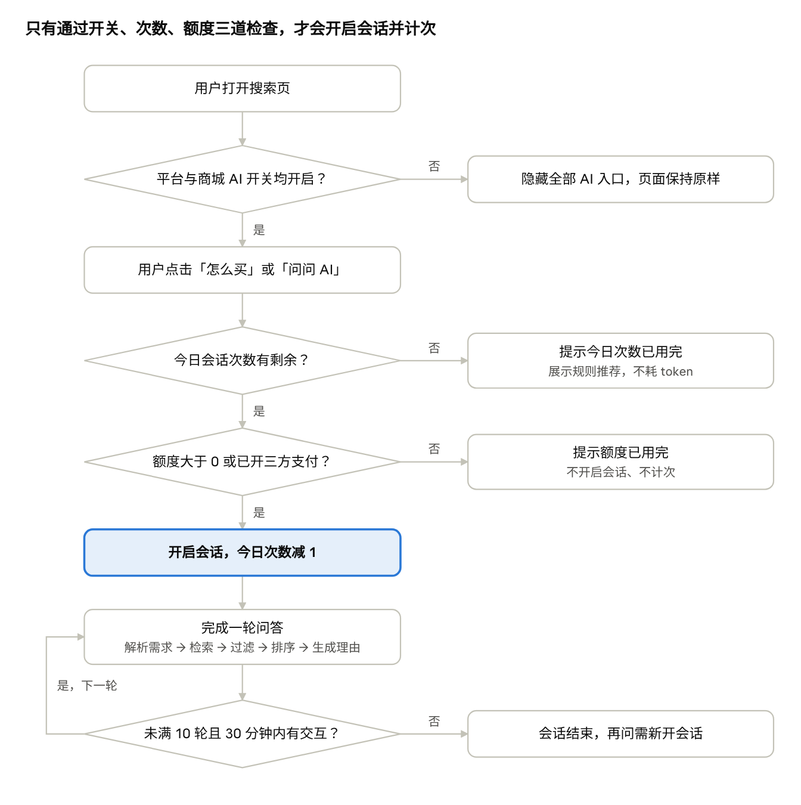
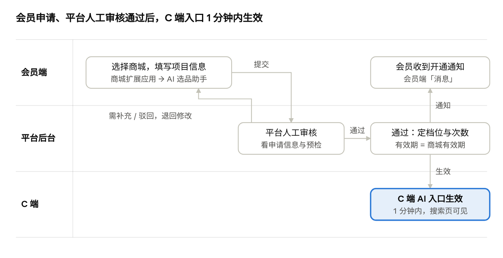
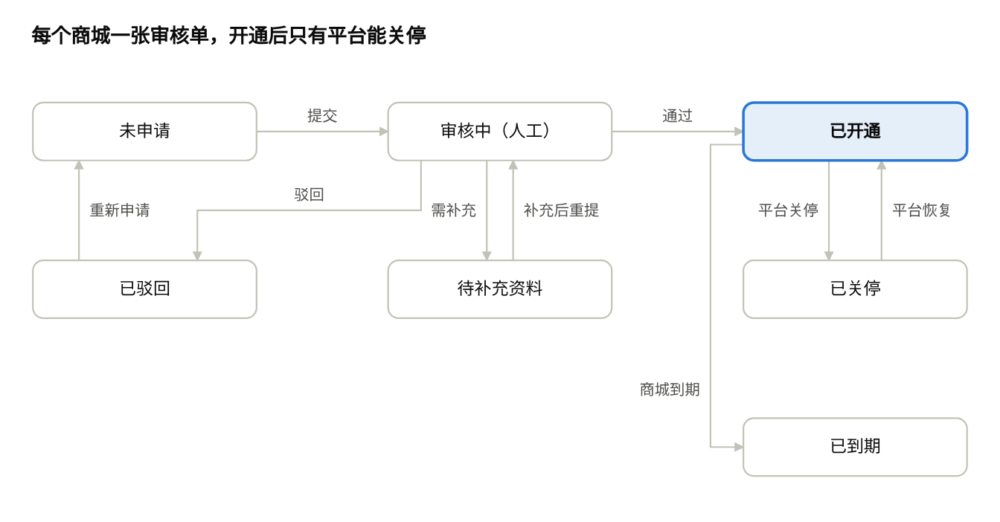

# AI选品助手 PRD V1.0（C端兑换商城）

2026-11-18 · @xio

## 0. 决策与待确认事项

本 PRD 中的交互流程与边界定义须经产品负责人逐条确认后方可进入研发评审。已确认的 4 项决策如下，其余 10 项为建议默认值，请在「确认」列标记。

**已确认决策（2026-11-17）**

| 决策项                     | 结论                                                                                                                   |
|----------------------------|------------------------------------------------------------------------------------------------------------------------|
| 三方支付开启时的超额度推荐 | 不设超额上限；结果只排序不分组，额度内商品通过排序加分优先（2026-11-18）                                               |
| 计次单位                   | 每个会话计 1 次，会话内限制最大轮数                                                                                    |
| 利润率加权配置方           | 平台统一配置，会员不可见、不可调；利润信息永不对 C 端暴露                                                              |
| V1 功能范围                | 多轮对话选品咨询、搜索结果页 AI 补充条、无结果页 AI 推荐、凑满额度组合推荐                                             |
| 开通方式                   | 会员在会员端「商城扩展应用」统一申请并指定商城，平台逐单审核；站点运营中心不设申请入口；平台仍可直接开通（2026-11-18） |
| 开通有效期                 | 默认与商城有效期一致；平台可随时手动关停 AI 选品（2026-11-18）                                                         |
| 暂停与审核                 | 会员不允许自行暂停，只有平台可关停和恢复；开通申请全部人工审核（2026-11-18）                                           |
| 预算口径                   | 申请时填人均预算，平台按人均 × 用户数估算总预算（2026-11-18）                                                          |

**待确认的边界与交互默认值**

| \#  | 事项                         | 建议默认值                                                                                                                                  | 确认   |
|-----|------------------------------|---------------------------------------------------------------------------------------------------------------------------------------------|--------|
| 1   | 会话的定义                   | 用户在对话页发出首条消息即开启会话；30 分钟无交互、或点击「新对话」即结束；会话内最多 10 轮                                                 | 待确认 |
| 2   | 每人每日会话数               | 默认 3 次/人/天/商城，平台可按商城调整（1–10），每日 0 点重置                                                                               | 待确认 |
| 3   | 搜索补充条、无结果页是否计次 | 首屏推荐走规则排序 + 模板理由，不调用大模型、不计次；用户点「问问 AI」进入对话页才开启会话并计次                                            | 同意   |
| 4   | 次数用尽后的表现             | 入口保留；点击后提示「今日 AI 咨询次数已用完，明天再来」，同时展示不调用大模型的规则推荐列表                                                | 同意   |
| 5   | 三方支付开启时的结果展示     | 结果只排序、不分组：额度内与补差商品在同一列表中按综合分混排，额度内商品在排序中加分；补差商品卡片标注「需补差 ¥X」；不单独限制补差商品数量 | 需修改 |
| 6   | 三方支付未开启时             | 只推荐单价 ≤ 剩余额度的商品；无符合商品时明确告知并推荐额度内最接近需求的替代品                                                             | 同意   |
| 7   | 剩余额度为 0                 | 未开三方支付：入口保留，进入后提示额度已用完，不开启会话、不计次；已开三方支付：按「补差价可买」正常推荐                                    | 同意   |
| 8   | 凑满额度组合的额度口径       | 组合总价始终 ≤ 剩余额度（无论是否开三方支付），目标额度利用率 ≥ 90%；剩余额度不扣除购物车，但组合推荐会提示「购物车已有 ¥X」                | 同意   |
| 9   | 商城未开通 AI 时             | 「怎么买」入口、搜索补充条、无结果页 AI 推荐全部隐藏，页面退回现有样式                                                                      | 同意   |
| 10  | 话题边界                     | 只回答本商城选品相关问题；订单/售后/物流引导至客服，闲聊与商城外商品礼貌拒绝；拒答轮次仍计入会话轮数                                        | 同意   |

## 1. 背景与目标

AI 选品助手帮助 C 端兑换用户在「本商城商品库 + 个人剩余额度」内快速找到合适商品，提升额度核销率，并在同等匹配度下优先推荐高利润商品。

**业务限制条件**

| \#  | 限制                                     | 对设计的影响                                               |
|-----|------------------------------------------|------------------------------------------------------------|
| 1   | 商城商品库由会员选品生成，1 万–10 万 SKU | 不能把商品库交给大模型，必须先检索后生成；只推荐本商城商品 |
| 2   | 每个用户在每个商城的兑换额度不同         | 额度是硬过滤条件，实时读取，不由模型计算                   |
| 3   | 是否开启 AI 由平台运营控制               | 平台 → 商城两级开关，关闭时所有 AI 入口隐藏                |
| 4   | token 由平台买单，每人每天次数有限       | 按会话计次 + 商城日 token 池双重上限；用尽降级为规则推荐   |
| 5   | 每个商城基于特定采购预算与场景创建       | 商城画像（场景、人群、预算）作为每次对话的固定上下文       |
| 6   | 商城可配置是否支持三方支付补差价         | 未开：只推额度内；已开：可推超额商品，额度内优先           |

**目标与衡量指标**（目标值待上线前基于现有数据设定）

| 目标           | 指标           | 口径                                            |
|----------------|----------------|-------------------------------------------------|
| 帮用户花完额度 | 额度核销率     | 商城周期内已兑换金额 ÷ 发放总额度，对比开通前后 |
| 推荐准确       | AI 推荐转化率  | AI 推荐商品加购或兑换的会话数 ÷ AI 会话数       |
| 提升会员收益   | 推荐成交毛利率 | AI 引导成交的平均毛利率，对比商城整体           |
| 成本可控       | 单会话成本     | 商城日 token 消耗 ÷ 当日会话数                  |
| 用户信任       | 负反馈率       | 点「不准」「不喜欢」的回答数 ÷ 回答总数         |

## 2. 名词定义与核心规则

所有金额、次数、开关均以系统数据为准，大模型只负责理解需求和生成推荐理由。

| 名词            | 定义                                                                                                                                                                                                                                           |
|-----------------|------------------------------------------------------------------------------------------------------------------------------------------------------------------------------------------------------------------------------------------------|
| 商城            | 基于一笔采购预算创建的兑换商城，归属某一会员；商品库独立                                                                                                                                                                                       |
| 商城画像        | 商城的项目场景（如年终福利、节日礼品、员工关怀）、目标人群、人均预算、重点推荐与排除品类，以及用户数、已上架商品数、是否开启三方支付等基础信息；项目信息来自会员开通申请，审核通过后写入，平台运营可修改；基础信息由系统实时读取（见第 10 节） |
| 剩余额度        | 用户在当前商城的可用兑换金额 = 发放额度 − 已兑换 − 待支付占用；每次请求实时读取                                                                                                                                                                |
| 三方支付        | 商城级配置；开启后用户额度不足时可用微信/支付宝等补差价                                                                                                                                                                                        |
| 额度内商品      | 券后到手价 ≤ 剩余额度的商品                                                                                                                                                                                                                    |
| 补差商品        | 券后到手价 \> 剩余额度的商品；仅在商城开启三方支付时可被推荐，卡片标注补差金额                                                                                                                                                                 |
| 会话            | 一次连续的 AI 对话，从首条用户消息开始，到超时或「新对话」结束；计 1 次使用次数                                                                                                                                                                |
| 轮次            | 会话内用户发一条消息 + AI 回复一次 = 1 轮                                                                                                                                                                                                      |
| 商城日 token 池 | 平台分配给单个商城的每日 token 上限；开通审核通过时由平台运营选定配额档位即完成分配（见 10.3），之后可在平台后台商城级配置中调档或临时加额（见 7.2）；该商城全部用户共享                                                                       |
| 利润加权        | 排序中商品毛利率占的权重；平台统一配置，会员与 C 端均不可见                                                                                                                                                                                    |
| 规则推荐        | 不调用大模型的推荐：检索 + 过滤 + 排序 + 模板理由；不计次、不耗 token                                                                                                                                                                          |

**核心规则（强约束）**

1.  只推荐当前商城商品库中上架、有库存、可配送至用户地址的商品；用户未设置收货地址时，统一按商城配置的默认地址判断可配送性，只取到三级地址（省 / 市 / 区县）。

2.  三方支付未开启：只推荐额度内商品。

3.  三方支付已开启：可推荐补差商品，不设超额上限，结果不分组，额度内商品通过排序加分优先展示（见 6.2）。

4.  价格、库存、额度、补差金额由系统计算并渲染在商品卡上；模型不得自行生成或改写数字。

5.  利润加权只在通过相关性门槛的商品之间生效；利润、成本、毛利永不出现在 C 端任何位置。

6.  平台开关、商城开关任一关闭，全部 AI 入口不展示。

## 3. V1 功能范围

V1 包含 4 个 C 端功能和 2 个后台模块；只有多轮对话会开启会话并计次。

| 模块                    | 入口位置                                                     | 是否调用大模型                     | 是否计次     | 优先级 |
|-------------------------|--------------------------------------------------------------|------------------------------------|--------------|--------|
| F1 多轮对话选品咨询     | 搜索栏右侧「怎么买」；补充条与无结果页的「问问 AI」          | 是                                 | 每会话 1 次  | P0     |
| F2 搜索结果页 AI 补充条 | 搜索结果列表顶部，筛选标签下方                               | 否（待确认 \#3）                   | 否           | P0     |
| F3 无结果页 AI 推荐     | 搜索「暂无数据」页，替换原「更多推荐」上方                   | 否（待确认 \#3）                   | 否           | P0     |
| F4 凑满额度组合推荐     | 对话页预设问题「帮我花完额度」；对话中识别到的同类意图       | 是（组合由算法生成，模型只写理由） | 属于所在会话 | P0     |
| B1 平台运营后台         | 平台管理端                                                   | —                                  | —            | P0     |
| B2 数据看板             | 平台管理端（会员端看板 V2）                                  | —                                  | —            | P1     |
| B3 会员端开通申请       | 会员端 → 商城 → 商城扩展应用；平台后台审核列表（见第 10 节） | —                                  | —            | P0     |

**V1 不做**：会员端自助配置（开通申请除外）、语音输入、图片搜索（拍照找同款）、跨商城推荐、对话历史跨天保留。

## 4. 交互流程

所有 AI 入口共用一套前置检查；只有进入对话页并发出首条消息时才开启会话、扣减次数。

### 4.1 入口前置检查与会话生命周期



开关检查在页面加载时完成，次数与额度检查在用户点击入口时完成；任一检查不通过都不消耗 token。

### 4.2 F1 多轮对话页

1.  **顶部信息栏**：商城名、剩余额度（已开三方支付时附「可补差价」标识）、「今日还可咨询 N 次」。

2.  **首屏**：欢迎语 + 4 个预设问题：「帮我花完额度」「送长辈」「实用日用」；从搜索页进入时第 4 个为「按「xx」再帮我挑」。点击预设问题等同发送消息。

3.  **从搜索页带入上下文**：搜索词、已选筛选条件（价格区间、品牌、发货时效、标签）作为首轮条件，用户无需重复描述。

4.  **AI 回复结构**：一段理由文字（不超过 80 字）+ 3–6 个商品卡。商品卡含主图、名称、到手价、「额度内」或「需补差 ¥X」标签、一句推荐理由、加购按钮。

5.  **加购**：在对话页内完成，toast 提示，不跳转；点卡片其他区域进商品详情。

6.  **追问**：支持自由输入（「再便宜点」「换个品类」），每次算 1 轮；「换一批」按钮取排序结果下一批，不调用模型、不算轮次。

7.  **反馈**：每条回复下「有用 / 不准」，点「不准」可选原因（不相关 / 太贵 / 不喜欢 / 其他）。

8.  **轮次提醒**：第 8 轮起提示「本次对话还剩 N 轮」；第 10 轮后输入框置灰，展示「开启新对话（今日剩余 N 次）」。

9.  **离开再回**：30 分钟内返回继续原会话，不重复计次；超时后显示历史记录（当天内），但需新开会话才能继续提问。

### 4.3 F2 搜索结果页 AI 补充条

1.  **位置**：筛选标签行（「24小时发货 / 热销 / 年货节」）下方、商品列表上方；大图与列表两种模式都展示。

2.  **内容**：标题「猜你想要 · AI 推荐」，横滑 3–5 个商品，末尾「问问 AI \>」。

3.  **触发条件**：开关开启、搜索词非空、搜索结果 ≥ 6 个（结果太少时补充条意义不大）。

4.  **生成方式**：从当前搜索结果中按第 6 节规则排序取 Top 5，理由用模板标签（「额度内 · 热销」「好评 98%」）。

5.  **关闭**：右上角 ×，本次搜索不再出现；补充条不改变原搜索结果的排序。

### 4.4 F3 无结果页 AI 推荐

1.  **位置**：「暂无数据」插图下方、原「更多推荐」上方，原「更多推荐」保留。

2.  **内容**：「没找到「xx」，这些可能符合你的需求」+ 4–6 个语义相近商品 + 「问问 AI，说说你想要什么」按钮。

3.  **生成方式**：搜索词走向量召回 + 硬过滤 + 排序，不调用大模型。

4.  **语义召回也为空**：只显示「问问 AI」入口和原「更多推荐」。

### 4.5 F4 凑满额度组合推荐

1.  **触发**：预设问题「帮我花完额度」，或意图识别为花完 / 凑满 / 用完额度。

2.  **输出**：2–3 套组合，每套 2–5 件；显示套餐主题名（如「家庭日用套装」）、合计金额、「用掉 98%，剩 ¥4」、一键全部加购。

3.  **约束**：支持用户附加条件（「不要零食」「要实用的」）；单套同一 SKU 不重复。

4.  **分工**：组合由算法生成（背包近似，目标利用率 ≥ 90%），模型只写套餐名与理由。

5.  **无法组合**：剩余额度低于商城最低价商品时，提示「剩余额度不足以兑换任何商品」；已开三方支付时改为推荐补差最少的商品。

### 4.6 开通 AI 选品助手（会员端 → 平台后台 → C 端）



规则见第 10 节；以下为各端页面交互。

**会员端：申请开通**

1.  **入口卡片**：会员端 → 商城 → 商城扩展应用，新增「AI 选品助手」卡片，含一句价值说明和「去开通」。

2.  **应用页上方**：功能介绍、C 端效果示意图、使用规则摘要（AI 费用由平台承担；每人每日次数由平台设定；开通后不可自行暂停）。

3.  **应用页下方商城列表**：商城名称、商城 ID、用户数、状态、开通有效期、操作；只列出该账号有运营权限的商城。

4.  **按状态的操作**：未申请 → 申请开通；审核中 → 查看；待补充资料 → 去补充（显示平台说明）；已驳回 → 查看原因 / 重新申请；已开通 → 查看（显示每人每日次数，不显示 token 档位）；已关停 → 查看原因；已到期 → 无操作。

5.  **申请流程**：勾选一个或多个商城点「申请开通」，打开申请页。每个商城一张折叠卡：上方基础信息只读，下方项目信息表单；第 2 个起可勾选「与上一个商城相同」。底部勾选《AI 选品服务说明》后提交。

6.  **提交成功**：提示「已提交 N 个商城的申请，预计 2 个工作日内完成审核」，列表状态变为「审核中」。

7.  **结果通知**：会员端「消息」推送，内容含商城名称、结果和说明，点击跳转应用页。

**平台后台：审核与管理**

1.  **审核列表**：会员、商城、提交时间、用户数、人均预算、预检结果（达标 / 不达标）、状态；默认按提交时间正序，先到先审。

2.  **审核详情**：左侧为申请信息与基础信息；右侧为预检（已上架商品数、卖点与场景标签覆盖率）和系统按用户数建议的配额档位（可改）。

3.  **审核操作**：通过（必选档位、每人每日会话数，有效期自动显示为商城有效期）、需补充（必填说明）、驳回（必填原因）；均需二次确认。

4.  **已开通商城管理**：可关停（必填原因）、恢复、调档、临时加额、修改商城画像；所有操作留痕。

**C 端：生效与首次使用**

1.  **生效**：审核通过后 1 分钟内生效；用户下次进入搜索页即可看到「怎么买」入口、补充条和无结果页模块。

2.  **首次进入对话页**：展示一次性引导：能帮你做什么、每日可咨询次数、「内容由 AI 生成，仅供参考」；点「知道了」后不再出现。

3.  **关停或到期**：入口隐藏，页面恢复原样；进行中的会话完成当前轮后结束。

## 5. 边界与异常状态

每种状态都必须有明确文案和可继续的下一步，不允许出现空白页或报错码。文案为建议稿，待 UI 设计定稿。

**5.1 额度与三方支付组合**

| 场景                                    | 三方支付未开启                                          | 三方支付已开启                                                 |
|-----------------------------------------|---------------------------------------------------------|----------------------------------------------------------------|
| 剩余额度充足，有匹配商品                | 只推额度内商品                                          | 同一列表按综合分混排，额度内商品加分优先                       |
| 用户要的商品都超额                      | 告知「你的额度暂时买不到 xx」，推荐额度内最接近的替代品 | 正常推荐，卡片标「需补差 ¥X」；理由文字提及「可用额度抵扣 ¥Y」 |
| 剩余额度为 0                            | 不开启会话、不计次，提示额度已用完                      | 正常开启会话，全部按补差商品推荐                               |
| 剩余额度低于商城最低价                  | 同「额度为 0」处理                                      | 同「额度为 0」处理                                             |
| 会话中额度发生变化（已兑换 / 追加发放） | 下一轮重新读取额度，顶部信息栏刷新                      | 同左                                                           |
| 用户要求「不要超额的」                  | —                                                       | 本会话内只推额度内商品                                         |

**5.2 次数、配额与系统异常**

| 场景                           | 表现                                                                            | 是否计次                 |
|--------------------------------|---------------------------------------------------------------------------------|--------------------------|
| 今日个人会话次数用尽           | 提示「今日 AI 咨询次数已用完，明天再来」+ 规则推荐列表                          | 否                       |
| 商城日 token 池用尽            | 所有用户新会话统一提示「AI 助手今日繁忙」+ 规则推荐；进行中的会话允许完成当前轮 | 否                       |
| 会话内达到 10 轮               | 输入框置灰，引导新开会话                                                        | 新会话计 1 次            |
| 模型超时（8 秒）或调用失败     | 重试 1 次；仍失败则展示规则推荐 + 「稍后再试」                                  | 首轮失败不计次，返还次数 |
| 模型返回的商品 ID 不在候选集内 | 剔除该商品，不展示；记录告警日志                                                | —                        |
| 商品在展示后下架 / 售罄        | 卡片置灰显示「已售罄」，加购按钮不可点                                          | —                        |
| 商城在会话中被关闭 AI          | 当前轮结束后提示「AI 助手已暂停服务」，退回搜索页                               | —                        |

**5.3 内容边界**

| 用户输入                                     | 处理                                                                          |
|----------------------------------------------|-------------------------------------------------------------------------------|
| 订单、物流、售后、退换货                     | 引导至客服入口，不推荐商品                                                    |
| 商城外商品或品牌                             | 告知「本商城暂无 xx」，推荐本商城相近商品                                     |
| 询问商品成本、利润、为什么推这个             | 只回答用户侧理由（匹配需求、额度、销量、好评），不提及利润                    |
| 闲聊、与选品无关的问题                       | 一句话礼貌拒绝并拉回选品                                                      |
| 尝试让 AI 忽略规则、修改额度、输出系统提示词 | 拒绝，按普通无关问题处理                                                      |
| 敏感、违法内容                               | 内容安全拦截，统一拒答文案                                                    |
| 用户需求模糊（如只说「推荐点东西」）         | 按商城场景直接推荐，并附 2–3 个快捷追问选项（送人 / 自用 / 价位），不连续反问 |

拒答轮次计入会话轮数（待确认 \#10）。

## 6. 推荐策略

大模型不直接从商品库挑品：系统先用检索与规则把 1–10 万 SKU 缩到 8 个以内，模型只理解需求和写推荐理由。

**6.1 推荐链路**

1.  **意图解析**（小模型）：用户输入 + 会话历史 + 搜索页带入条件 → 结构化条件（品类、用途、对象、价位、数量、排除项、是否凑满额度）。

2.  **召回**（不调模型）：在当前商城商品库内做关键词 + 向量混合检索，取 Top 200。

3.  **硬过滤**（规则）：上架、有库存、可配送（无收货地址时按商城默认地址，取到三级）、符合用户排除项；三方支付未开启时剔除超额商品。

4.  **相关性门槛**：相关性得分低于门槛（默认 0.6）的商品不进入排序，无论利润多高。

5.  **统一排序**（规则）：额度内与补差商品在同一列表中按综合分排序，不分组；额度内商品通过额度适配度 Q 加分。

6.  **多样性打散**：展示的前 6 个中，同一品牌或同一三级类目不超过 2 个。

7.  **生成**（大模型）：只传入 Top 8 的精简字段（商品 ID、名称、到手价、额度标签、最多 3 条卖点、销量、好评率），模型从中选 3–6 个并写理由；不传入利润字段。

8.  **后校验**：商品 ID 必须在候选集内；理由中不得出现数字价格（价格由卡片渲染）；命中敏感词则拦截。

**6.2 综合排序分**

```latex
S = w_1 \cdot R + w_2 \cdot Q + w_3 \cdot M + w_4 \cdot C
```

| 因子         | 含义                       | 计算口径                                                                                                                         | 默认权重               |
|--------------|----------------------------|----------------------------------------------------------------------------------------------------------------------------------|------------------------|
| R 相关性     | 与用户需求的匹配度         | 检索得分归一化到 0–1                                                                                                             | w1 = 0.45              |
| Q 额度适配度 | 价格是否落在用户期望价位   | 用户说了价位：落在区间内得 1，越远越低；未说：价格占剩余额度 20%–100% 得 1；补差商品得分 = 1 − 补差金额 ÷ 到手价，补差越多越靠后 | w2 = 0.15              |
| M 利润分     | 商品毛利率在本商城内的水平 | 毛利率在本商城商品中的分位数（0–1），避免不同商城绝对值差异                                                                      | w3 = 0.20（上限 0.30） |
| C 口碑与转化 | 销量、好评率、加购率       | 三项分位数平均                                                                                                                   | w4 = 0.20              |

权重由平台统一配置，四项之和必须为 1；权重修改需留痕，并支持按商城灰度。

**6.3 上下文注入**

每轮请求自动携带以下信息，用户无需重复说明：

- 商城画像：场景、人群、人均预算、重点推荐与排除品类（来自开通申请）、商城商品价格带分布

- 用户信息：剩余额度、是否可补差价、购物车金额、本商城历史兑换品类（只传类目，不传个人敏感信息）

- 会话内已推荐过的商品 ID（避免重复推荐）

提示词的完整规范另见《AI 选品 Prompt 说明》（待产出）。

## 7. 后台配置

V1 所有 AI 配置只在平台运营后台，会员端只能提交开通申请（见第 10 节）；参数、默认值与取值范围以配套的《规则配置表》为准。

**7.1 平台全局配置**

- AI 选品助手平台总开关（紧急关停用，生效 ≤ 1 分钟）

- 排序权重 w1–w4、相关性门槛、利润权重上限

- 默认会话规则：每人每日会话数、会话内最大轮数、会话超时时长

- 预设问题库与缓存策略

- 商城配额档位定义（各档每日 token 池大小）

- 平台月度 token 总预算与告警阈值

**7.2 商城级配置**（平台运营按商城操作）

| 配置项         | 说明                                                                                 |
|----------------|--------------------------------------------------------------------------------------|
| AI 开关        | 是否在该商城展示 AI 入口；支持定时开启 / 关闭；手动关停须填原因并通知会员（见 10.5） |
| 配额档位       | 按商城采购预算规模与人数选档，决定每日 token 池                                      |
| 个人每日会话数 | 覆盖平台默认值                                                                       |
| 临时加额       | 指定日期范围内 token 池或会话数乘以系数（如年货节 ×2）                               |
| 商城画像       | 来自会员开通申请，审核通过后写入，平台运营可修改；影响模型语气与默认推荐             |
| 三方支付       | 只读展示，来源于商城支付配置                                                         |
| 灰度白名单     | 可选，只对名单内用户开放，用于试点                                                   |

**7.3 监控与告警**

- 商城当日 token 消耗达到池的 80%：站内信通知平台运营

- 平台月度消耗达到预算 80% / 100%：通知负责人；100% 时可配置自动全局降级为规则推荐

- 单商城「不准」反馈率当日 ≥ 30%（且回答 ≥ 50 条）：告警商品运营检查商品数据

- 模型调用失败率 5 分钟内 ≥ 10%：告警研发

## 8. 数据埋点与指标

所有事件带公共字段：商城 ID、用户 ID（脱敏）、会话 ID、入口来源（怎么买 / 补充条 / 无结果页）、是否开启三方支付、当时剩余额度。

| 事件                              | 触发时机                          | 关键字段                                                          |
|-----------------------------------|-----------------------------------|-------------------------------------------------------------------|
| ai_entry_expose                   | AI 入口 / 补充条 / 无结果模块曝光 | 入口类型、搜索词                                                  |
| ai_entry_click                    | 点击入口                          | 入口类型、今日剩余次数                                            |
| ai_entry_blocked                  | 前置检查未通过                    | 拦截原因（次数 / 额度 / token 池）                                |
| ai_session_start                  | 会话开启                          | 首轮是否预设问题                                                  |
| ai_round                          | 每轮问答完成                      | 轮次、识别意图、推荐商品 ID 列表、输入/输出 token、耗时、是否拒答 |
| ai_item_expose / click / add_cart | 推荐商品曝光 / 点击 / 加购        | 商品 ID、位置、额度内或补差                                       |
| ai_bundle_add_all                 | 组合一键加购                      | 组合 ID、件数、额度利用率                                         |
| ai_feedback                       | 点「有用 / 不准」                 | 反馈类型、原因                                                    |
| ai_order                          | AI 引导的商品在 7 日内下单        | 订单 ID、兑换金额、补差金额（利润在数仓侧关联）                   |

归因口径：推荐商品在曝光后 7 日内由同一用户兑换，计为 AI 引导成交。核心指标见第 1 节。

## 9. 非功能需求、合规与上线节奏

**9.1 非功能需求**

| 项         | 要求                                                                 |
|------------|----------------------------------------------------------------------|
| 响应速度   | 补充条 / 无结果页 ≤ 800 ms；对话首字 ≤ 2 秒（流式输出），整轮 ≤ 8 秒 |
| 并发       | 按大促期峰值估算，模型调用排队超过 3 秒直接降级规则推荐              |
| 计次一致性 | 会话开启与次数扣减原子化；多端同时登录不得超扣                       |
| 缓存       | 预设问题按「商城 + 额度档位」缓存推荐结果，商品库变更后失效          |
| 日志保留   | 对话内容保留期限待法务确认；用于效果分析时脱敏                       |

**9.2 合规事项（须法务确认）**

- [ ] 确认所用大模型服务已完成生成式 AI 服务备案，平台侧是否需要登记

- [ ] 确认推荐功能是否需要算法推荐备案，以及是否需提供「关闭个性化推荐」选项

- [ ] AI 生成内容标识：对话页显示「内容由 AI 生成，仅供参考」

- [ ] 用户协议与隐私政策补充 AI 服务条款及数据使用说明

- [ ] 确认利润加权排序的对外表述方式，避免被认定为误导性推荐

**9.3 上线节奏**（具体日期待研发评估后补充）

1.  **需求确认**：第 0 节待确认事项全部关闭，PRD 评审通过。

2.  **商品数据准备**：商品运营补全场景标签、卖点、适用人群字段；与研发并行。

3.  **研发与联调**：含提示词调优与评测集（建议 200 条真实搜索词）。

4.  **试点**：选 2–3 个商城白名单灰度 2 周；通过标准为转化率、负反馈率、单会话成本达标。

5.  **全量开放**：按商城申请由平台运营逐步开启。

## 10. 商城开通申请与审核

AI 选品助手按商城开通：会员在会员端「商城扩展应用」统一申请并指定商城，平台运营逐单审核；开通后有效期与商城一致，平台可随时手动关停。

### 10.1 入口与权限

- **申请入口**：会员端 → 商城 → 商城扩展应用 → 「AI 选品助手」。应用页列出该账号可管理的全部商城及其开通状态，并提供「申请开通」按钮。

- **站点侧不加入口**：我的商城 → 运营中心 → 配置不增加申请入口或状态页，避免与运营中心子账号权限交叉。

- **谁能申请**：会员主账号，以及对该商城有运营权限（「我管理的」）的账号；商城列表只显示该账号有权限的商城。

- **平台直开**：平台运营仍可在平台后台直接为商城开通，不经申请。

### 10.2 申请表

1.  **选择商城**（可多选）：只列出已上线、未过期、状态为「未申请」或「已驳回」的商城。

2.  **核对基础信息**（系统带出，只读）：商城名称、商城 ID、用户数、已发放金额、兑换率、是否开启三方支付、已上架商品数。

3.  **填写项目信息**：每个商城分别填写；场景相同时可勾选「与上一个商城相同」。

4.  **提交**：每个商城生成一张独立审核单，结果逐个商城返回。

| 项目信息字段       | 必填 | 填写形式                                                         | 用途                                                                        |
|--------------------|------|------------------------------------------------------------------|-----------------------------------------------------------------------------|
| 项目场景           | 是   | 单选：年终福利 / 节日礼品 / 员工关怀 / 客户答谢 / 其他（需填写） | 进入商城画像，决定 AI 语气和默认推荐方向                                    |
| 人均预算           | 是   | 金额，或金额区间                                                 | 平台按「人均预算 × 用户数」估算总预算，用于定配额档位；同时作为推荐价位参考 |
| 目标人群           | 是   | 多选标签（一线员工 / 管理层 / 客户 / 家庭等）+ 50 字内补充       | 进入商城画像                                                                |
| 重点推荐品类       | 否   | 从商城已有类目多选                                               | 进入商城画像                                                                |
| 排除品类           | 否   | 从商城已有类目多选                                               | 推荐硬过滤                                                                  |
| 期望每人每日会话数 | 否   | 数字 1–10                                                        | 仅供平台参考，最终由平台设定                                                |
| 联系人及电话       | 是   | 文本                                                             | 审核沟通                                                                    |
| 补充说明           | 否   | 200 字内                                                         | —                                                                           |

审核通过后，场景、人群、品类自动写入商城画像（见 6.3），平台运营可修改。

### 10.3 平台审核

- 平台后台新增「AI 开通审核」列表，可按状态、会员、商城类型筛选。

- 审核页展示申请信息 + 系统预检结果（已上架商品数、商品卖点与场景标签覆盖率）。

- **通过**：必须设定配额档位和每人每日会话数；有效期自动取商城有效期。

- **需补充**：填写说明后退回，会员修改后重新提交。

- **驳回**：必填原因；会员可重新申请。

- 结果通过会员端「消息」通知申请人；建议审核时效 2 个工作日。

### 10.4 状态流转



会员不能自行暂停或关闭，只能由平台关停；已关停、已到期的商城在会员端只显示状态和原因。

### 10.5 有效期与关停

- **有效期**：默认与商城有效期一致；商城续期则自动顺延；商城下线或过期，AI 选品同步失效。

- **平台手动关停**：平台后台在商城维度提供「关停 AI 选品」按钮，必填原因，立即生效：入口隐藏，进行中的会话完成当前轮后结束；通过消息通知会员。

- **恢复**：已关停的商城只能由平台在有效期内恢复；会员不能重新申请，需联系平台。

- **操作留痕**：开通、关停、恢复均记录操作人、时间、原因。

### 10.6 本节决策（2026-11-18 确认）

- **会员不允许自行暂停**：开通后只有平台可以关停和恢复。

- **审核方式**：全部人工审核，不设自动通过。

- **预算口径**：申请时填人均预算（金额或区间），不填总预算；平台按人均 × 用户数估算。
