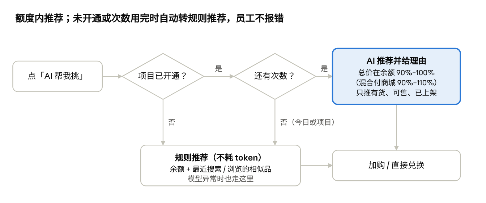

# 采发发 C端商城产品 Spec（V1 / V2）

Nov 6, 2026 · @sanyuan

## 一、概述

C 端商城分两版改造：**V1（11/20）** 把购物车、分类、个人中心迁到新前端并接入埋点框架，保证春节兑换高峰不出事故；**V2（约 12/4–12/9）** 在新前端上做统一商品展示、搜索修正、AI 选品和全流程埋点，让员工在 1 月集中兑换时顺利完成兑换。

依据：《采发发买家侧产品形态与版本规划（2026-11-03）》V1、V2 两节及其任务清单。本 Spec 只写 C 端商城（员工侧）和它直接需要的后台配套；场景货盘、项目视图、询价等会员侧内容不在本文。

### 1.1 为什么做

- 员工 1 月集中兑换，商城杂乱、搜不到货（如「搜衣架出洗衣机」），甲方会找服务商追责，影响续约和员工复购。

- 现有消费商城已能承载全部货源，问题在于版本老、不同货源的商品展示五花八门。

- 前后端仅打通订单，平台不知道员工卡在哪一步，也无法给商家提供展示、点击、成交数据。

### 1.2 用户与收益

| 角色     | 在 C 端商城做什么                                      | 本期得到什么                                                   |
|----------|--------------------------------------------------------|----------------------------------------------------------------|
| 员工     | 进入项目商城，用福利额度找货、加购、兑换，查订单和售后 | 购物车、分类、个人中心更顺；搜得到；一句话按额度选到商品       |
| 甲方     | 给员工发额度，验收福利效果                             | 福利好选、值得兑换，少收到员工投诉                             |
| 服务商   | 经营商城（装修、上架、定价），对甲方负责               | 商城统一、专业，有 AI 选品卖点；能提前看到兑换卡点；续约更容易 |
| 商家     | 供货                                                   | 拿到展示、点击、成交三层数据（V2 起积累，V4 回传）             |
| 平台运营 | 控制 AI 开通范围和成本                                 | 按项目审批 AI 选品，用量可控、成本可算                         |

### 1.3 两个版本一览

|            | V1 · 11/20 新前端首批                                                                                          | V2 · 约 12/4–12/9 C 端体验版                                                          |
|------------|----------------------------------------------------------------------------------------------------------------|---------------------------------------------------------------------------------------|
| 一句话价值 | 换前端不出事，兑换高峰购物车不卡                                                                               | 不论货从哪来，员工看到统一、好找、能帮挑的商城                                        |
| 范围       | 购物车、分类、个人中心迁到新前端；灰度与回退；新旧前端无缝；埋点框架                                           | 统一商品卡与详情；搜索修正与排序；推荐位；AI 选品（按项目开通）；全流程埋点与漏斗报表 |
| 门槛指标   | V1 整版门槛为存量 GMV 等经营指标；C 端部分以「灰度无 P0 事故、可回退、新旧前端埋点可对比」验收（本 Spec 补充） | 兑换转化率、搜索无结果率、P0 埋点覆盖率 100%、AI 采纳率与每次对话成本                 |
| 不做       | 首页、搜索、详情页改版；AI 选品                                                                                | 购物车、订单、售后全货源统一（移到 V3）；语义检索、个性化推荐（Q1）                   |

### 1.4 本文口径

- **C 端价格**：员工只看到销售价，市场价按站点配置决定是否作为划线价显示；接口价、会员价、分销价在 C 端任何位置都不出现。

- **额度 / 余额**：员工在商城内可用于兑换的余额。**混合付**：余额不足时允许员工自付补差，由站点配置决定是否开启。

- **项目**：V1 起一个存量商城自动对应一个项目；C 端产生的兑换订单都归到所在商城对应的项目。

- **优先级**：P0 = 本版目标成立的必要条件；P1 = 工时不足可顺延下一版；P2 = 延期时最先砍。

## 二、V1 · 11/20 C 端新前端首批

V1 只做前后端分离的第一批：购物车、分类、个人中心三部分迁到新前端，功能与旧版等价，不加新业务逻辑。它是 V2 AI 选品和统一展示的技术底座，也是春节兑换高峰前的稳定性保障。

### 2.1 目标

- 员工开始兑换时，购物车、分类不卡，服务商不被甲方追责。

- 员工感知不到两套前端，存量商城换前端后不丢内容。

- 新前端一上线就有埋点，灰度期间能对比新旧前端。

### 2.2 范围

| 在范围内                                            | 不在范围内                                                  |
|-----------------------------------------------------|-------------------------------------------------------------|
| 购物车、分类、个人中心迁移（独立前端工程 + 接口层） | 首页、搜索、商品详情、结算页改版（仍用旧前端）              |
| 旧配置与数据兼容                                    | 购物车全货源统一、订单 / 售后改造（V3，商品库切换后一起做） |
| 按站点灰度、可回退                                  | 用户可见的「新版 / 旧版」切换                               |
| 新旧前端登录态与跳转无缝                            | AI 选品、统一商品卡（V2）                                   |
| 统一埋点框架（三部分的事件）                        | 全流程埋点（V2）                                            |

### 2.3 功能需求

| 编号                 | 需求                             | 优先级 | 规则与说明                                                                                                                     |
|----------------------|----------------------------------|--------|--------------------------------------------------------------------------------------------------------------------------------|
| V1-7.1               | 购物车、分类、个人中心迁到新前端 | P0     | 功能与旧版一致；顺手修掉已知体验问题（卡顿、返回后滚动位置丢失）；接口层独立，后续可被 AI 调用                                 |
| V1-7.2               | 旧配置与数据兼容                 | P0     | 读取站点现有配置：分类配置、个人中心页装修、是否显示市场价、商品来源标签、价格标签、支付限制等；员工已有购物车商品在切换后保留 |
| V1-7.3               | 按站点灰度、可回退               | P0     | 运营可按站点开启新前端；三部分可分别回退旧前端；回退不影响员工购物车数据                                                       |
| V1-7.4               | 新旧前端无缝                     | P0     | 登录态共享，不重复登录；旧详情页加购 → 新购物车 → 旧结算页链路通畅；底部导航与样式一致                                         |
| V1-7.5               | 接入统一埋点框架                 | P0     | 见 2.4；所有事件带新旧前端标记                                                                                                 |
| V1-4.6 / 4.7（关联） | C 端订单挂到项目、带货源类型     | P0     | 员工兑换订单按「商城 → 项目」映射写入项目 ID；订单记录货源类型。属于买家侧项目需求，C 端下单链路需配合                         |

**三个页面的要点**

- **购物车**：展示商品、规格、销售价、数量；改数量、删除、勾选、去结算；无货 / 地区不可售的商品标出并不可结算。员工未设收货地区时，按商城默认三级地址判断可售。商品分组和拆单逻辑沿用旧版。

- **分类**：按站点现有分类配置展示一级 / 二级分类及商品列表；服务商已设的置顶商品顺序不变；从商品详情返回时保留分类和滚动位置。统一类目映射留到 V2。

- **个人中心**：按站点「个人中心页」装修配置渲染；余额 / 额度、订单入口、售后入口、收货地址、客服等入口与旧版一致；订单列表和详情仍跳旧前端。

### 2.4 埋点（V1 范围）

公共字段在 V1 就定下，V2 只加事件不改字段：站点 ID、项目 ID、服务商 ID、员工匿名 ID、前端版本（新 / 旧）、终端、页面、会话 ID、时间。商品类事件另带商品 ID / SKU ID 与货源类型。

| 页面     | 事件                                                 |
|----------|------------------------------------------------------|
| 购物车   | 页面浏览、商品曝光与点击、改数量、删除、勾选、去结算 |
| 分类     | 页面浏览、分类点击、商品曝光与点击、加购             |
| 个人中心 | 页面浏览、各入口点击                                 |

### 2.5 验收标准

- [ ] 灰度站点上，三个页面功能与旧版逐项对照一致，无 P0 缺陷

- [ ] 现金商城、积分商城及三种货源（平台货、自有供应商货、猫超 / 优品权益货）各跑一遍加购 → 结算

- [ ] 旧详情页加购后进入新购物车，不重新登录，购物车数据一致

- [ ] 任一部分可单独回退旧前端，回退后员工购物车不丢

- [ ] 2.4 全部事件有测试用例并带新旧前端标记

- [ ] C 端下单后，订单带项目 ID 和货源类型

- [ ] C 端任何页面不出现接口价、会员价、分销价

## 三、V2 · 约 12/4–12/9 C 端商城体验版

V2 让员工在项目商城里顺利完成兑换：商品展示统一、搜得到、按额度有人帮挑，并用全流程埋点定位卡点。AI 选品和统一展示放在本版，不压缩工期，保证质量。

### 3.1 目标与门槛

| 门槛指标      | 口径                                       |
|---------------|--------------------------------------------|
| 兑换转化率    | 进入商城的员工中，完成至少一笔兑换的占比   |
| 搜索无结果率  | 无结果搜索次数 ÷ 搜索总次数                |
| P0 埋点覆盖率 | 上线前须达 100%                            |
| AI 采纳率     | 发生过 AI 推荐加购或兑换的对话 ÷ AI 对话数 |
| 每次对话成本  | 模型账单 ÷ 计次对话数，事后核算            |

门槛具体数值待灰度数据出来后定（见待确认）。

### 3.2 范围

| 模块                  | 优先级 | 一句话价值                                   |
|-----------------------|--------|----------------------------------------------|
| V2-1 统一商品展示     | P0     | 不同货源不再五花八门，也是 AI 推荐的展示载体 |
| V2-2 找得到           | P0     | 员工找到想要的商品，兑换转化提升             |
| V2-3 看得懂（补充）   | P2     | 选得更有依据，商家品牌有曝光                 |
| V2-5 全流程埋点       | P0     | 每一步有数，定位卡点，积累商家三层数据       |
| V2-6 C 端商城 AI 选品 | P0     | 员工按额度快速选到商品，服务商商城有卖点     |

### 3.3 统一商品展示（V2-1）

| 编号   | 需求                       | 优先级 | 规则                                                                                                                                                                                                                                                              |
|--------|----------------------------|--------|-------------------------------------------------------------------------------------------------------------------------------------------------------------------------------------------------------------------------------------------------------------------|
| V2-1.1 | 全货源统一商品卡与详情模板 | P0     | 平台货、京东、猫超 / 优品、自有供应商货共用一套模板。商品卡：主图、名称、销售价、划线价（站点配置开启时）、营销标签、无货 / 不可售状态。详情：轮播图、价格区、规格选择、配送与可售地区、售后说明（如支持 7 天无理由）、图文详情。字段缺失时该块不展示，不显示空值 |
| V2-1.2 | 关键样式对标天猫超市并固定 | P0     | 商品卡、价格区、加购按钮、详情页结构不开放站点自定义；站点只保留主题色、是否显示市场价等现有开关                                                                                                                                                                  |

### 3.4 找得到（V2-2）

| 编号   | 需求                       | 优先级 | 规则                                                                                                        |
|--------|----------------------------|--------|-------------------------------------------------------------------------------------------------------------|
| V2-2.1 | 搜索修正                   | P0     | 分词修正，解决「搜衣架出洗衣机」。无结果时不留空白：提示换词 + 展示无结果页推荐位 + AI 助手入口（已开通时） |
| V2-2.2 | 规则排序                   | P1     | 综合排序按相关性、销量、价格加权；员工可切换销量、价格排序；服务商置顶商品优先                              |
| V2-2.3 | 分类整理                   | P1     | 各货源类目映射到统一类目，分类页与搜索筛选口径一致                                                          |
| V2-2.4 | 预留「平台核心供给」权重位 | P2     | 只留参数，权重默认 0，规则等卖家侧定                                                                        |
| V2-2.5 | 搜索热词与联想             | P1     | 热词 = 本商城近 7 天有结果的热搜词 + 服务商配置的推荐词；联想按商品名、品牌、类目前缀匹配                   |
| V2-2.6 | 推荐位规则                 | P1     | 位置：首页、详情页、购物车、无结果页。排序：本商城热销、同类目热销、额度内可兑换；不做个性化                |

### 3.5 看得懂（V2-3，P2）

- V2-3.3 评价 / 好评率、热度展示：评价和好评率仅京东商品有，其他货源不显示该块。

- V2-3.4 品牌 / 店铺展示：店铺形态规则未定，本版先做品牌。

- 两项在延期时优先砍。

### 3.6 C 端商城 AI 选品（V2-6）

AI 助手不另开入口，放在新前端搜索结果页；搜索功能保持不变。只在已开通 AI 的项目商城显示，推荐范围限当前商城已上架商品。

C 端 AI 选品流程 · 2 个判断、1 个降级出口

未开通、次数用完、模型异常三种情况都落到规则推荐，员工始终能拿到一组额度内的商品。

**员工侧规则**

| 编号    | 需求                         | 优先级 | 规则                                                                                                                                                                                     |
|---------|------------------------------|--------|------------------------------------------------------------------------------------------------------------------------------------------------------------------------------------------|
| V2-6.1  | 入口                         | P0     | 搜索结果页显示「AI 帮我挑」入口；进入后提示「今日可对话 N 次」                                                                                                                           |
| V2-6.2  | 理解需求和额度，推荐并给理由 | P0     | 读取员工当前余额。未开混合付的商城，推荐组合总价在余额的 90%–100%；允许混合付的商城在 90%–110%。只推荐有货、员工收货地区可售的商品（无地址时用商城默认三级地址）。每件商品配一句推荐理由 |
| V2-6.3  | 推荐直接加购或兑换           | P0     | 单件加购、整组加购、直接去兑换；产生的订单来源记为「AI 选品」                                                                                                                            |
| V2-6.5  | 商品字段可读性检查与补齐     | P0     | 推荐前校验名称、价格、类目、库存；不全的商品不进推荐                                                                                                                                     |
| V2-6.6  | 无结果回退                   | P1     | AI 无法给出推荐时，引导回搜索和分类                                                                                                                                                      |
| V2-6.10 | 规则推荐降级                 | P1     | 未开通、次数用完或模型异常时，按员工余额 + 最近搜索 / 浏览的相似品推荐，不耗 token；员工侧不报错                                                                                         |
| V2-6.8  | 常见问法评测集               | P1     | 约 50 条（如「500 元买点年货」「给父母买健康的」），上线前跑一遍，逐条记录是否合格                                                                                                       |

**开通与用量管控**（前期 token 由平台买单，开通范围由平台控制）

| 编号   | 需求                                    | 优先级 | 规则                                                                                                                                                                                               |
|--------|-----------------------------------------|--------|----------------------------------------------------------------------------------------------------------------------------------------------------------------------------------------------------|
| V2-6.4 | 按项目开通                              | P0     | 服务商在项目视图里申请，运营在运营管理后台审批；通过后该项目下所有商城显示 AI 入口。服务商可看本项目用量和带来的兑换，不能自行开启                                                                 |
| V2-6.9 | 用量管控（按对话次数，不做 token 计量） | P0     | 起步值，运营可调：项目总次数 = 发放人数 × 3；每人每天 5 次；一次对话内追问 3 轮不另计；同样问法复用结果不计次；兑换期结束自动关闭；项目次数用到 80% 提醒运营，可追加；员工次数用完自动切到规则推荐 |

### 3.7 全流程埋点（V2-5）

在 V1 公共字段和框架上扩展，展示、点击、成交分开统计、分开回传。曝光 = 商品卡在屏幕内可见（具体阈值写入事件字典）。

| 编号    | 环节                     | 优先级 | 事件                                                                                                        |
|---------|--------------------------|--------|-------------------------------------------------------------------------------------------------------------|
| V2-5.1  | 规范与事件字典           | P0     | 命名规则、公共字段、曝光口径、上报方式、新旧前端标记                                                        |
| V2-5.4  | 进入与浏览               | P0     | 进入商城、登录（成功 / 失败）、页面浏览与停留、首页模块曝光与点击、离开                                     |
| V2-5.5  | 找货                     | P0     | 分类点击、搜索（关键词、结果数）与结果点击、推荐位曝光与点击、商品曝光与点击、详情浏览                      |
| V2-5.6  | 交易                     | P0     | 加购、购物车操作、去结算、提交兑换、兑换成功 / 失败（原因：额度不足 / 无货 / 地区不可售）                   |
| V2-5.7  | AI 选品                  | P0     | 打开入口、提问、推荐曝光、推荐点击、推荐加购与兑换、回退到搜索 / 分类、降级为规则推荐；每次对话记录是否计次 |
| V2-5.2  | 兑换订单归到项目         | P0     | 订单带项目 ID、订单来源、货源类型                                                                           |
| V2-5.8  | 订单与个人中心           | P1     | 订单查看、物流查看、售后申请（原因类型）、额度查询                                                          |
| V2-5.3  | 关注商品                 | P2     | 员工关注 / 取消关注，商家多一项兴趣数据                                                                     |
| V2-5.9  | 埋点验收                 | P0     | 每个事件有测试用例；上线前 P0 事件覆盖 100%；新旧前端可对比                                                 |
| V2-5.10 | 内部漏斗与指标报表（BI） | P1     | 进入 → 浏览 → 加购 → 兑换转化、搜索无结果率、AI 采纳率、额度使用率、未兑换余额                              |

### 3.8 验收标准

- [ ] 三种货源商品在商品卡、详情页上布局一致，站点无法改动固定样式

- [ ] 「衣架」等已知 bad case 搜索结果正确；无结果页有推荐和引导，不留空白

- [ ] AI 推荐组合总价落在额度区间内，不推无货、不可售、本商城未上架的商品

- [ ] 未开通项目不显示 AI 入口；次数用完、模型异常时自动降级为规则推荐，员工无报错

- [ ] 评测集约 50 条跑完，结果归档

- [ ] P0 埋点覆盖 100%，漏斗报表能算出 3.1 全部门槛指标

## 四、边界、依赖与待确认

两版都不动购物车 / 订单 / 售后的业务逻辑，全货源统一放到 V3 商品库切换后一次改到位。工时不足时先砍 P2，再顺延 P1，P0 不动。

### 4.1 本轮不做

| 事项                                           | 去向                           |
|------------------------------------------------|--------------------------------|
| 购物车、订单、售后全货源统一（含猫超取消退款） | V3                             |
| 语义检索、个性化推荐、商城 AI 生图             | Q1 及以后                      |
| 会员端 / 运营端 AI 选品、AI 建商城             | Q1                             |
| token 计量体系（本期按对话次数管控）           | 后续                           |
| 商家补贴标识、推荐权重规则                     | 依赖卖家侧规则，本轮只预留位置 |
| 商家可见的展示 / 点击 / 成交数据               | V2 只采集，V4 回传             |

### 4.2 依赖

- **V2 依赖 V1**：新前端工程、灰度机制、埋点框架。搜索结果页和详情页在 V2 迁到新前端，AI 入口才有地方放。

- **项目关系（V1-4）**：商城 → 项目映射上线后，C 端订单才能归项目，AI 才能按项目开通。

- **项目视图（V1-5）**：服务商申请 AI 、查看用量的入口。

- **商品数据**：统一类目映射、字段补齐依赖商品运营补充字段（V1-6）与 3.0 商品数据清洗。

- **运营管理后台**：AI 开通审批、次数配置与 80% 提醒。

### 4.3 待确认

1.  新前端灰度范围：现金商城、积分商城是否同时覆盖；首批灰度哪些站点。

2.  V2 搬到新前端的页面清单：搜索结果页、详情页是否全部迁移，首页是否仍走装修。

3.  「兑换期结束自动关闭 AI」的兑换期从哪里取：项目字段里目前没有兑换期。

4.  「发放人数」的取数口径：商城用户数还是实际发放额度的人数。

5.  统一商品卡是否显示货源标签（如京东、天猫超市），还是继续由站点配置决定。

6.  V2 门槛的具体数值（兑换转化率、搜索无结果率、AI 采纳率、每次对话成本上限）。

7.  混合付下 AI 推荐超出余额部分（最多 10%）是否需要在推荐卡上提示「需自付 ¥x」。
