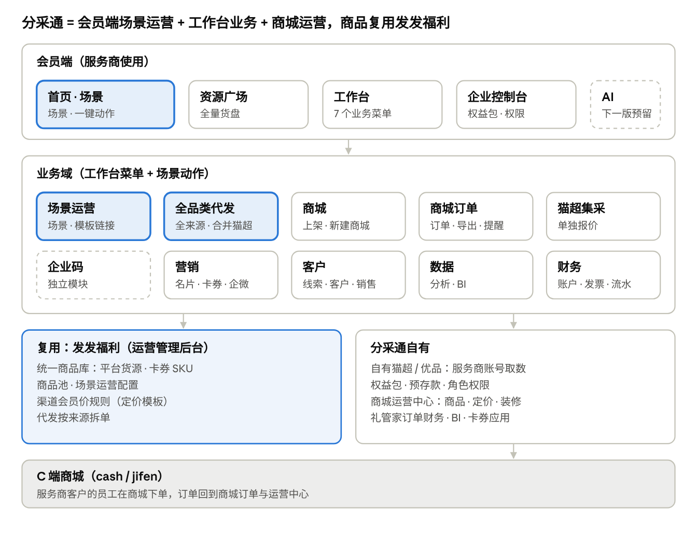
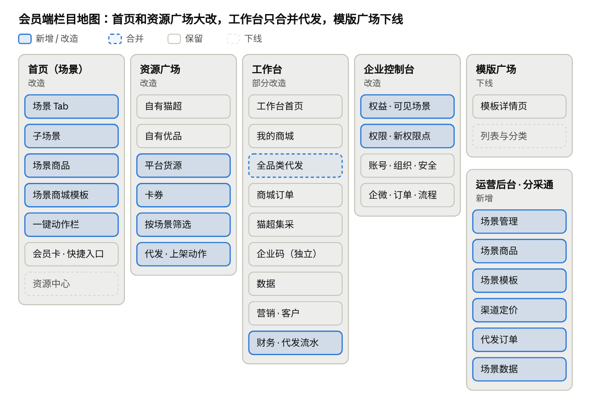

# 分采通系统产品架构与栏目设计框架

Oct 28, 2026 · @sanyuan

分采通本版从「货架 + 工具」改为「场景运营」：会员端首页变成按权益包可见的场景页，资源广场汇总自有货源和平台货源，三个一键动作（全品类代发、上架到商城、新建商城）在两个入口共用；工作台把猫超代发并入全品类代发，其余业务栏目保留；商品复用发发福利的统一商品库和运营管理后台，价格与商城运营留在分采通。

## 本版定调

| \#  | 议题         | 结论                                                                                                                    |
|-----|--------------|-------------------------------------------------------------------------------------------------------------------------|
| 1   | 首期范围     | 场景运营、场景业务交互、全品类代发都做                                                                                  |
| 2   | 场景定价     | 本版场景不做加价，先满足基本运营                                                                                        |
| 3   | 接口价可见   | 自有猫超 / 自有优品是用服务商自己的账号从猫超 / 优品取数，平台只提供技术支持，服务商可以看到接口价                      |
| 4   | 一键用商城   | 本版只做新建商城                                                                                                        |
| 5   | 卡券         | 可作为 SKU 进场景；不能上架到商城，只能代发下单购买和浏览详情                                                           |
| 6   | 场景可见     | 按权益包控制                                                                                                            |
| 7   | 老功能       | 都要考虑迁移；猫超代发并入全品类代发；场景运营时可直接链接到现有模板的详情                                              |
| 8   | 节奏         | 本版优先上线；春节前转为现有业务系统的运营提效和营销增收                                                                |
| 9   | 沿用前期结论 | 商品复用发发福利、定价分开；首页 = 场景页，模板广场并入场景，资源广场保留；本版纯 GUI，预留 AI 位；企业码独立；不做礼包 |

## 系统总体架构

分采通系统总体架构 · 5 层

本版新增的是高亮的三块：场景首页、场景运营、全品类代发；其余业务域保留，企业码仍独立。平台货源、卡券、商品池和场景配置走发发福利的运营管理后台；自有猫超 / 优品、权益包、预存款和商城运营留在分采通。

## 货源与价格

分采通里的商品分三类，可见价格和能做的动作不一样，所有栏目都按这张表判断。

| 维度             | 自有猫超 / 自有优品                               | 平台货源                                                                   | 卡券                     |
|------------------|---------------------------------------------------|----------------------------------------------------------------------------|--------------------------|
| 来源             | 服务商自己的猫超 / 优品账号取数，平台提供技术支持 | 发发福利统一商品库中对分采通开放的来源（京东、1688、平台精选、入驻商家等） | 统一商品库中的卡券类 SKU |
| 服务商看到的成本 | 接口价                                            | 会员价（分采通渠道规则从接口价算出，不展示接口价）                         | 会员价                   |
| 参照价           | 市场价、平均到手价、价格力标签                    | 市场价                                                                     | 面值 / 市场价            |
| 场景加价         | 本版不做                                          | 本版不做                                                                   | 本版不做                 |
| 一键代发         | 支持                                              | 支持                                                                       | 支持                     |
| 一键上架到商城   | 支持，服务商用改价 / 定价策略定分销价、销售价     | 支持，同左（定价基准待确认）                                               | 不支持                   |
| 新建商城时入商城 | 支持                                              | 支持                                                                       | 不支持（自动跳过）       |
| 浏览详情         | 支持                                              | 支持                                                                       | 支持                     |

## 栏目地图

会员端栏目地图 · 新增 / 合并 / 保留 / 下线

改动集中在首页、资源广场和新增的运营后台渠道；工作台只是把猫超代发合并为全品类代发、财务加代发流水，其余栏目保留；模版广场只留详情页供场景链接。

## 栏目设计框架

按「会员端 → 工作台 → 配置与后台」的顺序逐一说明。「变化」列：新增 = 本版新做；改造 = 现有栏目大改；合并 = 老栏目并入新栏目；保留 = 本版不动；下线 = 入口去掉。

### 1. 会员端顶部导航

| 导航                                                         | 变化 | 说明                                               |
|--------------------------------------------------------------|------|----------------------------------------------------|
| 首页（场景）                                                 | 改造 | 默认落地页，按权益包显示场景                       |
| 资源广场                                                     | 改造 | 全量货盘，增加平台货源和卡券                       |
| 模版广场                                                     | 下线 | 模板详情页保留，由场景链接进入；老地址重定向到首页 |
| 工作台                                                       | 保留 | 侧栏见第 4 部分                                    |
| 顶栏工具（导入导出、审批、消息、弹窗广告、客服、企业控制台） | 保留 | 导入导出增加代发导入记录                           |
| AI 对话                                                      | 预留 | 首页搜索框位置，下一版升级为对话入口               |

### 2. 首页（场景）

自上而下的栏目：

| 顺序 | 栏目                                 | 变化                       | 内容与交互                                                                                                                           |
|------|--------------------------------------|----------------------------|--------------------------------------------------------------------------------------------------------------------------------------|
| 1    | 搜索栏                               | 保留                       | 搜场景内商品；位置预留给 AI 对话                                                                                                     |
| 2    | 公告 Banner                          | 保留                       | 如出版物资质提醒                                                                                                                     |
| 3    | 会员卡 + 订单角标 + 快捷入口         | 保留                       | 快捷入口增加「全品类代发」；「企业码」从资源中心移到快捷入口，只做跳转                                                               |
| 4    | 场景 Tab                             | 新增                       | 按权益包显示；默认当前档期；顺序由运营配置                                                                                           |
| 5    | 场景头部                             | 新增                       | 场景说明、适合客户、热销指引                                                                                                         |
| 6    | 子场景                               | 新增                       | 卡片切换，切换后下方商品与模板联动                                                                                                   |
| 7    | 场景商品                             | 新增（替代「大家都在用」） | 按商品池分组；商品卡显示来源、成本价（自有货源为接口价，其他为会员价，明确标注）、市场价、库存状态、发货仓、卡券标识；可勾选、看详情 |
| 8    | 场景商城模板                         | 新增（替代模版广场）       | 模板卡片链接到现有模板详情（预览、方案简介、适合客户）；按钮「用此模板新建商城」                                                     |
| 9    | 一键动作栏                           | 新增                       | 勾选商品后出现：代发下单（已选 N 件）、上架到商城（含卡券时提示卡券将被跳过）                                                        |
| —    | 资源中心（猫超 / 优品 / 企业码 Tab） | 下线                       | 货源入口移到资源广场                                                                                                                 |

### 3. 资源广场

| 栏目           | 变化 | 内容与交互                                                                                                               |
|----------------|------|--------------------------------------------------------------------------------------------------------------------------|
| 货源 Tab       | 改造 | 自有猫超 · 自有优品 · 平台货源（二级按来源：京东 / 1688 / 平台精选 / 入驻商家）· 卡券                                    |
| 筛选区         | 改造 | 保留现有筛选（类目、品牌、库存地区、营销标签、价格力、价格利润区间）；新增「按场景」；价格力与平均到手价只在自有猫超显示 |
| 商品列表       | 改造 | 成本列按货源切换：自有货源显示接口价，平台货源与卡券显示会员价                                                           |
| 动作           | 改造 | 代发下单、上架到商城（卡券无此按钮）、挑选入方案（待确认是否保留）、导出筛选商品                                         |
| 出版物使用须知 | 保留 |                                                                                                                          |

### 4. 工作台侧栏

| 一级   | 分组                       | 栏目                                      | 变化                 | 说明                                                                       |
|--------|----------------------------|-------------------------------------------|----------------------|----------------------------------------------------------------------------|
| 工作台 | —                          | 工作台首页                                | 保留                 | 订单数据增加代发批次状态                                                   |
| 商城   | 商城管理                   | 我的商城                                  | 保留                 | 卡片增加「来自场景模板」标识                                               |
| 订单   | 全品类代发                 | 批量下单                                  | 新增（合并猫超代发） | 支持全部货源和卡券；可从场景 / 资源广场带入商品，也可 Excel / 在线表格导入 |
| 订单   | 全品类代发                 | 下单管理                                  | 新增（合并猫超代发） | 按批次管理，批次内按来源拆子单；历史猫超代发批次迁入                       |
| 订单   | 商城订单                   | 订单管理 · 订单导出 · 服务订单 · 下单提醒 | 保留                 |                                                                            |
| 订单   | 猫超集采                   | 集采报价 · 下单管理                       | 保留                 | 单独报价，与场景和代发无关                                                 |
| 企业码 | 服务企业 · 订单中心        | 全部 7 个栏目                             | 保留                 | 独立模块                                                                   |
| 数据   | —                          | 订单分析 · 用户分析 · 经营概览 · 订单明细 | 保留                 | 代发订单是否纳入经营概览待确认                                             |
| 营销   | 名片 · 卡券 · 企微         | 全部栏目                                  | 保留                 |                                                                            |
| 客户   | 线索 · 客户关系 · 销售管理 | 全部栏目                                  | 保留                 |                                                                            |
| 财务   | 平台财务                   | 账户管理                                  | 保留                 | 预存款用于全品类代发扣款                                                   |
| 财务   | 平台财务                   | 发票管理 · 集采财务                       | 保留                 | 代发订单的开票入口待确认                                                   |
| 财务   | 商城财务 · 交易明细        | 全部栏目                                  | 保留                 | 交易明细增加代发扣款流水                                                   |

### 5. 企业控制台

| 栏目                                                                           | 变化 | 说明                                             |
|--------------------------------------------------------------------------------|------|--------------------------------------------------|
| 我的权益                                                                       | 改造 | 权益包增加「可见场景」展示                       |
| 账号信息 · 组织管理 · 安全审计 · 客户中心配置 · 企微配置 · 订单配置 · 流程引擎 | 保留 | 角色权限增加「全品类代发」「场景一键动作」权限点 |

### 6. 商城运营中心

| 栏目                                                  | 变化 | 说明                                                                            |
|-------------------------------------------------------|------|---------------------------------------------------------------------------------|
| 商品 · 我的商品                                       | 改造 | 在自有猫超 / 自有优品商品之外增加「平台货源商品」 Tab，接收一键上架；卡券不进入 |
| 试用 · 定价策略                                       | 改造 | 现在只对自有猫超 / 自有优品生效，需覆盖平台货源（基准待确认）                   |
| 装修                                                  | 保留 | 新建商城时自动套用模板装修                                                      |
| 插件 · 活动 · 订单 · 财务 · 用户 · 数据 · 通知 · 配置 | 保留 |                                                                                 |

### 7. 运营管理后台（分采通渠道）

| 栏目     | 变化 | 说明                                                                                    |
|----------|------|-----------------------------------------------------------------------------------------|
| 场景管理 | 新增 | 场景 / 子场景、档期、排序、上下线、可见权益包、场景说明与指引                           |
| 场景商品 | 新增 | 为子场景绑定商品池（复用发发福利商品池，含卡券 SKU）；自有猫超 / 优品商品如何入池待确认 |
| 场景模板 | 新增 | 为场景关联现有商城模板详情（链接，不迁移数据）                                          |
| 渠道定价 | 新增 | 平台货源与卡券在分采通的会员价规则（复用发发福利定价模板）                              |
| 代发订单 | 新增 | 全品类代发批次与子单查询、异常处理、售后                                                |
| 场景数据 | 新增 | 按场景统计浏览、代发单量与金额、上架商品数、新建商城数                                  |

## 关键业务规则

| 规则       | 内容                                                                                                                                          |
|------------|-----------------------------------------------------------------------------------------------------------------------------------------------|
| 场景可见   | 服务商的权益包包含该场景才显示；一个场景都看不到时，首页显示资源广场入口和升级权益包提示（兜底形态待确认）                                    |
| 场景不加价 | 本版场景只组织商品和模板，不带任何价格规则；上架时服务商按现有改价 / 定价策略定价                                                             |
| 价格可见   | 自有猫超 / 自有优品显示接口价；平台货源和卡券只显示会员价；所有商品卡都写清价格口径                                                           |
| 卡券       | 可进场景和资源广场，可代发下单、可看详情；不能上架到商城，勾选中含卡券时上架和新建商城自动跳过并提示                                          |
| 全品类代发 | 沿用猫超代发规则（一行一单不合单、数量 1–50、单次 ≤ 5000 行、先待确认再支付）；扩到全部货源和卡券；从预存款扣款；批次内按来源拆子单发货和售后 |
| 一键上架   | 只能上架到「我管理的」商城；写入运营中心「我的商品」；上架前必须设置加价规则或启用定价策略                                                    |
| 新建商城   | 只新建，不覆盖已有商城；从场景关联的现有模板新建，套用模板装修；新商城归创建人管理                                                            |
| 企业码     | 独立模块，不进场景、不进代发，首页只保留跳转入口                                                                                              |
| 猫超集采   | 单独报价，与场景和代发无关                                                                                                                    |
| 权限       | 代发下单、一键上架、新建商城各是一个角色权限点，在企业控制台配置                                                                              |

## 老功能迁移方案

| 老功能                          | 迁移方式                                                         | 历史数据                                   |
|---------------------------------|------------------------------------------------------------------|--------------------------------------------|
| 首页「资源中心」「大家都在用」  | 内容由场景商品替代；货源入口移到资源广场；企业码入口移到快捷入口 | 无                                         |
| 模版广场                        | 导航入口下线；模板详情页保留，由场景链接；老地址重定向首页       | 模板数据不迁移，运营在后台逐个关联到场景   |
| 猫超代发 · 批量下单             | 并入全品类代发 · 批量下单；老的 Excel 模板（按 SKU ID）继续可用  | —                                          |
| 猫超代发 · 下单管理             | 并入全品类代发 · 下单管理                                        | 历史批次迁入，来源标为猫超，售后照常可发起 |
| 资源广场（自有猫超 / 自有优品） | 保留为两个货源 Tab，筛选与字段不变                               | 无                                         |
| 我的商城（已有商城）            | 不迁移，照常运营；可以接收一键上架                               | 不动                                       |
| 方案 / 挑选                     | 待确认是否保留                                                   | —                                          |
| 已开通权益包的老会员            | 上线时按权益包默认开放一组场景，避免首页为空（默认规则待确认）   | —                                          |

## 版本节奏

| 阶段             | 范围                                                                                                                                                                                  |
|------------------|---------------------------------------------------------------------------------------------------------------------------------------------------------------------------------------|
| 本版（优先上线） | 运营后台分采通渠道（场景、场景商品、场景模板、渠道定价、代发订单、场景数据）· 场景首页 · 资源广场改造 · 全品类代发（合并猫超代发）· 一键上架 · 一键新建商城 · 权益包可见 · 老功能迁移 |
| 春节前           | 现有业务系统的运营提效和营销增收；具体项目待你定，可从两类挑：提效（如三条下单通道的统一查询、对账与开票效率）、增收（如定价策略覆盖更多货源、卡券营销、春节场景运营）                |
| 后续             | 场景内 AI 对话 · 场景加价 · 一键套用已有商城                                                                                                                                          |

## 仍需确认的点

前 3 个影响代发和上架的价格口径，建议先定。

1.  自有猫超 / 自有优品代发按什么价扣款？现在的猫超代发批次详情显示的是「会员价」，它和服务商看到的接口价是否是同一个数？

2.  平台货源上架到商城后，运营中心的成本列和定价策略基准用会员价（平台货源不展示接口价）？

3.  自有猫超 / 优品商品如何进场景？它们来自各服务商自己的账号，运营在后台建的商品池是按 SKU 对所有服务商生效，还是场景只用平台货源？

4.  一键上架后是一次性复制，还是跟着场景商品池动态上下架？

5.  新建商城时用模板自带的专题商品，还是用当前场景的商品池替换？

6.  卡券代发的交付方式（电子卡密发给收件人，还是实体卡寄送）和开票方式。

7.  权益包控制可见的粒度，以及老会员上线时默认看到哪些场景。

8.  「挑选入方案」是否保留。

9.  代发订单的开票入口，是否计入 BI 经营概览。
