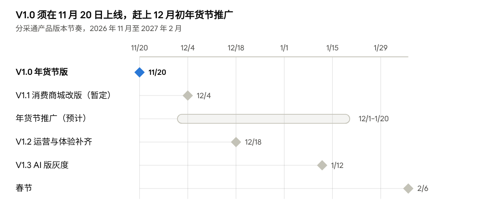

# 分采通 11–1月产品规划

Oct 28, 2026 · @sanyuan

## 版本节奏总览

11–1 月分四个版本：V1.0 年货节版 11/20 上线，做场景化运营和全品类代发；V1.1 消费商城改版单独发布，暂定 12/4；V1.2 12/18 补齐装修与详情组件、售后和埋点；V1.3 1/12 灰度 AI 问数和 AI 导购。

分采通版本节奏 · 3 个版本

V1.0 是硬节点，必须在年货节推广前上线；消费商城改版不卡年货节节点，独立发布。V1.3 之后 C 端不再大改，保春节兑换高峰稳定。年货节推广的起止时间是预估，待市场确认。

## V1.0 年货节版（11月）

11 月 20 日上线，12 月初年货节推广启动。目标：服务商打开首页就能按春节场景选品，一键代发或上架商城，承接年货节流量。

| 模块                      | 任务                     | 子项                                                                                                                                                                                                                                                       | 业务价值                                                                                                                   |
|---------------------------|--------------------------|------------------------------------------------------------------------------------------------------------------------------------------------------------------------------------------------------------------------------------------------------------|----------------------------------------------------------------------------------------------------------------------------|
| 基础设施                  | 商品体系建设             | 商品已通过 API 全量接入，本版补管理能力：在统一商品库中建类目体系和品牌库（与发发福利共用）并完成各来源映射；规则化选品（按来源、类目、品牌、价格带、毛利率、库存自动入池）；定价规则（以接口价为基准按来源、类目加价算出会员价）；自有猫超 / 优品不进场景 | 选品和定价从人工逐个处理变成规则批量生成，年货节可按档期快速换货盘；也是场景商品池、分类品牌组件、同品替换和 AI 问数的基础 |
| 运营能力提升 · 场景化运营 | 场景首页                 | 场景 Tab、场景头部、子场景、场景商品、场景商城模板；首批上线春节年货、员工福利、工会慰问等场景，按权益包可见                                                                                                                                               | 从「给过程」转向「给结果」：服务商直接拿到春节方案，缩短从选品到成交的时间                                                 |
| 运营能力提升 · 场景化运营 | 商品池管理               | 运营后台场景管理、子场景绑定商品池、场景关联模板、档期与上下线                                                                                                                                                                                             | 运营按档期换场景和货盘，年货节期间不依赖研发                                                                               |
| 运营能力提升 · 场景化运营 | 一件代发 / 上架商城      | 全品类代发（合并猫超代发，批次内按来源拆子单，按会员价从预存款扣款）；一键上架到我的商城，定价基准由会员在会员价 / 平均到手价 / 市场价中手动选；下单和上架时按 SKU ID 替换为服务商自有猫超 / 优品的同品；用场景模板一键新建商城                            | 年货节的主成交路径：选品直接变成代发订单或商城上架；同品替换让自有账号的服务商也能用场景选品                               |
| 资源优化                  | 平台猫超万鲤会员代发兼容 | 万鲤会员下单可走平台猫超代发链路                                                                                                                                                                                                                           | 多一条年货节成交渠道，扩大猫超货源的销量                                                                                   |
| 运营能力提升 · 售后优化   | 上门取件兼容万鲤会员     | 万鲤会员退换货支持上门取件                                                                                                                                                                                                                                 | 万鲤会员代发在本版放量，售后同步到位，减少客服工单和客诉                                                                   |
| 体验                      | 春节商城模板             | 春节、工会、地域三类模板做到可直接投产，带场景卖点；模板视觉更新                                                                                                                                                                                           | 解决「模板只能演示」：服务商当天就能开出春节商城给客户用                                                                   |
| 体验                      | 工作台精简               | 下线营销下的名片、企微等无人使用栏目；企业控制台企微配置同步隐藏（待确认）                                                                                                                                                                                 | 减少无效入口，新老用户更快找到场景和代发；降低维护成本                                                                     |
| 数据监控                  | 数据埋点                 | 场景浏览、勾选、代发、上架、新建商城全链路埋点；运营后台场景数据                                                                                                                                                                                           | 年货节可按场景复盘转化，为 12 月优化和 1 月 AI 问数打底                                                                    |
| 数据监控                  | 数据清洗                 | 历史订单清洗；商品、类目、场景标签统一；统一指标口径（含代发订单是否计入经营概览）                                                                                                                                                                         | 年货节数据一开始就按统一口径沉淀；也是 AI 问数和 AI 导购的数据底座                                                         |
| 迁移                      | 老功能迁移               | 模版广场下线并重定向；猫超代发历史批次迁入；老会员按权益包默认开放场景                                                                                                                                                                                     | 老用户无感切换，首页不出现空白                                                                                             |

已定的价格与货源口径：

- 代发按会员价扣款。

- 平台货源上架的定价基准有三种：会员价、平均到手价、市场价，会员手动选。

- 自有猫超 / 优品商品不进场景；下单和上架时按 SKU ID 做同品替换。

## V1.1 消费商城改版（12月初）

暂定 12 月 4 日上线，与年货节版分开发布，赶在 1 月员工兑换高峰之前。目标：消费商城的购物车、订单、支付、售后一次改到位，并支持所有货源商品。

| 模块                | 任务                 | 子项                                                                      | 业务价值                                                     |
|---------------------|----------------------|---------------------------------------------------------------------------|--------------------------------------------------------------|
| 体验 · C 端消费商城 | 消费商城交易链路改版 | 在已规划的购物车、售后改版基础上，增加订单、支付改版                      | 页面老旧、体验不流畅的核心链路一次改到位，提高员工兑换完成率 |
| 体验 · C 端消费商城 | 全货源兼容           | 购物车、订单、支付、售后支持所有货源商品（自有猫超 / 自有优品、平台货源） | 平台货源一键上架到商城后，员工能顺畅下单、支付和售后         |
| 体验 · C 端消费商城 | 已有商城切换         | 已有商城按商城灰度切到新版交易链路                                        | 不影响服务商正在运营的春节商城                               |

## V1.2 运营与体验补齐（12月中）

12 月 18 日上线，赶在 1 月员工兑换高峰之前。目标：补齐商城装修和商品详情组件，补齐售后和价格审核，补上 C 端埋点，给 1 月的 AI 导购备好数据。

| 模块                    | 任务                 | 子项                                                                                                                       | 业务价值                                                                               |
|-------------------------|----------------------|----------------------------------------------------------------------------------------------------------------------------|----------------------------------------------------------------------------------------|
| 体验 · C 端消费商城     | 装修组件运营能力补充 | 首页由装修搭建，只补组件能力：图片组件上传后可配置跳转链接（商品分类、商品详情、专题等）；其他组件待补的跳转和配置项待盘点 | 服务商和运营自己就能搭出场景化、好看的首页（春节福利、生日福利等入口），不依赖研发     |
| 资源优化                | 京东 API 补充        | 接入评价、相似品推荐等 API；在已改版的商品详情页增加京东评价组件和相似品推荐组件                                           | 员工下单更放心，缺货不流失；也是 1 月 AI 导购的推荐数据来源                            |
| 资源优化                | 资源产品化           | 电影票、本地生活在商城里直观展示；支付宝、医保通等外部链接的展示和跳转优化                                                 | 把已有的核心资源变成可卖的商品，增加商城可消费的品类                                   |
| 运营能力提升 · 售后优化 | 猫超取消退款流程     | 代发子单未发货前可取消，退款原路回预存款                                                                                   | 减少人工处理取消退款，降低年货节后半段的客诉                                           |
| 基础设施 · 商品体系     | 精选商品价格审核     | 精选商品上架必须附京东 / 天猫公允价链接；市场价虚高拦截；修补精选供应商排名规则                                            | 防止商家靠虚标市场价、高毛利刷排名；市场价已是上架定价基准之一，虚高会直接带高商城售价 |
| 数据监控                | 数据埋点（C 端）     | 商城搜索、浏览、加购、下单、支付埋点                                                                                       | 评估交易链路改版效果；给 AI 导购冷启动和效果评估                                       |

## V1.3 AI 版（1月）

1 月 12 日灰度上线，赶在春节兑换高峰前。目标：落地会议定的年底 2–3 个 AI 功能——工作台数据分析升级为 AI 问数，C 端消费商城增加 AI 导购。

| 模块                | 任务               | 子项                                                                                                                                | 业务价值                                                               |
|---------------------|--------------------|-------------------------------------------------------------------------------------------------------------------------------------|------------------------------------------------------------------------|
| AI · 工作台         | 数据分析 → AI 问数 | 自然语言查询订单、代发、场景、商城经营数据；回答带图表和指标口径说明；替换工作台「数据」入口，原报表保留作兑底                      | 服务商不用翻报表就能问「春节场景卖了多少」，用数据指导补货和换场景     |
| AI · C 端商城       | AI 导购            | 员工在商城里对话式选礼（预算 / 积分、送给谁、偏好）；结合京东评价、相似品和历史成交推荐；推荐结果直接加购下单；先在春节模板商城灰度 | 解决员工「不知道买什么」，提高兑换转化和积分消耗，增强服务商商城的卖点 |
| 数据监控            | 数据反哺给 AI      | V1.0 清洗后的订单、场景、商品数据接入 AI；AI 问答和推荐效果回流埋点                                                                 | 让 AI 结果可信、可衡量，形成「数据 → 推荐 → 成交 → 数据」闭环          |
| AI · 会员端（可选） | AI 选品助手        | 首页搜索框升级为对话入口；按场景和预算推荐商品，可查历史成交和毛利率                                                                | 会议候选的第 3 个 AI 功能；产能不够就放到节后                          |

## 老用户运营：宣发与培训

改版后首页、入口和下单方式都变了，老用户要先知道、会用，才能在年货节转化成交。产品侧提供材料和站内触达能力，运营侧执行；按版本节点安排如下。

| 节点         | 事项             | 内容                                                                                                               | 业务价值                                     |
|--------------|------------------|--------------------------------------------------------------------------------------------------------------------|----------------------------------------------|
| V1.0 上线前  | 改版预告         | 站内公告 Banner、登录弹窗、短信 / 企微群通知：首页改为场景页、模版广场下线、猫超代发并入全品类代发、名片和企微下线 | 老用户提前知道变化，减少「找不到入口」的客诉 |
| V1.0 上线前  | 培训材料         | 操作手册、短视频和 FAQ，覆盖场景选品、全品类代发、一键上架、定价基准选择、同品替换、新建商城                       | 用户自助学会；客服、运营、区代统一口径       |
| V1.0 上线前  | 内部培训         | 客服、客户运营、销售和区代的新功能培训与考核                                                                       | 上线当天就能答疑和带客户上手                 |
| V1.0 上线时  | 新功能引导       | 首次登录新手引导、更新日志（需纳入 V1.0 产品需求）                                                                 | 老用户第一次进来就知道场景和一键动作在哪     |
| V1.0 上线后  | 老用户线上培训   | 分批线上培训 / 直播，结合春节场景演示从选品到代发、开商城                                                          | 把老用户引到新功能上，转成年货节成交         |
| V1.0 上线后  | 重点客户一对一   | 客户运营回访头部活跃会员，协助完成首笔全品类代发或首个春节商城                                                     | 保住核心客户的年货节业务，也得到一手反馈     |
| V1.0 上线后  | 反馈收集         | 客服工单打标签、简短问卷；按周整理问题                                                                             | 作为 V1.2 优化输入                           |
| 年货节推广期 | 年货节宣发       | 春节场景海报、场景方案册、企微 / 朋友圈素材，供服务商转发给其企业客户                                              | 帮服务商把春节方案卖给终端企业，带动平台成交 |
| V1.1 上线时  | 消费商城改版通知 | 告知服务商切换节奏和变化；提供可转发给企业 HR 和员工的兑换指引                                                     | 服务商和终端员工平稳过渡到新版商城           |
| V1.3 上线时  | AI 功能推广      | 邀请灰度客户；AI 问数、AI 导购使用指南和示例问题                                                                   | 提高 AI 功能使用率，收集效果反馈             |

效果用 V1.0 埋点衡量：老会员使用场景页、全品类代发、一键上架的比例，具体目标待与运营商定。

## 风险与待决策

价格口径已定；消费商城改版已拆成独立版本，V1.0 只留年货节必需的内容。最大的风险是 V1.0 与 V1.1 之间的衔接。

1.  **平台货源上架早于商城兼容**：V1.0 就能把平台货源一键上架到商城，但商城全货源兼容要到 V1.1。需确认现有商城能否支持平台货源下单和售后；不支持的话，V1.0 的一键上架只开放自有猫超 / 优品，平台货源上架随 V1.1 开放。

2.  **V1.0 范围**：需要取舍时按这个顺序后移到 V1.2——模板视觉更新 → 一键新建商城 → 工作台精简。场景首页、商品池、全品类代发、一键上架不能砍。

3.  **V1.1 上线日期**：12/4 是暂定，按购物车、售后已有规划的进度调整；最晚不晚于 12/18，否则来不及承接 1 月兑换高峰。

4.  **全货源兼容的边界**：不同货源的售后规则（猫超、京东、入驻商家等）和支付方式是否统一，商城里怎么展示差异，需在需求评审前梳理。

5.  **同品替换的边界**：服务商自有账号里没有对应 SKU 时，是按平台货源下单还是提示不可替换？替换后代发扣款是否仍按会员价？

6.  **平均到手价覆盖不全**：只有部分天猫超市商品有，且 T+1 更新。会员选它做基准时，没有该价的商品怎么定价？价格变化后商城售价是否跟着动？

7.  **名片、企微下线**：下线前拉一次使用数据确认确实无人使用，并提前通知老用户。

8.  **1 月是兑换高峰**：春节是 2 月 6 日，V1.3 的 C 端功能必须灰度；1 月下旬起不再上新功能。

9.  **AI 导购依赖 V1.2**：需要京东评价、相似品组件和 C 端埋点。V1.2 滑期，AI 导购就只能用商品库标签做简单推荐；AI 问数的数据清洗已在 V1.0。

10. **场景化定价**：所有版本都不做场景加价。年货节后看模板使用和场景转化数据，再决定节后做不做。

11. **第 3 个 AI 功能**：AI 选品助手和 AI 运营提效（商城美化建议、图片生成）选哪个，待与陈金飞、商月良对齐。
