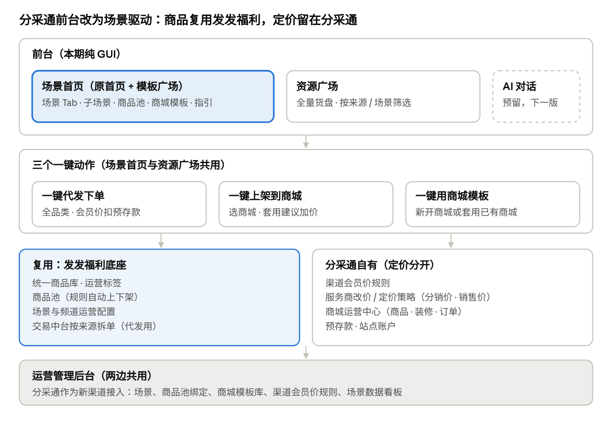
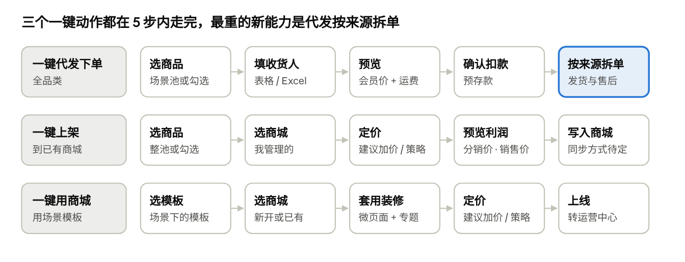

# 分采通首页、资源广场与模板广场场景化重构：产品架构思路

Oct 27, 2026 · @sanyuan

思路是把分采通前台从「货架 + 模板库」改成「场景运营」：运营在发发福利的统一商品库上按场景配商品池和商城模板，服务商进场景后一键代发下单、一键上架到自己的商城、一键用模板开商城；价格仍走分采通自己的会员价和服务商加价规则。

## 已确认的前提

| \#  | 议题     | 结论                                                    | 对架构的影响                                                             |
|-----|----------|---------------------------------------------------------|--------------------------------------------------------------------------|
| 1   | 底座     | 商品复用发发福利，定价分开                              | 商品库、商品池、场景配置用运营管理后台；会员价规则、服务商加价仍在分采通 |
| 2   | 页面结构 | 首页 = 场景页，模板广场并入场景，资源广场保留为全量货盘 | 前台从 3 个页面变为 2 个；模板不再是独立频道                             |
| 3   | 一键下单 | 做与猫超代发相似的全品类代发                            | 代发从「只支持猫超」扩到商品库全部来源                                   |
| 4   | 交互     | 本期纯 GUI，预留 AI 位                                  | 页面和卡片按结构化数据设计，下一版可直接被对话调用                       |

我做了以下默认假设，不对的话直接改：

- 场景里不含礼包（分采通已去掉礼包业务）；卡券是否进场景列在最后的待确认里。

- 企业码继续独立，不进场景、不进代发。

- 用户还是分采通的服务商（会员），不是发发福利的企业采购用户。

## 目标架构

分采通重构目标架构 · 4 层

前台只留场景首页和资源广场两个入口，共用三个一键动作；商品、商品池、场景配置和拆单复用发发福利，会员价、服务商定价、商城运营中心和账户留在分采通。

## 场景模型

场景是这次重构的核心对象：运营在后台把商品池、商城模板和定价参照打包成一个场景，前台服务商进场景就能做 3 件事。

| 层级     | 含义                                                                          | 例子                                                                 |
|----------|-------------------------------------------------------------------------------|----------------------------------------------------------------------|
| 场景     | 档期或主题，首页一级 Tab                                                      | 春节年货、劳保福利、餐补福利、日常福利                               |
| 子场景   | 场景下的细分用途，决定商品池和模板                                            | 员工年货、客户送礼、高温补贴                                         |
| 商品池   | 绑定在场景 / 子场景上，来自发发福利统一商品库，按规则自动上下架               | 春节粮油池、春节零食池                                               |
| 商城模板 | 绑定在场景上的整套商城方案（微页面 + 特色专题），专题的商品来源就是场景商品池 | 银行劳保商城、春节员工福利商城                                       |
| 定价参照 | 场景给出「建议加价」，服务商上架或开商城时可一键套用；不改会员价              | 销售价 = 平均到手价 × 100%，上限市场价（沿用运营中心定价策略的公式） |
| 场景指引 | 热销推荐、话术、案例；本期展示，下一版做 AI 提示词                            | 「500 元预算适合哪种商城」                                           |

场景内的 3 个一键动作：

1.  一键代发：服务商替客户把场景商品发到一个或多个收件人，按会员价扣预存款。

2.  一键上架：把场景商品（整池或勾选）上架到自己管理的某个商城。

3.  一键用商城：用场景的商城模板新开一个商城，或套到已有商城。

## 三个页面怎么改

前台从 3 个页面收成 2 个：场景首页负责「按场景找生意」，资源广场负责「按货找商品」，两边用同一套商品卡片和同样 3 个动作。

| 页面     | 现状                                                                                 | 重构后                                                                                 | 主要模块                                                                                                                              |
|----------|--------------------------------------------------------------------------------------|----------------------------------------------------------------------------------------|---------------------------------------------------------------------------------------------------------------------------------------|
| 首页     | Banner + 资源中心（猫超 / 优品 / 企业码 Tab）+ 「大家都在用」8 个类目推荐 + 快捷入口 | 场景落地页：一级 Tab 是场景，默认当前档期（如春节）                                    | 场景 Tab · 子场景卡片 · 场景商品池（分组展示）· 场景商城模板 · 场景指引 · 三个一键动作 · 会员卡与订单角标（保留）· 顶部 AI 对话框占位 |
| 资源广场 | 自有猫超 / 自有优品两个货池，筛选丰富但只有「挑选」一个动作                          | 全量货盘：统一商品库里对分采通开放的全部来源（猫超 / 优品 / 京东 / 1688 / 平台精选等） | 按来源分 Tab · 保留现有筛选（价格力、利润率、营销标签、库存地区）· 新增「按场景筛选」· 动作从「挑选」扩为代发 / 上架 / 加入方案       |
| 模板广场 | 独立页面，按热门 / 季节 / 节日等分类列出商城模版                                     | 取消独立页面，模板挂到场景下；老入口重定向到场景首页                                   | 模板作为场景的一个模块：预览 · 适合客户 · 推荐理由 · 一键用商城                                                                       |

商品卡片统一展示：会员价（明确标注，解决现在首页价格不标口径的问题）、市场价、平均到手价（有则显示）、库存状态、来源与发货仓（电商仓 / 商家仓）、价格力标签。

## 三个一键动作

三个一键动作 · 各 5 步

上架和用模板的最后一步都落到商城运营中心已有的「我的商品」和「装修」上，前一步的定价也复用现有改价 / 定价策略；代发要把猫超代发扩到全来源，按来源拆单、分别发货和售后是新增能力。

## 定价分开怎么落

同一个商品在两个渠道各有一个会员价：发发福利按场景 / 频道算，分采通按分采通自己的规则算，场景只给建议加价，不改会员价。

| 价格     | 发发福利                                            | 分采通（重构后）                                                |
|----------|-----------------------------------------------------|-----------------------------------------------------------------|
| 接口价   | 统一商品库，两边共用                                | 同左                                                            |
| 会员价   | 按场景 / 频道定价模板从接口价算出，不同场景可以不同 | 按分采通渠道规则从接口价算出（如按来源 / 类目加价），不随场景变 |
| 分销价   | 无                                                  | 服务商自定：改价或定价策略（现有能力），场景可带默认建议        |
| 销售价   | 无                                                  | 同上                                                            |
| 代发结算 | —                                                   | 会员价 + 运费，扣分采通预存款                                   |

对系统的要求：

- 价格引擎要多一个「渠道」维度：商品 × 渠道（发发福利某场景 / 分采通）→ 会员价。分采通渠道可以直接复用发发福利的「定价规则模板」来配，只是不挂在场景上。

- 场景的「建议加价」只是改价 / 定价策略的默认值，服务商上架时可以改。

- 现在运营中心的成本列和定价公式基准都是「接口价」。定价分开后，服务商的成本应该是会员价，这里要一起改（见待确认）。

## 运营后台与边界

分采通在运营管理后台里作为一个新渠道接入，和发发福利共用商品和场景配置能力，分开配定价和内容。

| 后台能力                 | 发发福利已有           | 分采通需要新增                                                     |
|--------------------------|------------------------|--------------------------------------------------------------------|
| 统一商品库 + 运营标签    | 是                     | 增加「对分采通开放」的范围控制（按来源 / 类目）                    |
| 商品池（规则自动上下架） | 是                     | 商品池可标注使用渠道，同一个池可以两边共用                         |
| 场景 / 频道运营          | 是                     | 分采通场景列表（独立配置）、子场景、场景指引                       |
| 定价规则模板             | 是                     | 分采通渠道会员价规则；场景建议加价                                 |
| 商城模板管理             | 否（发发福利不做商城） | 模板库从模板广场迁入后台，模板里的特色专题绑定商品池，模板挂到场景 |
| 数据看板                 | 是                     | 按场景统计浏览、代发单量、上架商品数、用模板开商城数               |

这次不碰的：

- 企业码：独立模块，不进场景和代发。

- 猫超集采：单独报价，保持原样。

- 商城运营中心内部（装修、订单、财务、用户）：只接收上架和模板的输入，内部不动。

- 客户与销售（CRM）、名片 / 企微营销：不在这次范围。

- 礼包：不做。

## 分期建议

建议先做能复用现有能力的部分（上架、用模板都能落到运营中心已有的商品与装修能力上），全品类代发涉及京东 / 1688 等新来源的下单、拆单、物流和售后，风险最高，放在第二步。没有定日期，等你定。

| 阶段 | 范围                                                                                                              | 依赖                                                   |
|------|-------------------------------------------------------------------------------------------------------------------|--------------------------------------------------------|
| 一期 | 后台分采通渠道（场景、商品池绑定、模板迁入、会员价规则）· 场景首页 · 资源广场换数据源 · 一键上架 · 一键用商城模板 | 发发福利商品库和商品池能力已可用；价格引擎支持渠道维度 |
| 二期 | 全品类代发（按来源拆单、物流、售后）· 猫超代发并入 · 场景数据看板                                                 | 发发福利交易中台拆单能力；各来源下单接口               |
| 三期 | 场景内 AI 对话（按人数和预算推荐、生成对客方案）· 老入口下线                                                      | 场景标签商品、选品 / 下单接口                          |

## 需要你拍板的点

前 4 个会直接改变一期范围，建议先定。

1.  分采通会员价规则：粒度是全渠道统一加价、按来源还是按类目？场景是否允许单独的活动会员价（本文默认不允许）？

2.  服务商看到的成本：运营中心和资源广场里的成本列、定价策略的基准，是否从「接口价」改为「会员价」？

3.  一键上架后的同步方式：一次性复制到商城，还是与场景商品池动态同步（池子下架、商城跟着下架）？

4.  全品类代发放一期还是二期？扣款是否沿用分采通预存款？订单是否复用发发福利交易中台按来源拆单？

5.  一键用商城：只新建商城，还是也允许覆盖已有商城的装修？模板支持 5 类商城里的哪几类？

6.  场景内容范围：卡券（作为 SKU）是否进场景？「挑选入方案」是否保留？

7.  场景对哪些服务商可见：全部会员，还是按权益包控制？

8.  老功能迁移：猫超代发菜单是否并入全品类代发？模板广场里现有模版如何归入场景？

9.  上线时间，以及与发发福利 11-20 版本的先后关系（两边共用运营后台和商品库）。
