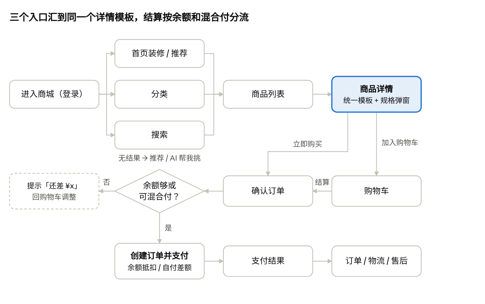

# 采发发 C 端消费兑换商城 · 统一商城产品说明

Nov 6, 2026 · @sanyuan

## 一、现状体验：乐享铂礼商城

结论：同一个商城里并存新旧两套前端，天猫超市商品走新版详情（青绿色、有属性 / 服务 / 品牌馆），其他货源走旧版详情（橙色、只有库存 / 运费 / 参数），员工每点一个商品看到的是两种商城。搜索「衣架」「大米」前几条都不是想要的商品。

体验对象：[cash.88buys.com/1020369](https://cash.88buys.com/1020369)（乐享铂礼，现金商城，站点默认地区江苏无锡梁溪区），手机尺寸。走到「确认订单」页为止，**未创建订单、未支付**；测试加入购物车的 2 件商品已删除。商城内见到的货源：天猫超市、电商精选（京东图源，厂家仓直配）、自有供应商（无锡铂礼科技，大闸蟹提货券）。

### 1.1 页面组成

| 页面                 | 组成                                                                                                                                                                                                                                                                      | 前端                     |
|----------------------|---------------------------------------------------------------------------------------------------------------------------------------------------------------------------------------------------------------------------------------------------------------------------|--------------------------|
| 首页                 | 顶部 Logo + 搜索框；轮播大图；「大牌携手」品牌图片热区；16 个品类图标（整张图做热区）；页脚链接（商城首页 / 个人中心 / 认证中心）；底部 4 Tab；首页弹窗、待支付订单提醒                                                                                                   | 旧壳 + 新版 webv2 iframe |
| 分类                 | 左侧一级类目（17 个），右侧二级类目图标宫格；没有搜索入口                                                                                                                                                                                                                 | 旧版                     |
| 商品列表（分类进入） | 搜索框 + 价格区间；排序：综合 / 价格；单双列切换；商品卡：图、货源角标（仅猫超）、标题、销售价、划线价；加载更多                                                                                                                                                          | 旧版                     |
| 搜索结果             | 同上，排序多一个「销量」；无结果时有「暂未找到相关商品，为你推荐以下商品」兜底                                                                                                                                                                                            | 旧版                     |
| 详情 · 天猫超市      | 图集（1/6）；销售价 + 市场价；货源角标 + 标题；属性条（品牌 / 系列 / 规格…，点开全部属性）；地址行（发货地 / 收货地）；服务行（破损包邮 / 假一赔十 / 上门取退 / 7 天无理由）；规格行；购买须知；商城广告位；品牌馆；图文详情；底栏：购物车 / 客服 / 加入购物车 / 立即购买 | 新版                     |
| 详情 · 其他货源      | 图集；标题；销售价 +「原价」；购买须知一句话；送至 / 库存 / 运费 / 配送方式；参数；购买须知；热销商品；广告位；看了又看                                                                                                                                                   | 旧版                     |
| 规格弹窗             | 商品图、价格、已选、规格、数量、确认按钮；新版多一行服务摘要和规格列表 / 大图切换                                                                                                                                                                                         | 新旧各一套               |
| 购物车               | 收货地址；按货源分组（天猫超市 / 平台精选）；商品行：勾选、图、标题、规格、价格、步进器；管理（删除）；看了又看；全选 / 合计 / 结算                                                                                                                                       | 旧版                     |
| 确认订单             | 收货地址；按包裹分块（「以下商品由商家配送」）、商品小计；商品合计 / 运费 / 优惠减免 / 账户余额（自动抵扣）；实付 + 创建订单                                                                                                                                              | 旧版                     |
| 个人中心             | 头像 + 手机号；我的订单（待付款 / 待发货 / 已发货 / 售后中）；我的钱包（余额 / 优惠券 / 虚拟卡券 / 提货券）；广告位；购物车 / 地址 / 客服电话 / 认证信息 / 退出登录；看了又看                                                                                             | 旧版                     |

### 1.2 交互流程

员工主链路：进入商城 → 首页热区 / 分类 / 搜索 → 商品列表 → 详情 → 规格弹窗 → 加购（留在详情）或立即购买 → 购物车 → 确认订单（余额自动抵扣）→ 创建订单 → 支付 → 订单 / 售后。流程图见第二节。

### 1.3 问题清单

| \#  | 现象                                                                                              | 影响                            |
|-----|---------------------------------------------------------------------------------------------------|---------------------------------|
| 1   | 猫超商品详情是新版青绿色，其他货源是旧版橙色，布局、按钮、价格文案都不同（「市场价」 vs「原价」） | 同一商城像两个站，显得不专业    |
| 2   | 搜「衣架」前 4 条是洗衣机底座；搜「大米」第 1 条是米桶                                            | 搜不到货，兑换流失              |
| 3   | 货源角标只在分类列表的猫超商品上有，搜索结果里没有；接口叫「电商精选」，购物车分组叫「平台精选」  | 口径不统一                      |
| 4   | 部分商品销售价高于划线价（如 82.68 元 / 划线 72.90 元；125.64 元 / 划线 119 元）                  | 员工觉得被加价                  |
| 5   | 京东图源商品主图、列表图加载失败（空白占位）；分类页部分二级类目没有图标                          | 商品像没上好                    |
| 6   | 购物车、确认订单里规格显示为原始字符串 \["无规格 无规格"\]                                        | 显得糙                          |
| 7   | 猫超详情地址弹窗把站点默认地区标成「发货地」                                                      | 信息错误                        |
| 8   | 「看了又看」推荐 3391 元固态硬盘、微耕机、篮球架，与员工额度和场景无关                            | 推荐位浪费                      |
| 9   | 首页是整张图做热区，页面文字只有底部 Tab                                                          | 读屏、搜索引擎、AI 都读不到商品 |
| 10  | 购物车删除商品没有二次确认                                                                        | 误删                            |
| 11  | 购买须知和服务保障按货源写死：猫超有 4 项服务，其他货源只有「无质量问题不支持退换货」             | 服务信息不对等                  |

## 二、统一商城：设计原则与页面清单

统一商城 = 一套前端、一套商品模板、一套价格口径。所有货源共用列表卡、详情、购物车、订单模板，渠道之间只在「个性字段」上有不同的显示规则。

### 2.1 设计原则

1.  **一套模板**：天猫超市、天猫优品、电商精选（原京东渠道，C 端不出现「京东」）、精选、入驻商家 / 自有供应商、卡券商品全部用同一套商品卡和详情模板，模块顺序固定。

2.  **有就显示，没有就隐藏**：渠道个性字段（好评率、口碑等）取不到就整块不显示，不出现空值、「暂无」或占位图。

3.  **C 端只露销售价**：划线价按站点开关显示，且只在高于销售价时显示；接口价、会员价、分销价、各类利润率在 C 端任何位置都不出现。

4.  **关键样式固定**：商品卡、详情、购物车、结算对标天猫超市并固定；站点只能配主题色、Logo、首页装修和现有开关（是否显示市场价、是否显示货源标签等）。

5.  **商品用商品组件展示**：图片热区只用于营销 Banner；商品、品类入口必须是有文字的组件，便于搜索、读屏和 AI 读取。

6.  **额度优先**：员工是用福利额度兑换，商品卡、详情、购物车、结算都能看到「余额是否够」。

### 2.2 页面清单

| 页面            | 员工在这里做什么             | 核心模块                                            |
|-----------------|------------------------------|-----------------------------------------------------|
| 首页            | 逛、从专题和品类进入         | 搜索、余额条、装修模块、推荐位                      |
| 分类            | 按品类找                     | 搜索、一级 / 二级类目、类目内商品                   |
| 搜索 / 商品列表 | 按词、按类目、按专题找       | 热词联想、筛选排序、商品卡、无结果兜底、AI 助手入口 |
| 商品详情        | 判断要不要、选规格           | 统一模板，见第四节                                  |
| 规格弹窗        | 选规格、数量                 | 价格、规格、数量、限购、确认                        |
| 购物车          | 挑好的商品放在一起，凑满额度 | 地址、按发货方分组、失效区、合计与余额              |
| 确认订单        | 确认地址和金额               | 地址、包裹、金额明细、余额抵扣 / 混合付             |
| 支付 / 结果     | 完成兑换                     | 支付方式、结果、引导看订单 / 继续逛                 |
| 个人中心        | 看余额、订单、卡券           | 余额、订单状态入口、卡券、地址、客服                |
| 订单 / 售后     | 查物流、申请售后             | 订单列表 / 详情、物流、售后申请与进度               |

### 2.3 兑换主流程

员工兑换主流程 · 3 个找货入口、1 个结算分流

不管从哪个入口进来，员工看到的都是同一个商品卡和详情模板；余额不够且商城不允许混合付时，在购物车就提示「还差 ¥x」，不让员工走到支付才失败。

## 三、页面说明

各页面的商品展示都引用同一个「商品卡」和同一套字段（第五节），下面只写每个页面自己的模块和规则。

### 3.1 商品卡（全局组件）

| 位置   | 内容                              | 规则                                                                                |
|--------|-----------------------------------|-------------------------------------------------------------------------------------|
| 主图   | 商品主图                          | 1:1 裁切；加载失败显示商城统一缺省图；无货 / 不可售叠加半透明蒴层                   |
| 角标   | 货源标签（天猫超市 / 电商精选等） | 站点开关控制，开启时所有列表（分类、搜索、推荐）一致显示                            |
| 标题   | 商品标题                          | 最多 2 行，超出省略                                                                 |
| 利益点 | 最多 2 个标签                     | 优先级：商品池营销标签 \> 热销 \> 24 小时发货（见 4.3；7 天无理由等服务项不进标签） |
| 价格   | 销售价 + 划线价                   | 划线价仅在站点开启且高于销售价时显示；积分商城显示积分 + 金额                       |
| 操作   | 加购按钮                          | 单规格直接加购，多规格弹规格弹窗                                                    |

### 3.2 首页

- **顶部**：Logo、搜索框（带推荐词轮播）。

- **余额条**：登录后显示「可用余额 ¥x」，点击进钱包；站点可关。

- **装修区**：服务商用装修组件搭建（轮播、品牌、品类导航、商品专题等）；品类导航用「图标 + 文字」组件，不用整图热区。

- **推荐位**：本商城热销 / 额度内可兑换，瀑布流。

- **弹窗与提醒**：首页弹窗、待支付订单提醒沿用现有配置。

### 3.3 分类

- 顶部增加搜索框。

- 左侧一级类目，右侧二级类目图标 + 该类目商品列表；二级类目没有图标时只显示文字标签。

- 类目取站点分类配置；类目下无商品时不显示该类目。

- 进入详情再返回，保留类目和滚动位置。

### 3.4 搜索与商品列表

- **搜索前**：历史词、热词（本商城近 7 天有结果的热搜词 + 服务商配置的推荐词）。

- **输入中**：按商品名、品牌、类目前缀联想。

- **结果页**：排序综合 / 销量 / 价格；快捷筛选「余额内可兑」「有货」「24 小时发货」「热销」；筛选抽屉里有价格区间、品牌、货源、发货时效；单双列切换。综合排序先看标题 / 品牌 / 类目命中，再看销量，服务商置顶商品优先。

- **无结果 / 少结果**：提示换词，下方显示推荐商品；开通 AI 的商城显示「AI 帮我挑」入口。

- **列表口径**：分类进入、专题进入、搜索进入共用同一个列表页和商品卡。

### 3.5 规格弹窗

- 头部：当前规格图、销售价、划线价、已选规格、库存状态。

- 规格区：按规格维度分组（如颜色、容量）；无货 / 不可售的组合置灰；「无规格」商品不显示规格区。

- 数量：步进器，受起购量、限购量、倍数购买约束，超出时提示原因。

- 按钮：从「加入购物车」进入只显示加购，从「立即购买」进入只显示购买；按钮文案取站点配置（如「立即兑换」）。

### 3.6 购物车

- 顶部收货地址，切换地址后重新校验可售和库存。

- 商品按「发货方」分组（天猫超市 / 电商精选 / 精选，不显示商家名），名称与商品卡货源标签一致。

- 商品行：勾选、图、标题、规格（可点击重选，显示为「颜色：红 ；容量：500ml」这样的文字）、价格、数量。

- 失效区：下架、无货、当前地址不可售的商品移到底部，写明原因，不可勾选，提供「找相似」。

- 底部：全选、合计、「可用余额 ¥x」，超出余额时提示「还差 ¥x」（允许混合付的商城提示「超出部分需自付」）。

- 删除前二次确认。

### 3.7 确认订单、支付与结果

- 收货地址；卡券类商品显示「接收手机号」而不是收货地址。

- 按包裹分块：块标题 = 发货方 + 配送说明（如「天猫超市 · 猫超仓发货」「商家发货 · 3–7 天内发货」），块内商品、运费、小计。

- 金额明细：商品合计、运费、优惠减免、余额抵扣、实付；允许混合付时实付 = 超出余额部分。

- 提交前校验：库存、可售地区、限购、价格变化（价格变了先提示再提交）。

- 结果页：成功 / 失败原因，按钮「查看订单」「继续逛」。

### 3.8 个人中心与订单售后

- 个人中心：头像与手机号（中间 4 位打码）、余额、订单状态入口（待付款 / 待发货 / 已发货 / 售后）、钱包（余额 / 优惠券 / 虚拟卡券 / 提货券）、地址、客服、认证信息。按站点「个人中心页」装修配置渲染。

- 订单列表 / 详情：按包裹展示，每个包裹有发货方、物流公司、单号、轨迹；卡券商品显示卡号 / 卡密或提货入口。

- 售后：按商品的售后服务字段决定可选类型（仅退款 / 退货退款 / 换货）和是否支持上门取件；卡券已使用不可退。

## 四、商品详情统一模板

所有货源的详情页都用下面这 16 个模块，顺序固定；渠道之间的区别只在 4.2 列出的个性字段。模块里没有可显示的字段时，整个模块隐藏。

### 4.1 模块顺序

| \#  | 模块       | 内容                                                                                           | 显示条件                                     |
|-----|------------|------------------------------------------------------------------------------------------------|----------------------------------------------|
| 1   | 图集       | 主图 + 轮播图（有视频时视频置首），页码「1/6」                                                 | 始终；无图用缺省图                           |
| 2   | 价格区     | 销售价（积分商城为积分 + 金额）、划线价（统一叫「市场价」）、销量                              | 划线价：站点开启且 \> 销售价；销量：≥ 100 时 |
| 3   | 标题区     | 货源标签 + 标题；下方利益点标签（营销标签、热销、24 小时发货等；服务项只在模块 8 显示）        | 货源标签受站点开关控制                       |
| 4   | 额度提示   | 「余额可兑」或「还差 ¥x」                                                                      | 登录且有余额时                               |
| 5   | 口碑摘要   | 好评率、评价数；点击在商城内打开京东评价组件的完整评价列表                                     | 渠道有评价数据时                             |
| 6   | 属性摘要   | 横向 3–4 个关键属性（品牌 / 系列 / 规格…），点击弹出全部属性                                   | 有属性时                                     |
| 7   | 配送行     | 送至（收货地址）、发货方式与时效、库存状态、运费                                               | 实物商品；卡券显示「电子发放」               |
| 8   | 服务保障行 | 服务项列表（如破损包邮 / 7 天无理由），点击弹出说明                                            | 始终；不支持退换也要写明                     |
| 9   | 规格行     | 已选规格 + 数量，规格缩略图，「共 N 款」                                                       | 始终；无规格时只显示数量                     |
| 10  | 卡券信息   | 卡券类型、有效期、使用 / 兑换方式、适用范围                                                    | 仅卡券商品                                   |
| 11  | 购买须知   | 按货源配置的库存、价格、活动说明                                                               | 货源配置了说明时                             |
| 12  | 评价       | 取消：京东评价正文拿不到，详情页不展示评价条目；评价由模块 5 进入京东评价组件查看              | 不展示                                       |
| 13  | 品牌行     | 取消（2026-11-09）：不再单独设品牌馆，品牌入口并入参数弹窗（品牌值可点，进入本商城该品牌列表） | 有品牌时；品牌馆仅猫超                       |
| 14  | 商城广告位 | 服务商配置的详情页广告                                                                         | 站点配置了时                                 |
| 15  | 图文详情   | 商品详情图文                                                                                   | 始终                                         |
| 16  | 推荐       | 同类目热销、额度内可兑换                                                                       | 始终                                         |

底栏固定：购物车（带角标数量）、客服、加入购物车、立即购买（文案取站点配置）。无货 / 下架 / 当前地址不可售时，两个按钮合并为一个置灰按钮并写明原因（「已售罄」「该地区暂不支持配送」），旁边给「找相似」。

### 4.2 渠道个性字段展示规则

列为货源类型，行为只有部分渠道有的字段。「—」= 该渠道没有此字段，对应位置不显示。

| 个性字段               | 天猫超市 / 天猫优品                                                    | 电商精选（原京东渠道）                                                                                                                          | 电商精选                  | 入驻商家 / 自有供应商               | 卡券                           |
|------------------------|------------------------------------------------------------------------|-------------------------------------------------------------------------------------------------------------------------------------------------|---------------------------|-------------------------------------|--------------------------------|
| 货源标签               | 「天猫超市」「天猫优品」官方角标图                                     | 「电商精选」角标                                                                                                                                | 统一显示「精选」          | 本期不显示（不展示商家名 / 店铺名） | 「电子卡券」                   |
| 销量                   | 接口销量（如「已售 7 万+」），低于 100 不显示                          | 销量等级（展示规则待定）                                                                                                                        | 系统销量，低于 100 不显示 | 系统销量，低于 100 不显示           | 系统销量，低于 100 不显示      |
| 营销标签               | 运营补充的营销标签（有效期内）                                         | 运营补充的营销标签                                                                                                                              | 运营标签                  | 运营标签                            | 运营标签                       |
| 好评率 / 评价数 / 评价 | —                                                                      | 好评率 + 评价数一起显示，如「好评率 98% · 1 万+ 条评价」（模块 5）；好评率低于 88% 时不显示好评率、只显示评价数；点击进入京东评价组件的完整列表 | —                         | —                                   | —                              |
| 属性                   | 属性数据全，摘要取品牌 / 系列 / 规格 / 类型                            | 京东规格参数                                                                                                                                    | 供应商参数，常为 1–2 项   | 商家录入参数                        | 卡券规格（如面值、套餐内容）   |
| 发货方式与时效         | 电商仓（猫超仓）：「24 小时内发货」；商家仓：「商家发货 · N 日内发货」 | 京东物流（电商仓）：「24 小时内发货」；否则「商家发货 · N 日内发货」                                                                            | 「厂家直发 · N 日内发货」 | 「商家发货 · N 日内发货」           | 「电子发放，无需物流」         |
| 库存                   | 有货 / 库存紧张 / 无货（按收货地区）                                   | 同左                                                                                                                                            | 同左                      | 同左，有数量时可显示「仅剩 N 件」   | 剩余张数                       |
| 服务保障               | 接口返回的服务项：破损包邮 / 假一赔十 / 上门取退 / 7 天无理由          | 接口返回的服务项（7 天无理由等）                                                                                                                | 按商品售后设置            | 按商品售后设置                      | 「已使用不支持退款」等卡券规则 |
| 购买须知               | 货源配置的库存 / 价格 / 活动说明                                       | 货源配置的说明                                                                                                                                  | 货源配置的说明            | 商家填写                            | 使用说明                       |
| 保质期 / 效期          | 属性中有「保质期」时提到属性摘要                                       | 同左                                                                                                                                            | 同左                      | 商家填了时显示                      | 卡券有效期（必显）             |
| 品牌入口               | 取消品牌馆；参数里的品牌可点                                           | —                                                                                                                                               | —                         | —                                   | —                              |
| 卡券信息块             | —                                                                      | —                                                                                                                                               | —                         | —                                   | 显示（模块 10）                |

**不在 C 端展示的渠道字段**：价格力标签（猫超拿普惠券后价和接口价比出来的，反映的是平台成本优势，不是员工看到的销售价）、平均到手价、券前价、近 28 天最低 / 平均到手价、近 28 天在架天数、京东实际价、品牌等级、品牌归属。它们只用于选品、定价和排序。

**供货稳定（内部规则）**：近 28 天在架 ≥ 25 天的商品视为供货较稳定，用于商品池选品规则、列表排序和 AI 选品优先级；C 端不显示「稳定」字样，不承诺库存和货期。

**自有猫超 / 自有优品**（阿里权益服务商的商城）：按天猫超市 / 天猫优品列的规则展示。

### 4.3 商品标签体系

标签分两类：**C 端可见标签**（商品卡和详情页的利益点）和**内部标签**（只用于选品规则、排序和 AI 选品）。标签来自六个渠道，其中两个待定。

| 来源               | 打标方式                                                                         | 例子                                                            | 更新频率             | 用途                                     | 状态 |
|--------------------|----------------------------------------------------------------------------------|-----------------------------------------------------------------|----------------------|------------------------------------------|------|
| 商品池规则反向打标 | 商品被某个商品池的规则命中，自动带上该商品池配置的营销标签；移出商品池时自动摘除 | 年货节、送礼精选                                                | 跟随商品池上下架同步 | C 端营销标签                             | 确定 |
| 猫超人工导入       | 商品运营按 SKU 导入补充字段，系统按字段规则转成标签                              | 近 28 天在架 ≥ 25 天 →「供货稳定」；电商仓发货 →「24 小时发货」 | 不定期导入           | 供货稳定：内部；24 小时发货：C 端        | 确定 |
| 平台热销           | 按平台销量排名，前 5000 自动打「热销」，掉出前 5000 自动摘除                     | 热销                                                            | 每周跑一次           | C 端标签 + 排序                          | 确定 |
| 京东口碑字段       | 京东 API 返回好评率、好评数                                                      | 好评率 98% · 1 万+ 条评价                                       | 随接口同步           | C 端口碑摘要（作为字段展示，不占标签位） | 确定 |
| 京东反向场景标签   | \[待定\]                                                                         | —                                                               | —                    | —                                        | 待定 |
| AI 打标            | \[待定\]                                                                         | —                                                               | —                    | —                                        | 待定 |

**规则**

1.  **营销标签每个商品最多 3 个**。一个商品被多个商品池命中、标签超过 3 个时，按商品池标签优先级取前 3 个；重名标签只算一个。

2.  **商品池新增「营销标签」配置**：选择或新建标签（带搜索的弹窗）、优先级、有效期；商品明细里可以看到每个标签来自哪个商品池。

3.  **有效期与摘除**：标签过期、商品移出商品池、掉出热销前 5000、补充字段不再满足条件时，对应标签自动摘除。

4.  **C 端展示**：商品卡最多显示 2 个，顺序为 商品池营销标签 \> 热销 \> 24 小时发货；详情页标题区全部显示。7 天无理由、破损包邮等服务项不作为标签，只在详情页服务行显示。内部标签不在 C 端出现。

5.  **字段含义**：「供货稳定」= 近 28 天在架天数 ≥ 25 天，只表示货源较稳定，不代表员工所在地区有货；「24 小时发货」= 电商仓（猫超仓、京东物流）发货，代表履约快。

## 五、字段字典

「现有字段」取自本次体验时新版详情接口 lgj/product/detail、price、stock 和列表接口 search/ajax_get_search_list 的返回，统一商城按「统一字段」一套命名下发；空格表示现有接口里没有。

### 5.1 商品基础

| 统一字段        | 现有字段                          | 含义                                                                                               | 展示位置与规则                                                   |
|-----------------|-----------------------------------|----------------------------------------------------------------------------------------------------|------------------------------------------------------------------|
| 商城商品 ID     | storeProductId / store_product_id | 商品在本商城的 ID，同一商品在不同商城 ID 不同                                                      | 不展示；埋点与下单用                                             |
| 货源类型        | sourceType / source_type          | 商品来自哪个渠道。已见：10 = 天猫超市，1 = 电商精选 / 自有供应商等                                 | 决定 4.2 的展示规则；需拆出京东、天猫优品、卡券的独立取值        |
| 渠道 SKU        | sourceSku、skuId                  | 渠道侧商品 / SKU 编号；猫超无规格商品 SKU 为「fx + SPU ID」                                        | 不展示                                                           |
| 发货方名称      | supplierName                      | 天猫超市 / 精选（电商精选统一叫法）/ 商家公司名                                                    | 购物车分组、包裹标题；商家名是否展示由站点配置决定；各处同一叫法 |
| 货源标签图      | resourceTag（aliResourceTagList） | 货源角标图片                                                                                       | 商品卡、详情标题前；受站点开关 hide_supplier_icon 控制           |
| 京东标          | showJdTag                         | 已定（2026-11-09）：京东渠道商品统一叫「电商精选商品」，显示「电商精选」角标，C 端不出现「京东」   | 商品卡角标                                                       |
| 标题            | title                             | 商品标题                                                                                           | 商品卡 2 行，详情全显                                            |
| 主图            | mainPic / pic                     | 第一张图                                                                                           | 商品卡、购物车、订单                                             |
| 图集            | pics / pic_list                   | 轮播图列表                                                                                         | 详情模块 1；http 图片地址需转 https，避免加载失败                |
| 类目            | categoryId                        | 商品类目                                                                                           | 分类页、推荐；需映射到统一类目                                   |
| 品牌            | brandName                         | 品牌名                                                                                             | 属性摘要、品牌行                                                 |
| 属性列表        | propertiesList（name / value）    | 商品参数；同名属性可能有多条（如两条「成分特色」）                                                 | 摘要取前 3–4 个，弹窗全显；同名属性合并为一行，用「、」隔开      |
| 图文详情        | detail                            | 富文本 / 图片                                                                                      | 模块 15                                                          |
| 销量            | sales                             | 渠道或系统销量，如「7 万+」；低于 100 不显示                                                       | 价格区；规则见 4.2                                               |
| 销量等级        | —                                 | 京东商品的销量等级，商品运营人工补齐                                                               | 价格区；展示规则待定                                             |
| 好评率 / 评价数 | —                                 | 京东接口提供；好评率必须和评价数一起显示，评价数按档显示（如 100+ / 1 万+）；好评率低于 88% 不显示 | 模块 5、12                                                       |
| 营销标签        | —                                 | 商品运营补充，带有效期                                                                             | 商品卡利益点、详情标题区；过期不显示                             |
| 商品状态        | status                            | 1 = 上架                                                                                           | 下架时详情底栏置灰，购物车进失效区                               |

### 5.2 价格

C 端只有三类价格：**商品价**（销售价、划线价、积分价、阶梯价）、**优惠**（优惠券、优惠减免）、**结算金额**（商品合计、运费、余额抵扣、实付）。其余所有成本价、参照价和由它们算出的标签都不下发到 C 端接口。

| 统一字段                                                                                               | 现有字段                           | 含义                                                                | 展示位置与规则                                                                                                               |
|--------------------------------------------------------------------------------------------------------|------------------------------------|---------------------------------------------------------------------|------------------------------------------------------------------------------------------------------------------------------|
| 销售价                                                                                                 | price / floatPrice                 | 员工实际兑换价，由服务商的加价规则或定价策略算出                    | 所有价格位；以详情 price 接口按 SKU 和数量实时返回的为准                                                                     |
| 划线价（市场价）                                                                                       | marketPrice / market_price         | 供应链定义的市场价                                                  | 站点开启 isShowMarketPrice 且高于销售价时显示；统一叫「市场价」；列表接口里 marketPrice 与 market_price 值不同，需确认取哪个 |
| 积分价                                                                                                 | integralPrice、pricingIntegralShow | 积分商城下的积分价与展示方式                                        | 积分商城的价格位                                                                                                             |
| 是否显示价格                                                                                           | isShowPrice                        | 站点配置                                                            | 关闭时所有价格位不显示                                                                                                       |
| 定价方式                                                                                               | pricingType、pricingRate           | 服务商上架时的定价规则                                              | 不展示                                                                                                                       |
| 阶梯价                                                                                                 | isStairPrice、stairPriceList       | 按数量分档的价格                                                    | 有时在价格区下方显示「买 N 件 ¥x/件」                                                                                        |
| 优惠券                                                                                                 | couponRespList                     | 可用优惠券                                                          | 有时在价格区下方显示领券行                                                                                                   |
| 接口价 / 会员价 / 分销价 / 各类利润率 / 平均到手价 / 券前价 / 近 28 天到手价 / 京东实际价 / 价格力标签 | —                                  | 平台和服务商的成本与参照价                                          | **C 端接口不下发、页面不展示**                                                                                               |
| 结算金额                                                                                               | 确认订单页金额明细                 | 商品合计、运费、优惠减免、余额抵扣、实付（混合付时 = 超出余额部分） | 确认订单、订单详情；实付 = 商品合计 + 运费 − 优惠 − 余额抵扣                                                                 |

### 5.3 库存、配送与限购

| 统一字段           | 现有字段                                         | 含义                                                                                                 | 展示位置与规则                                                              |
|--------------------|--------------------------------------------------|------------------------------------------------------------------------------------------------------|-----------------------------------------------------------------------------|
| 库存状态           | fuzzyQuantity（stock 接口）/「有货」文本         | 按收货地区查的模糊库存：有货 / 库存紧张（\< 50）/ 无货                                               | 配送行、规格弹窗、购物车；无货时不可买                                      |
| 地区可售           | areaSale                                         | 当前收货地区是否可售                                                                                 | 不可售时底栏置灰并写明原因                                                  |
| 收货地区           | 用户默认地址；无地址时取站点 selectArea          | 库存和可售的判断依据                                                                                 | 配送行「送至」；站点默认地区不能写成「发货地」                              |
| 京东物流           | isJDLogistics                                    | 是否京东物流配送                                                                                     | 为 1 时按电商仓处理，显示「24 小时内发货」，C 端不出现「京东」              |
| 发货仓类型         | —                                                | 电商仓（京东、猫超仓）/ 商家仓。本质是履约时效：电商仓一般 24 小时内发货，商家仓按商家承诺的发货天数 | 配送行和商品卡利益点都写成时效（「24 小时内发货」「N 日内发货」），不写仓名 |
| 配送说明           | 旧版「配送方式」文本、freightDesc                | 如「厂家仓直配，3–7 日内发货」                                                                       | 配送行时效                                                                  |
| 运费               | 旧版「运费」、确认订单运费                       | 包邮或运费金额                                                                                       | 配送行、包裹小计                                                            |
| 起购 / 限购 / 倍数 | buy_min_limit、buy_max_limit、multiple_buy_limit | 最少买几件、最多买几件、按几的倍数买                                                                 | 规格弹窗步进器；非默认值时在弹窗里写明                                      |

### 5.4 服务与说明

| 统一字段   | 现有字段                                         | 含义                                                                                                             | 展示位置与规则                                                                    |
|------------|--------------------------------------------------|------------------------------------------------------------------------------------------------------------------|-----------------------------------------------------------------------------------|
| 服务保障   | afterSalesBenefits（code / title / content）     | 服务项列表。已见 code：FreeShipping 破损包邮、RefundProduct 假一赔十、PickUpReturn 上门取退、Support7 7 天无理由 | 服务行显示 title，弹窗显示 content；所有货源都用这个结构，商家 / 精选商品也要下发 |
| 购买须知   | buyNotice、shipNotice（按货源）                  | 库存、价格、活动等说明                                                                                           | 模块 11                                                                           |
| 免责声明   | isDisclaimer、disclaimerTitle、disclaimerContent | 站点配置的免责说明                                                                                               | 模块 11 末尾                                                                      |
| 详情页广告 | productTopAd（picUrl / type / content）          | 服务商配置的广告图与跳转                                                                                         | 模块 14                                                                           |
| 卡券信息   | —                                                | 卡券类型、有效期、使用方式、适用范围                                                                             | 模块 10；有效期必填                                                               |

### 5.5 规格

| 统一字段     | 现有字段                                       | 含义                     | 展示位置与规则                           |
|--------------|------------------------------------------------|--------------------------|------------------------------------------|
| 是否多规格   | isMultiple                                     | 是否有多个规格           | 决定加购是否弹规格弹窗                   |
| 规格维度     | sku.properties（specName / specValueList）     | 如「颜色：红 / 蓝」      | 规格弹窗；「无规格」不显示               |
| SKU 列表     | sku.skuList（specs / mainPic / price / skuId） | 每个规格组合的图、价、ID | 规格弹窗                                 |
| 已选规格文本 | 购物车 / 订单里的规格串                        | 已选规格的展示文字       | 显示为「规格名：值」，不显示方括号和引号 |

### 5.6 交易与站点配置

| 统一字段                  | 现有字段                             | 含义                           | 展示位置与规则                                   |
|---------------------------|--------------------------------------|--------------------------------|--------------------------------------------------|
| 可用余额                  | balance                              | 员工在本商城的可用余额         | 首页余额条、详情额度提示、购物车、结算、个人中心 |
| 混合付                    | 站点「支付限制」配置                 | 余额不足时是否允许员工自付补差 | 购物车提示、结算实付                             |
| 购物车数量                | cart/count                           | 购物车商品数                   | 详情底栏、Tab 角标                               |
| 待支付订单                | wait_pay_order                       | 是否有未支付订单               | 首页 / 各页提醒条                                |
| 主题色                    | style_color                          | 站点主题色                     | 按钮、价格、选中态；商品卡和详情布局不受影响     |
| 购买按钮文案              | buyButtonText                        | 如「立即购买」「立即兑换」     | 详情底栏、规格弹窗                               |
| 登录方式 / 下单是否需登录 | loginType、loginOrder、isOpenWxLogin | 员工登录配置                   | 加购 / 购买时未登录先登录                        |
| 客服                      | kfPhone、kfUrl、openKfType           | 客服电话或链接                 | 详情底栏、个人中心                               |
| 站点默认地区              | selectArea / selectAreaStr           | 员工没有地址时的可售判断地区   | 仅用于判断，不作为「发货地」展示                 |
| 认证状态                  | cert_status                          | 员工是否完成认证               | 个人中心「认证信息」                             |

## 六、待确认

1.  **货源类型取值**：本次只见到 10（天猫超市）和 1（电商精选、自有供应商都是 1）。京东、天猫优品、入驻商家、卡券的 sourceType 各是多少？「电商精选」是不是就是「平台精选」？

2.  **电商精选是否显示货源标签**：已定，统一显示「精选」。

3.  **划线价取哪个字段**：列表接口 marketPrice 与 market_price 值不同（如 83.08 与 87）。

4.  **销量展示阈值**：已定，销量低于 100 不显示；京东销量等级的展示规则待产品补充。

5.  **京东评价内容**：已定（2026-11-09），京东评价组件可嵌入商城打开，点击口碑摘要进入完整评价列表；评价正文拿不到，详情页不展示评价条目。

6.  **商家 / 精选商品的服务保障**：商家端是否有结构化的售后设置（是否支持 7 天无理由等），还是只有一句话文本。

7.  **卡券商品字段**：有效期、使用方式、适用范围目前在哪里维护；提货券是发实物卡还是电子券。

8.  **品牌馆**：已定（2026-11-09），取消品牌馆，品牌入口并入参数弹窗，进入本商城内的该品牌商品列表。

9.  **新旧前端**：统一后是否只保留 webv2 一套；积分商城是否同步覆盖。

<!-- -->

10. **热销口径**：「平台销量前 5000」是按全平台所有商城的订单算，还是按类目分别取前 N；统计窗口是近 7 天还是近 30 天。

11. **最多 3 个的范围**：按商品总数算（本文假设），还是每个商品池各自最多 3 个。

12. **好评率显示门槛**：已定，好评率低于 88% 不显示。

原逻辑改动清单、六个核心页面的交互与字段明细见：改动清单与核心页面

## 改动清单与核心页面字段说明

本页列出现有 C 端商城需要改的逻辑，以及六个核心页面的内容、交互和字段。字段表的「接口字段」取自 2026-11-06 在乐享铂礼商城（cash.88buys.com/1020369）看到的接口返回；「字段来源说明」留空的，待产品补充。

### 一、原逻辑改动清单

共 22 项：前 5 项是全局口径，其余按页面列。「影响」列标出要动的是前端、接口还是运营后台。

| # | 模块 | 现状（原逻辑） | 改为 | 影响 |
| --- | --- | --- | --- | --- |
| 1 | 全局 · 前端 | 同一商城新旧两套前端：天猫超市商品详情走新版（webv2），其他页面和货源走旧版 | 六个核心页面统一一套前端和样式 | 前端 |
| 2 | 全局 · 商品展示 | 详情按货源分两套模板，布局、按钮色、文案都不同 | 一套模板（16 个模块，顺序固定），渠道字段有就显示、没有就整块隐藏 | 前端、接口 |
| 3 | 全局 · 价格 | 「市场价」「原价」混用；部分商品销售价高于划线价仍显示划线；列表接口同时下发 marketPrice 和 market_price 且值不同 | 统一叫「市场价」；市场价 > 销售价才显示；接口只保留一个市场价字段；C 端不下发成本价、参照价和价格力标签 | 前端、接口 |
| 4 | 全局 · 货源口径 | 接口 supplierName 叫「电商精选」，购物车分组叫「平台精选」；sourceType 只分出天猫超市（10），其余都是 1 | 同一货源各处一个叫法，京东渠道商品统一叫「电商精选商品」（角标「电商精选」），自有供应商显示「精选」，C 端不出现「京东」；货源类型拆出京东、天猫优品、入驻商家、卡券 | 接口 |
| 5 | 全局 · 图片 | 京东图源为 http 地址，列表和详情大量加载失败 | 图片地址转 https；失败显示商城统一缺省图 | 接口、前端 |
| 6 | 标签 | 只有天猫超市角标，无统一标签体系 | 商品池规则反向打标（≤ 3 个）、热销（平台销量前 5000，每周跑）、猫超人工导入转标签；商品卡最多显示 2 个；服务项不进标签 | 运营后台（商品池加营销标签）、接口、前端 |
| 7 | 发货信息 | 写仓库名：「猫超仓发货」「厂家仓直配，3至7日内发货」 | 写时效：电商仓「24 小时内发货」，商家仓「N 天内发货」 | 接口、前端 |
| 8 | 商品列表 | 货源角标只在分类列表的猫超商品上有；只有综合 / 价格排序，无筛选 | 所有列表一致显示角标（受站点开关控制）；增加销量排序、快捷筛选和筛选抽屉 | 前端、接口 |
| 9 | 商品详情 · 地址 | 猫超详情地址弹窗把站点默认地区标成「发货地」 | 站点默认地区只用于可售判断，不展示为发货地 | 前端 |
| 10 | 商品详情 · 服务 | 猫超有 4 项结构化服务；其他货源只有一句「无质量问题不支持退换货」 | 所有货源都下发 afterSalesBenefits 结构 | 接口 |
| 11 | 商品详情 · 口碑 | 无 | 电商精选商品（京东渠道）显示好评率 + 评价数，好评率低于 88% 只显示评价数；点击进入京东评价组件的完整列表 | 接口、前端 |
| 12 | 商品详情 · 底栏 | 无货 / 不可售时的显示方式未核实 | 两个按钮合并为一个置灰按钮并写明原因，旁边给「找相似」 | 前端 |
| 13 | 商品搜索 | 分词不准（搜「衣架」前 4 条是洗衣机底座，搜「大米」第 1 条是米桶）；结果无货源角标 | 分词修正；增加历史、热词、联想；结果页加快捷筛选和 AI 入口 | 接口、前端 |
| 14 | AI 搜索 | 无 | 新增「AI 帮我挑」：按项目开通、按对话次数管控、规则推荐降级 | 前端、接口、运营后台 |
| 15 | 推荐位 | 「看了又看」推 3391 元硬盘、微耕机、篮球架等与额度无关的商品 | 按本商城热销、同类目热销、余额内可兑排序；不做个性化 | 接口 |
| 16 | 购物车 · 规格 | 规格显示为原始字符串 ["无规格 无规格"] | 显示为「规格名：值」；无规格不显示；可点击重选 | 前端 |
| 17 | 购物车 · 删除 | 管理模式删除无二次确认 | 左滑单件删除；批量删除前弹确认 | 前端 |
| 18 | 购物车 · 失效 | 无失效区 | 下架 / 无货 / 不可售商品移到底部失效区，写原因，可「找相似」 | 前端、接口 |
| 19 | 购物车 · 余额 | 结算栏只有合计 | 实时显示余额是否够；不允许混合付时超额提示「还差 ¥x」 | 前端、接口 |
| 20 | 分类 | 没有搜索入口；部分二级类目没有图标（空白） | 顶部加搜索；无图标只显示文字；类目下无商品不显示 | 前端 |
| 21 | 首页 | 品类导航是整张图做热区，页面没有可读文字 | 品类导航用「图标 + 文字」装修组件；可配余额条 | 前端、装修 |
| 22 | 个人中心 | 手机号明文；「虚拟卡券」命名；「看了又看」不相关 | 手机号中间 4 位打码；改叫「电子卡券」；推荐按第 15 项规则 | 前端 |

**已定（2026-11-08）**：11-07 会议定了「一切供给都以店铺出现」，但 C 端本期不展示店铺名，货源标签、购物车分组名、包裹标题沿用货源 / 发货方名称。

### 二、商品列表页

从分类、专题、首页装修模块进入的列表都用这一页，和搜索结果页共用商品卡、排序栏和筛选抽屉。

#### 2.1 页面结构（从上到下）

1. 顶部导航：返回、标题（类目名 / 专题名）、搜索图标。
2. 排序栏：综合、销量、价格↑↓、筛选。
3. 快捷筛选：余额内可兑、有货、24 小时发货、热销（可多选，超出屏幕横向滑动）。
4. 商品列表：双列网格，可切单列。
5. 底部：加载中 /「没有更多了」。
6. 悬浮：回到顶部、购物车（带数量角标）。

#### 2.2 交互

| 交互 | 规则 |
| --- | --- |
| 上滑加载 | 滑到距底部约 1 屏时自动加载下一页（每页数量待定）；全部加载完显示「没有更多了」 |
| 下拉刷新 | 在顶部下拉重新拉取第 1 页，保留当前排序和筛选 |
| 吸顶 | 向上滚动时排序栏 + 快捷筛选吸顶 |
| 排序 | 点「价格」第一次升序、再点降序；切换排序后回到列表顶部 |
| 筛选抽屉 | 点「筛选」从右侧滑出：价格区间（两个输入框）、品牌（多选，品牌多时带搜索）、货源、发货时效；底部「重置」「确定」；点遮罩或右滑关闭；有筛选条件时「筛选」高亮 |
| 加购按钮 | 单规格：直接加购，toast「已加入购物车」，购物车角标 +1；多规格：弹出规格弹窗（见 3.3）；未登录：先登录 |
| 点商品 | 进入详情；返回时保留滚动位置、排序和筛选 |
| 回到顶部 | 滚动超过 2 屏出现 |
| 空状态 | 筛选后无商品：提示「没有符合条件的商品」+「清除筛选」按钮 + 推荐商品 |

#### 2.3 字段

| 字段 | 展示位置与规则 | 现有接口字段 | 字段来源说明 |
| --- | --- | --- | --- |
| 商城商品 ID | 不展示；跳详情、加购、埋点用 | store_product_id |  |
| 主图 | 商品卡顶部，1:1 | pic | 渠道商品主图 |
| 货源标签 | 标题前角标；站点关闭时不显示 | source_type、showJdTag；角标图取 aliResourceTagList.resourceTag |  |
| 标题 | 最多 2 行 | title | 渠道商品标题 |
| 标签 | 最多 2 个，顺序：商品池营销标签 > 热销 > 24 小时发货 | — | 商品池反向打标、热销周任务、猫超人工导入 |
| 销售价 | 价格区 | price | 服务商加价规则 / 定价策略算出 |
| 市场价 | 划线价；站点开启且 > 销售价才显示 | market_price / marketPrice（两者取值不同，待定） | 供应链定义 |
| 积分价 | 积分商城显示「积分 + 金额」 | integral_price、pricing_integral_show |  |
| 库存状态 | 无货时主图加蒴层「已售罄」，加购按钮置灰 | — |  |
| 优惠信息 | 有时显示在价格下方 | prefer_info |  |
| 是否多规格 | 决定加购是否弹规格弹窗 | —（详情接口有 isMultiple） |  |
| 排序 / 筛选参数 | 排序栏、筛选抽屉 | sort、price_min、price_max；品牌 / 货源 / 时效 / 标签筛选待加 |  |
| 可用余额 | 「余额内可兑」筛选的依据 | balance（decoration/globalConfig） |  |

### 三、商品详情页

所有货源共用一套模板，模块顺序见主文档 4.1；渠道差异只在字段是否显示。

#### 3.1 页面结构（从上到下）

1. 顶部导航：初始透明（返回、购物车、更多），向下滚动后变白底并出现锚点「商品 / 详情 / 推荐」。
2. 图集：主图 + 轮播图（有视频时视频置首），右下角页码「1/6」。
3. 价格区：销售价、市场价（划线）、销量。
4. 标题区：货源标签 + 标题；下方标签（全部显示）。
5. 口碑摘要（仅电商精选商品）：好评率 + 评价数，点击打开京东评价组件。
6. 属性摘要：3–4 个关键属性。
7. 配送行：送至地址、库存、发货时效、运费（卡券显示「电子发放」）。
8. 服务行：服务项列表。
9. 规格行：已选规格、数量、「共 N 款」。
10. 卡券信息（仅卡券）：有效期、使用方式、适用范围。
11. 购买须知。
12. （取消）评价条目：京东评价正文拿不到，不展示。
13. （取消）品牌馆：品牌入口并入参数弹窗。
14. 商城广告位。
15. 图文详情。
16. 推荐：同类热销 · 余额内可兑。
17. 底栏（固定）：客服、购物车（角标）、加入购物车、立即兑换。

#### 3.2 交互与弹窗

| 交互 | 触发 | 规则 |
| --- | --- | --- |
| 图集轮播 | 左右滑动 | 页码跟随；点击大图全屏预览，双指缩放、左右滑切换、点击或下滑退出；视频默认不自动播放 |
| 导航渐显 | 向下滚动 | 滚过图集后导航变白底；锚点点击滚到对应区块，滚动时自动高亮当前区块 |
| 商品属性弹窗 | 点属性摘要 | 底部弹出，最高屏幕 70%；上方 6 个重点属性，下方全部属性列表，内部可滚动；同名属性合并一行；点 ×、遮罩或下滑关闭 |
| 选择地址弹窗 | 点送至 | 底部弹出：已有地址单选列表（默认地址带标记）+「选择其他地区」（省市区三级选择）；确定后刷新库存、可售、发货时效、运费；未登录或无地址时默认用商城默认三级地址 |
| 服务说明弹窗 | 点服务行 | 底部弹出：每项服务一行标题 + 说明；底部「我知道了」 |
| 规格弹窗 | 点规格行、加入购物车、立即兑换 | 见 3.3 |
| 口碑 / 评价 | 点口碑摘要 | 点口碑摘要，在商城内打开京东评价组件的完整评价列表；返回时回到详情页原位置 |
| （取消）品牌馆 | 点品牌行 | 进入商品列表页，筛选条件 = 该品牌，只含本商城已上架商品 |
| 客服 | 点底栏客服 | 按站点配置：电话 → 弹确认框「拨打 [客服电话]」；链接 → 打开客服页 |
| 不可购买 | 无货 / 下架 / 当前地址不可售 | 底栏两个按钮合并为一个置灰按钮，文案「已售罄」「已下架」「该地区暂不支持配送」；旁边「找相似」 |
| 未登录 | 点加购 / 兑换 | 先按站点登录方式登录，登录后回到本页并继续弹出规格弹窗 |

#### 3.3 规格弹窗

- **打开方式**：底部弹出，高度随内容，最高屏幕 80%，规格多时内部滚动；点 ×、遮罩或下滑关闭，关闭后已选规格同步到详情页规格行。
- **头部**：当前规格图（可点击放大）、销售价、库存状态和发货时效、已选规格。
- **规格区**：按维度分组（如颜色、容量）；选中一个维度后，其他维度里无货 / 不可售的组合置灰不可点；规格带图时可切「大图 / 列表」；「无规格」商品不显示规格区。
- **数量**：步进器，受起购量、限购量、倍数购买约束；到上限 / 下限按钮置灰，手动输入超限时 toast 提示原因（如「该商品 2 件起购」）。
- **按钮**：从「加入购物车」进入只显示加购，从「立即兑换」进入只显示兑换，从规格行进入两个都显示；未选完规格点按钮时 toast「请选择 [规格名]」。
- **结果**：加购成功关闭弹窗，toast「已加入购物车」，购物车角标 +1；兑换进入确认订单。

#### 3.4 字段

| 字段 | 展示位置与规则 | 现有接口字段 | 字段来源说明 |
| --- | --- | --- | --- |
| 图集 | 模块 2；第一张为主图 | mainPic、pics | 渠道商品图 |
| 视频 | 模块 2 首位 | — |  |
| 销售价 | 模块 3、规格弹窗；按 SKU 和数量取实时价 | price、floatPrice（lgj/product/price） | 服务商加价规则 / 定价策略算出 |
| 市场价 | 模块 3 划线；站点开启且 > 销售价 | marketPrice、isShowMarketPrice | 供应链定义 |
| 积分价 | 积分商城的价格位 | integralPrice、pricingIntegralShow |  |
| 阶梯价 | 价格区下方 | isStairPrice、stairPriceList |  |
| 优惠券 | 价格区下方领券行 | couponRespList |  |
| 销量 | 模块 3 右侧；销量低于 100 不显示 | sales（如「7万+」） | 猫超为渠道销量；其他为系统销量；电商精选商品见下一行「销量等级」 |
| 销量等级 | 电商精选商品模块 3 右侧；展示规则待定 | — | 京东销量等级（商品运营人工补齐） |
| 货源标签 | 模块 4 标题前 | sourceType、supplierName；角标图取 aliResourceTagList |  |
| 标题 | 模块 4 | title | 渠道商品标题 |
| 标签 | 模块 4；营销标签 ≤ 3 + 热销 + 时效 | — | 商品池反向打标、热销周任务、猫超人工导入 |
| 好评率 / 评价数 | 模块 5；仅电商精选商品；好评率低于 88% 不显示好评率，只显示评价数 | — | 京东 API |
| 属性 | 模块 6 取前 3–4 个，属性弹窗全显 | propertiesList（name / value）、brandName | 渠道商品参数；商家录入 |
| 送至地址 | 模块 7 | 用户地址（lgj/store/user/address/list）；无地址时 selectArea |  |
| 库存状态 | 模块 7、规格弹窗 | fuzzyQuantity、skuStockList（lgj/product/stock） | 按收货地区查询 |
| 地区可售 | 模块 7、底栏 | areaSale |  |
| 发货时效 | 模块 7、标签 | isJDLogistics；其他待加 | 电商仓 = 24 小时；商家仓 = 商家承诺天数 |
| 运费 | 模块 7 | freightDesc |  |
| 服务保障 | 模块 8、服务弹窗 | afterSalesBenefits（code / title / content） | 猫超接口返回；其他货源待定 |
| 规格 | 模块 9、规格弹窗 | isMultiple、sku.properties、sku.skuList |  |
| 起购 / 限购 / 倍数 | 规格弹窗数量 | buy_min_limit、buy_max_limit、multiple_buy_limit |  |
| 卡券信息 | 模块 10 | — |  |
| 购买须知 | 模块 11 | buyNotice、shipNotice（aliResourceTagList） | 按货源配置 |
| 免责声明 | 模块 11 末尾 | isDisclaimer、disclaimerTitle、disclaimerContent | 站点配置 |
| （取消）品牌馆 | 模块 13 | — |  |
| 广告位 | 模块 14 | productTopAd（picUrl / type / content） | 服务商配置 |
| 图文详情 | 模块 15 | detail | 渠道商品详情 |
| 客服 | 底栏 | kfPhone、kfUrl、openKfType | 站点配置 |
| 购物车数量 | 底栏角标 | lgj/product/cart/count |  |
| 按钮文案 | 底栏「立即兑换」 | buyButtonText | 站点配置 |

### 四、商品搜索

搜索分三个状态：搜索前、输入中、结果页。结果页的排序、筛选、商品卡和商品列表页完全一致（见第二节）。

#### 4.1 页面结构

| 状态 | 内容 |
| --- | --- |
| 搜索前 | 搜索框（自动聚焦、弹键盘，占位词为推荐词）+「取消」；搜索历史（最多 10 条，带清空）；热搜词 |
| 输入中 | 联想列表覆盖历史和热词，匹配部分高亮 |
| 结果页 | 搜索框（带关键词 + 清除）；排序栏；快捷筛选；「AI 帮我挑」入口卡（仅已开通 AI 的项目商城）；结果列表 |
| 无结果 / 少结果 | 「没找到 “xx” 相关商品」+ 换词建议；「AI 帮我挑」入口（已开通时）；「为你推荐」商品列表 |

#### 4.2 交互

| 交互 | 规则 |
| --- | --- |
| 提交搜索 | 键盘「搜索」键、点历史 / 热词 / 联想项都直接搜索；空输入时按占位推荐词搜索 |
| 联想 | 输入停顿约 300ms 后请求，最多 10 条；按商品名、品牌、类目前缀匹配 |
| 历史 | 本机保存，按商城区分；点垃圾桶图标弹确认「清空搜索历史？」 |
| 回到搜索前 | 结果页点搜索框，回到搜索前状态并保留关键词；点清除只清空输入 |
| 排序 / 筛选 / 上滑加载 / 吸顶 | 同商品列表页 2.2 |
| AI 入口 | 点入口卡进入 AI 帮我挑，打开全屏 AI 页，把当前搜索词带入作为第一句提问 |
| 结果排序规则 | 综合 = 标题 / 品牌 / 类目命中优先，再看销量；服务商置顶商品优先；预留「平台核心供给」权重位 |

#### 4.3 字段

| 字段 | 展示位置与规则 | 现有接口字段 | 字段来源说明 |
| --- | --- | --- | --- |
| 关键词 | 搜索框 | keyword（search/ajax_get_search_list） | 员工输入 |
| 占位推荐词 | 搜索框空时显示 | — | 服务商配置 |
| 搜索历史 | 搜索前 | — | 本机缓存 |
| 热搜词 | 搜索前 | — | 本商城近 7 天有结果的热搜词 + 服务商配置的推荐词 |
| 联想词 | 输入中 | suggestionId（现有搜索参数） |  |
| 排序 | 排序栏 | sort |  |
| 价格区间 | 筛选抽屉 | price_min、price_max |  |
| 品牌 / 货源 / 时效 / 标签筛选 | 快捷筛选、筛选抽屉 | — |  |
| 页码 | 上滑加载 | page |  |
| 结果商品 | 结果列表 | list[]：字段同商品列表页 2.3 |  |
| 无结果推荐 | 无结果页 | —（现有页面已有「为你推荐」） | 本商城热销 + 余额内可兑 |
| AI 是否开通 | 决定是否显示 AI 入口 | — | 运营管理后台按项目审批 |

### 五、AI 搜索（AI 帮我挑）

AI 搜索只在已开通 AI 的项目商城出现，在本商城已上架商品里按员工余额推荐一组商品并给理由。次数用完或模型异常时自动改用规则推荐，员工侧不报错。

#### 5.1 页面结构

1. **入口**：搜索结果页顶部入口卡、无结果页。点击后打开全屏页面，并带入当前搜索词。
2. **顶部**：返回、标题「AI 帮我挑」、今日剩余次数。
3. **对话区**：员工提问气泡；AI 回复 = 一句说明（合计、兑换后剩余）+ 推荐组合卡（每行：图、标题、推荐理由、价格）+ 「换一组」「整组加入购物车」。
4. **推荐问法**：可点击的问法标签（如「送父母的」「只要粮油日用」）。
5. **底部输入**：输入框 + 发送。

#### 5.2 交互

| 交互 | 规则 |
| --- | --- |
| 进入 | 顶部提示「今日可问 N 次」；从搜索结果 / 无结果页进入时，搜索词自动作为第一句提问（是否直接发出并计次待定） |
| 发送 | 发送后显示「正在挑选…」占位；回复完成前输入框不可再发送 |
| 追问 | 一次对话内追问 3 轮不另计次；同样问法复用结果不计次 |
| 点推荐商品 | 进入商品详情；返回时对话记录和滚动位置保留 |
| 单品加购 | 商品行右侧加购按钮；多规格弹规格弹窗 |
| 整组加入购物车 | 全部加入后 toast「已加入 N 件」，并给「去结算」按钮；其中有无货的跳过并提示 |
| 换一组 | 同一问法重新推荐，算一次追问 |
| 推荐问法 | 点击即发送 |
| 次数用完 | 输入框置灰，提示「今天的次数用完了，已按你的余额推荐」，下方展示规则推荐商品 |
| 模型异常 / 超时 | 自动改用规则推荐，不展示错误信息 |
| 无结果 | 提示换个说法，并给「去搜索」「去分类」按钮 |
| 对话保留 | 本次进入商城期间保留；员工退出商城后清空，不保留对话记录 |

#### 5.3 推荐规则

- 推荐范围：只在当前商城已上架、有货、员工收货地区可售的商品里选；商品名称、价格、类目、库存不全的不进推荐。
- 金额区间：未开混合付的商城，组合总价在余额的 90%–100%；允许混合付的商城在 90%–110%。
- 优先：「供货稳定」商品优先。
- 规则推荐（不耗 token）：按员工余额 + 最近搜索或浏览的相似品。

#### 5.4 字段

| 字段 | 展示位置与规则 | 现有接口字段 | 字段来源说明 |
| --- | --- | --- | --- |
| 项目是否开通 AI | 决定入口是否显示 | — | 服务商在项目视图申请，运营管理后台审批 |
| 今日剩余次数 | 顶部 | — | 每人每天 5 次（起步值，运营可调） |
| 项目剩余次数 | 不展示；用到 80% 提醒运营 | — | 项目总次数 = 发放人数 × 3（起步值） |
| 员工可用余额 | 推荐说明、金额区间依据 | balance |  |
| 是否允许混合付 | 决定金额区间上限 | — | 站点「支付限制」配置 |
| 提问内容 | 对话区 | — | 员工输入 |
| 推荐商品 | 推荐组合卡 | —（商品字段同商品列表页） |  |
| 推荐理由 | 每个商品一句 | — | AI 生成 |
| 组合合计 / 兑换后剩余 | AI 回复说明 | — | 系统计算 |
| 推荐来源 | 不展示；区分 AI / 规则推荐，用于埋点和成本核算 | — |  |
| 本次是否计次 | 不展示；埋点记录 | — |  |
| 订单来源 | 从 AI 推荐加购并兑换的订单记为「AI 选品」 | — |  |

### 六、购物车

购物车按发货方分组，实时算合计和余额是否够；余额不够且不允许混合付时，在这里就拦住，不让员工走到支付才失败。

#### 6.1 页面结构

1. 顶部：标题「购物车」+「管理」；收货地址行。
2. 分组卡：组头 = 勾选 + 发货方名称 + 发货时效 / 运费；组内商品行（勾选、图、标题、规格、单价、数量步进）。
3. 失效区：「失效商品 N 件」+「清空」；每行写原因 +「找相似」。
4. 推荐：余额内可兑。
5. 结算栏（固定在底部 Tab 上方）：余额提示一行；全选、合计、「去结算(N)」。
6. 管理模式下结算栏变为：全选、「删除」。
7. 空购物车：插图 +「去逛逛」+ 推荐。

#### 6.2 交互

| 交互 | 规则 |
| --- | --- |
| 勾选联动 | 商品、分组、全选三级联动；失效商品不可勾选 |
| 数量步进 | 到库存 / 限购上限时「+」置灰并 toast 原因；到起购量时「−」置灰；点数字可直接输入 |
| 修改规格 | 点规格标签弹出规格弹窗（同 3.3，按钮为「确定」）；换成购物车已有的规格时合并数量 |
| 左滑删除 | 商品行向左滑出「删除」按钮，点击直接删除并 toast「已删除」；同时只能有一行处于滑开状态，点其他地方收回 |
| 管理模式 | 点「管理」进入，右上变「完成」；批量删除前弹确认框「确定删除这 N 件商品？」 |
| 清空失效 | 弹确认框后清空 |
| 找相似 | 进入搜索结果页，按该商品的类目 + 品牌搜索 |
| 切换地址 | 点地址行弹出「选择地址」弹窗（同详情页）；切换后重新校验库存和可售，不可售的移入失效区 |
| 余额提示 | 合计 ≤ 余额：「可用余额 ¥x，兑换后剩余 ¥y」；超出且允许混合付：「超出余额 ¥z，结算时需自付」；超出且不允许：「还差 ¥z，请减少商品后再结算」，「去结算」置灰 |
| 去结算 | 未勾选商品时 toast「请选择商品」；进入确认订单前再校验价格和库存，价格变了先弹窗告知再继续 |
| 下拉刷新 | 重新拉取价格、库存、可售 |
| 价格变动提示 | 商品行提示「比加入时降 / 涨 ¥x」，是否做待定 |

#### 6.3 字段

| 字段 | 展示位置与规则 | 现有接口字段 | 字段来源说明 |
| --- | --- | --- | --- |
| 收货地址 | 顶部地址行 | — |  |
| 发货方名称 | 组头；与商品卡货源标签叫法一致 | supplierName | 本期不展示店铺名 |
| 发货时效 / 运费 | 组头 | — |  |
| 购物车行 ID | 不展示 | — |  |
| 商品 ID / SKU | 不展示 | storeProductId、skuId |  |
| 主图、标题 | 商品行 | — | 同商品详情 |
| 已选规格文本 | 商品行；「规格名：值」，无规格不显示 | —（现为原始字符串） |  |
| 单价 | 商品行 | — | 销售价 |
| 数量 | 商品行步进器 | — |  |
| 是否选中 | 勾选框 | — |  |
| 失效原因 | 失效区：已下架 / 已售罄 / 当前地址不可售 | — |  |
| 起购 / 限购 / 倍数 | 步进器上下限 | buy_min_limit、buy_max_limit、multiple_buy_limit |  |
| 合计 | 结算栏 | — | 已选商品 单价 × 数量 之和 |
| 可用余额 | 余额提示 | balance |  |
| 是否允许混合付 | 余额提示文案、是否可结算 | — | 站点「支付限制」配置 |
| 购物车数量 | 底部 Tab 角标 | lgj/product/cart/count |  |

### 七、个人中心

个人中心按站点「个人中心页」装修配置渲染，重点是余额和订单入口。

#### 7.1 页面结构

1. 用户信息：头像、手机号（中间 4 位打码）、企业名称。
2. 余额卡：可用余额 +「余额明细」。
3. 我的订单：「全部订单」+ 待付款 / 待发货 / 已发货 / 退款售后，各带数量角标。
4. 卡券：优惠券、电子卡券、提货券数量。
5. 广告位（装修配置，可关）。
6. 功能列表：收货地址、联系客服、账号与认证（含退出登录）。
7. 推荐：余额内可兑。
8. 底部 Tab。

#### 7.2 交互

| 交互 | 规则 |
| --- | --- |
| 下拉刷新 | 刷新余额、订单角标、卡券数量 |
| 余额明细 | 进入明细页：按时间倒序列出发放 / 消费 / 退款记录，上滑加载 |
| 订单入口 | 进入订单列表对应 Tab；角标为 0 不显示，超过 99 显示「99+」 |
| 卡券 | 进入对应列表；数量为 0 也可进入 |
| 联系客服 | 电话 → 弹确认框「拨打 [客服电话]」；链接 → 打开客服页 |
| 退出登录 | 在「账号与认证」内，弹确认框后退出并回到登录页 |
| 未登录 | 用户信息区显示「登录 / 注册」，余额、订单数显示「—」 |

#### 7.3 字段

| 字段 | 展示位置与规则 | 现有接口字段 | 字段来源说明 |
| --- | --- | --- | --- |
| 头像 | 用户信息 | — |  |
| 手机号 | 用户信息；中间 4 位打码 | —（user/getSession） |  |
| 企业名称 | 用户信息 | — |  |
| 可用余额 | 余额卡 | balance |  |
| 余额明细 | 明细页 | — |  |
| 各状态订单数 | 订单入口角标 | — |  |
| 待支付订单 | 待付款角标、各页提醒条 | v2/amap/order/wait_pay_order |  |
| 优惠券数 | 卡券区 | — |  |
| 电子卡券数 | 卡券区 | — |  |
| 提货券数 | 卡券区 | — |  |
| 客服电话 / 链接 | 联系客服 | kfPhone、kfUrl、openKfType | 站点配置 |
| 认证状态 | 账号与认证 | cert_status |  |
| 登录状态 | 未登录显示 | lgj/store/user/status |  |
| 个人中心装修配置 | 整页模块显隐、广告位 | — | 站点装修「个人中心页」 |
