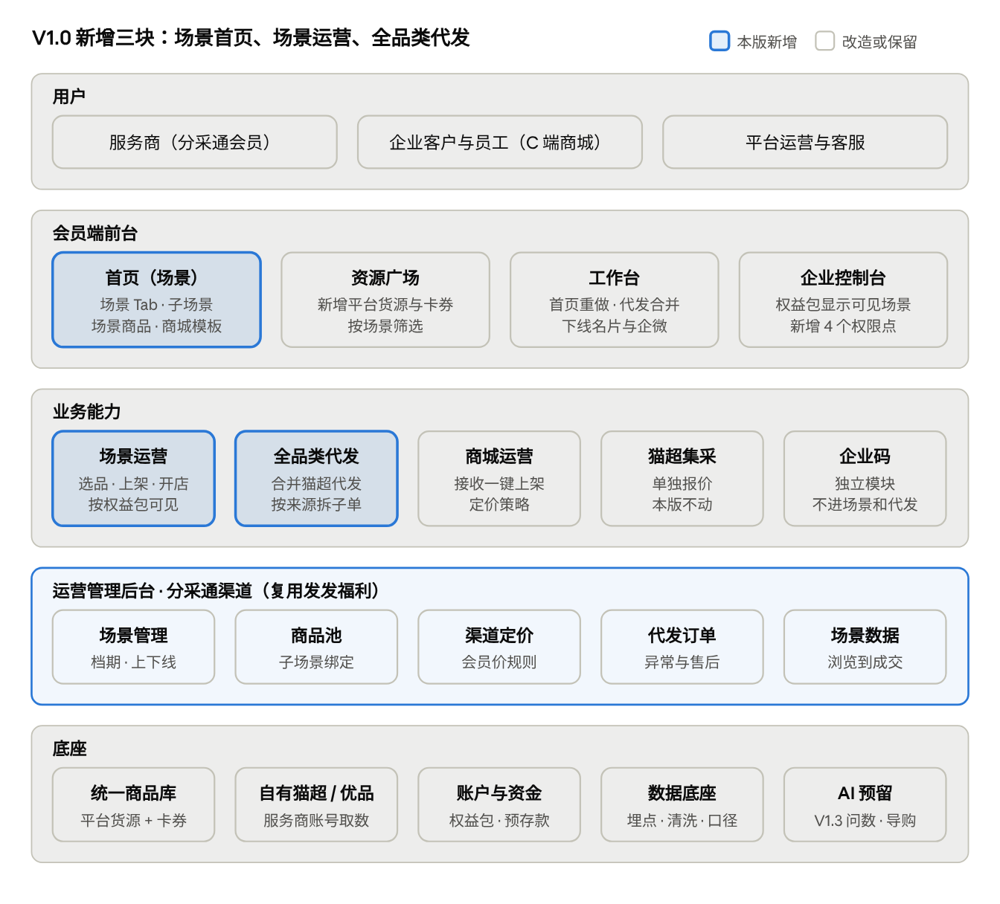
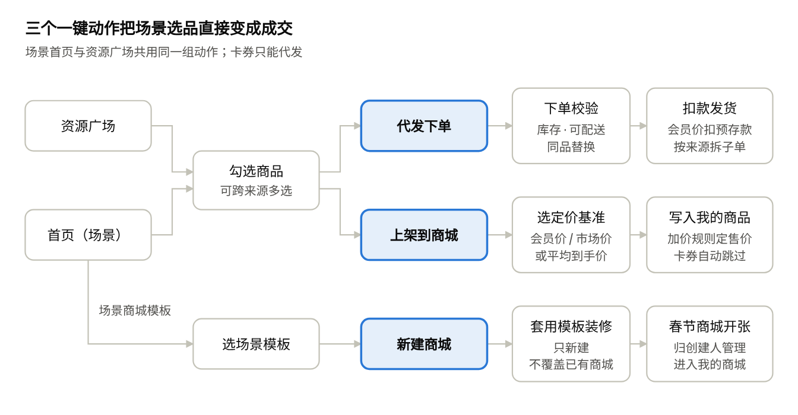
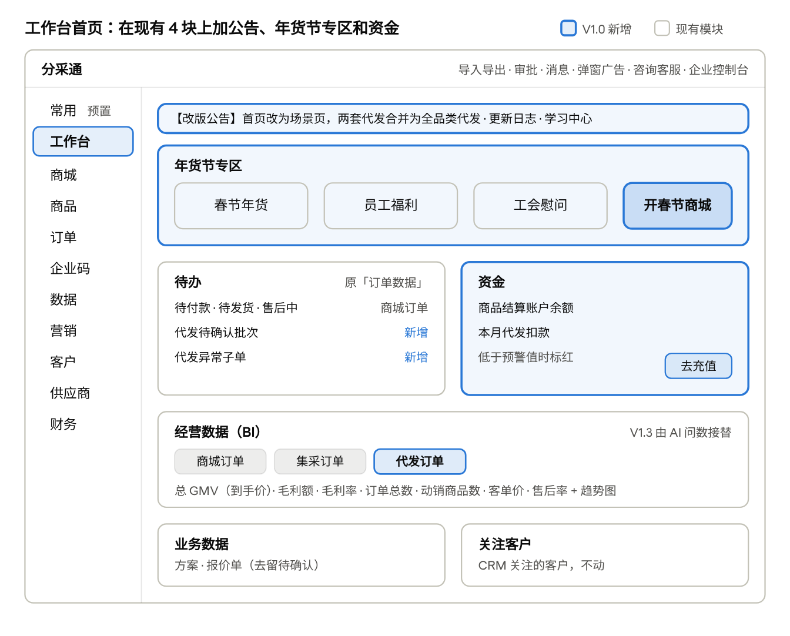

# 分采通 V1.0 年货节版：产品架构与工作台栏目改版

Oct 28, 2026 · @sanyuan

## 版本定位

V1.0 年货节版 11 月 20 日上线，12 月初年货节推广启动。一句话：服务商打开分采通就能按春节场景选品，一键代发、一键上架或用模板开出春节商城；工作台围绕「代发 · 商城 · 资金」三件事重排，去掉无人使用的营销入口。

本版从「货架 + 工具」转为「场景运营」：给服务商的不再是 50 多万个 SKU 和一堆菜单，而是一套能直接卖给企业客户的春节方案。

| 本版做                                                         | 本版不做（去向）                                      |
|----------------------------------------------------------------|-------------------------------------------------------|
| 场景首页（春节年货 / 员工福利 / 工会慰问），按权益包可见       | 场景加价（节后看数据再定）                            |
| 资源广场增加平台货源和卡券                                     | 一键套用已有商城（后续）                              |
| 全品类代发（合并猫超代发与其他代发）、一键上架、用模板新建商城 | C 端消费商城交易链路改版（V1.1，暂定 12/4）           |
| 运营管理后台分采通渠道：场景、商品池、渠道定价、代发订单       | 装修组件、京东评价 / 相似品、取消退款（V1.2）         |
| 工作台栏目改版与精简、品牌替换为分采通                         | AI 问数、AI 导购（V1.3，1/12 灰度）；本版只预留入口位 |
| 万鲤会员猫超代发兼容、上门取件                                 | 企业码改动（独立模块，不进场景不进代发）              |
| 全链路埋点、历史数据清洗、老功能迁移                           | 礼包搭建                                              |

已定的价格口径：代发按会员价扣款；平台货源上架的定价基准由会员在会员价 / 平均到手价 / 市场价中选；自有猫超 / 优品不进场景，下单和上架时按 SKU ID 替换为同品。

## 产品架构

V1.0 在现有分采通上叠加场景运营：前台新增场景首页，业务层新增场景运营和全品类代发，货盘与场景配置走发发福利的运营管理后台（分采通渠道）；商城运营、猫超集采、企业码保持不动。

分采通 V1.0 产品架构 · 5 层

| 层           | 归属系统         | 本版要点                                                                                     |
|--------------|------------------|----------------------------------------------------------------------------------------------|
| 会员端前台   | 分采通           | 首页改为场景页，模版广场并入场景；资源广场保留为全量货盘；工作台见下文                       |
| 业务能力     | 分采通           | 三个一键动作（代发、上架、新建商城）在首页和资源广场共用；卡券只能代发，不能上架             |
| 运营管理后台 | 发发福利共享后台 | 新增分采通渠道：场景、商品池、渠道定价、代发订单、场景数据；定价与发发福利分开               |
| 底座         | 两边共用         | 商品复用统一商品库；权益包、预存款、商城运营留在分采通；历史订单清洗与指标口径统一在本版完成 |

## 核心业务链路

年货节的成交走三条路：勾选商品后代发下单、勾选商品后上架到自己的商城、选场景模板新建商城。工作台是这三条路的「后半程」：代发批次、上架结果、新商城都落到工作台里跟进。

场景选品到成交 · 3 条路径

自有猫超 / 优品商品不进场景，但代发和上架时会按 SKU ID 替换为服务商自有账号的同品。

## 工作台栏目改版

2026-10-30 用「分采通业务演示专用」账号实测：工作台有「常用」快捷菜单 + 工作台首页 + 9 个一级菜单，共 85 个页面，比知识库记录的多出「商品」「供应商」两个一级和「其他代发」「商城扩展应用」等分组。最大的发现是：非猫超货源的代发已经存在（订单 · 其他代发，7 页），所以 V1.0 的全品类代发是「合并两套代发」，不是新建。

### 现状与改版结论

| 发现                                                                                                                   | 对 V1.0 的影响                                                       |
|------------------------------------------------------------------------------------------------------------------------|----------------------------------------------------------------------|
| 代发有两套：猫超代发（2 页）和其他代发（7 页，货源为电商精选 / 精选商品 / 自有供应商商品），导入规则不同               | 全品类代发 = 两套合并，重点是统一规则和批次管理                      |
| 两个「下单管理 / 下单历史」列表显示同一批批次（如批次 6860、6343）                                                     | 批次数据已经共用，合并下单管理的改动量小                             |
| 商品 · 商品替换日志已有「原商品会员价 / 替换商品会员价 / 上架商城」字段                                                | 同品替换的记录复用这页，不新建                                       |
| 财务 · 账户管理已有商品结算账户 / 活动账户 / 技术服务账户；商品交易明细已有「采购-商品、采购-运费、退款-订单退款」类型 | 代发从商品结算账户扣款，流水走商品交易明细，不再新增「代发交易明细」 |
| 「常用」快捷菜单已存在，最多 10 个，演示账号未设置                                                                     | 用它预置年货节快捷入口，首页不再做「常用功能」模块                   |
| 工作台首页现有 4 块：订单数据、经营数据（BI）、业务数据、关注客户                                                      | 在现有 4 块上改，不推倒重做                                          |
| 名片小程序未授权，数据监测累计访客 42；企微群发、话术、企微好友 / 群 / 流失均无数据                                    | 支持下线；演示账号不代表全量，下线前拉全量使用数据                   |
| 其他代发价格列出现「协议价」，已选商品显示「会员价 / 协议价」                                                          | 「协议价」不在名词字典里，代发合并前要定口径                         |
| 商品 · 本地资源场景有 9 页（特惠电影…小象超市），每页都是同样的定价规则列表                                            | 与新的「场景运营」同名易混，建议分组改名「本地生活资源」             |

### 侧栏新旧对照

一级菜单 9 个保持不动。合并 9 页为全品类代发 5 页，下线 9 页，挪位 2 页，其余保留。

| 一级   | 分组                           | 现有栏目                                                                               | 变化           | V1.0 改什么                                                                                                                           |
|--------|--------------------------------|----------------------------------------------------------------------------------------|----------------|---------------------------------------------------------------------------------------------------------------------------------------|
| 常用   | —                              | 快捷菜单（用户自选，最多 10 个）                                                       | 改造           | 未设置过的用户默认预置：全品类代发 · 批量下单、下单管理、已选商品、我的商城、账户管理；已设置的不覆盖                                 |
| 工作台 | —                              | 工作台首页                                                                             | 改造           | 见下一节                                                                                                                              |
| 商城   | 商城管理                       | 我的商城、我的礼包                                                                     | 改造           | 我的商城增加「用场景模板新建」入口和「来自场景模板」标识；我的礼包不动                                                                |
| 商城   | 商城扩展应用                   | 互动营销、预算分发、促销增购、用户权益、销售渠道、个性配置                             | 保留           | 6 页都是插件介绍目录；建议 V1.2 合并为一页带分类                                                                                      |
| 商品   | 商品管理                       | 商品库、商品发布、商品导入                                                             | 保留           | 服务商自有商品；「退货地址设置」从其他代发挪到本组（页面自述用于商品录入）                                                            |
| 商品   | 供应商商品                     | 挑选商品、商品变更审核、商品替换日志                                                   | 改造           | 商品替换日志增加「替换场景」（代发 / 上架），记录自有猫超 / 优品同品替换                                                              |
| 商品   | 本地资源场景                   | 特惠电影、快速电影、点餐服务、美团外卖、高德打车、鲜花蛋糕、淘宝闪购、大润发、小象超市 | 改名           | 分组名改为「本地生活资源」；9 页合一带 Tab 放 V1.2                                                                                    |
| 订单   | 全品类代发（新）               | 合并「猫超代发」2 页 +「其他代发」5 页                                                 | 合并           | 见下方「全品类代发」；放在订单第一组                                                                                                  |
| 订单   | 商城订单                       | 订单管理、订单导出、服务订单、下单提醒                                                 | 改造           | 「代售后查询」从其他代发挪到本组（它按商城列代售后服务，属于商城订单）；订单管理的订单来源已含代发宝、猫超集采、发发集采等 7 类，不动 |
| 订单   | 猫超集采                       | 集采报价、下单管理                                                                     | 保留           | 单独报价                                                                                                                              |
| 企业码 | 服务企业 · 订单中心            | 7 页                                                                                   | 保留           | 独立模块；11 月对账口径按 Q4 任务 43.1 单独上线                                                                                       |
| 数据   | —                              | 订单分析、用户分析、经营概览、订单明细                                                 | 保留           | 代发是否计入经营概览待确认；V1.3 AI 问数接替入口                                                                                      |
| 营销   | 名片营销                       | 我的名片、数据监测、名片设置                                                           | 下线           | 3 页                                                                                                                                  |
| 营销   | 卡券营销                       | 卡券兑换、卡券推广、卡券营销                                                           | 保留           | 营销下只剩这一组                                                                                                                      |
| 营销   | 企微营销                       | 群群发、客户群发、销售话术                                                             | 下线           | 3 页                                                                                                                                  |
| 客户   | 客户关系                       | 企微好友、企微客户群、客户流失                                                         | 下线（待确认） | 3 页，依赖企微配置                                                                                                                    |
| 客户   | 线索公海 · 客户关系 · 销售管理 | 企业线索、联系人线索、企业客户、联系人、销售报价、客户跟进、商机管理、客户合同         | 保留           | 不动                                                                                                                                  |
| 供应商 | 自有供应商                     | 供应商管理、新增、导入、供应商登录（门户）                                             | 保留           | 服务商自己的供应商，与平台入驻商家不是一回事，文案上要区分                                                                            |
| 财务   | 平台财务                       | 账户管理、发票管理、集采财务、营业额申报                                               | 改造           | 账户管理的商品结算账户即代发扣款账户：加「用于全品类代发」说明和余额预警（页面已有「可用额度预警」，确认是否可复用）                  |
| 财务   | 商城财务                       | 短信管理、额度管理、额度明细、开票审核、微信支付配置                                   | 保留           | 不动                                                                                                                                  |
| 财务   | 交易明细                       | 服务交易明细、猫超交易明细、商品交易明细                                               | 改造           | 商品交易明细增加批次号、货源筛选，作为代发资金流水；猫超交易明细（商城猫超订单的支付宝流水）保留                                      |

顺带改的非菜单入口：顶栏「导入导出」增加代发导入记录和一键上架任务；「消息」增加代发批次待支付、子单异常、余额不足三类；工作台 Logo 目前仍是「采发发 · 会员端」，按 Q4 任务 36.2 替换为分采通。

### 工作台首页

在现有 4 块上改：顶部加公告和年货节专区，「订单数据」升级为「待办」并并列新增「资金」，经营数据加「代发订单」 Tab，业务数据和关注客户不动。

工作台首页线框 · 现有 4 块 + 新增 3 块

| 顺序 | 模块           | 现状                                                                                                                  | V1.0                                                                                   | 优先级 |
|------|----------------|-----------------------------------------------------------------------------------------------------------------------|----------------------------------------------------------------------------------------|--------|
| 1    | 公告与更新日志 | 无（顶栏只有弹窗广告）                                                                                                | 新增：改版公告 + 更新日志链接 + 学习中心链接；首次登录触发 3 步新手引导                | P0     |
| 2    | 年货节专区     | 无                                                                                                                    | 新增：运营配置的档期 Banner + 当前档期场景卡（按权益包可见，最多 3 张）+「开春节商城」 | P0     |
| 3    | 待办           | 「订单数据」：待付款、待发货、售后中，只统计商城订单                                                                  | 保留 3 项，增加代发待确认批次、代发异常子单；每项点击带筛选进列表                      | P0     |
| 4    | 资金           | 无（余额在财务 · 账户管理）                                                                                           | 新增：商品结算账户余额、本月代发扣款、低于预警值标红 +「去充值」                       | P0     |
| 5    | 经营数据       | BI 嵌入：商城订单 / 集采订单两个 Tab；总 GMV（到手价）、毛利额、毛利率、订单总数、动销商品数、客单价、售后率 + 趋势图 | 增加「代发订单」 Tab，指标同口径；V1.3 由 AI 问数接替                                  | P1     |
| 6    | 业务数据       | 方案 / 报价单两个 Tab                                                                                                 | 不动；是否保留跟「挑选入方案」一起定                                                   | —      |
| 7    | 关注客户       | CRM 关注客户列表                                                                                                      | 不动                                                                                   | —      |

### 全品类代发：两套合一

| 新栏目       | 来自                                      | V1.0 做什么                                                                             |
|--------------|-------------------------------------------|-----------------------------------------------------------------------------------------|
| 已选商品     | 其他代发 · 已选商品                       | 场景首页和资源广场勾选的商品都进这里，支持全部货源和卡券；从这里发起批量下单            |
| 批量下单     | 猫超代发 · 批量下单 + 其他代发 · 批量下单 | 一个入口；两种老模板继续可用；校验结果逐行显示库存、可配送、同品替换、会员价、运费      |
| 下单管理     | 猫超代发 · 下单管理 + 其他代发 · 下单历史 | 合为一页；增加来源入口、场景名字段和筛选；批次详情按货源拆子单，子单级发起售后          |
| 商品变更通知 | 其他代发                                  | 保留（字段：会员价、市场价、新会员价、新市场价、库存），覆盖已选商品里的全部货源        |
| 代发选品     | 其他代发 · 代发选品                       | 不再单独展示：老地址重定向到资源广场「平台货源」；它的「自有供应商商品」 Tab 去向待确认 |

两套代发现在的规则不一致，合并时按货源分别校验：

| 规则     | 猫超代发（现）       | 其他代发（现）                   | V1.0 建议                                          |
|----------|----------------------|----------------------------------|----------------------------------------------------|
| 文件格式 | .xlsx，另有在线表格  | .csv                             | 统一 .xlsx + 在线表格，兼容老 .csv                 |
| 商品标识 | SKU ID               | 商品 ID                          | 两种都识别，按标识判断货源                         |
| 每行数量 | 1–50                 | 1–99999                          | 按货源校验，各自沿用                               |
| 合单     | 一行一单，不合并     | 按收货人姓名 + 手机号 + 地址合并 | 按货源：猫超子单不合并，其他货源沿用合并（待确认） |
| 单次上限 | 5000 行              | 5000 条                          | 5000 行                                            |
| 扣款     | 确认支付后从预存款扣 | 同左                             | 商品结算账户按会员价扣款                           |
| 售后     | 在下单管理查看       | 联系专属客服                     | 子单级发起；万鲤会员支持上门取件                   |

卡券代发的交付方式（电子卡密还是实体卡）会改变收件信息字段；「取消未发货子单并退款」在 V1.2，本版仍走人工。

### 权限点

企业控制台 → 组织管理的角色权限新增 4 个权限点：代发下单、代发支付（扣商品结算账户）、一键上架、新建商城。下单和支付分开，便于业务员建单、财务付款。

老账号迁移：管理员默认全开；原来有猫超代发或其他代发任一权限的子账号，自动获得代发下单和代发支付。企业控制台「我的权益」增加「可见场景」；「企微配置」随企微栏目一起隐藏（待确认）。

### 下线与迁移

| 对象                                                                | 页面数 | 处理方式                                                       | 历史数据                     |
|---------------------------------------------------------------------|--------|----------------------------------------------------------------|------------------------------|
| 名片营销                                                            | 3      | 菜单隐藏；/module/market/card/\* 重定向工作台首页并提示已下线  | 保留不删；是否提供导出待确认 |
| 企微营销                                                            | 3      | 同上（/module/customer/groupSending、customerSending、script） | 同上                         |
| 客户 · 企微好友 / 客户群 / 客户流失                                 | 3      | 同上（/module/wechat/friend、group、exposures），待确认        | 同上                         |
| 猫超代发 · 批量下单 / 下单管理                                      | 2      | 老路由重定向到全品类代发对应页                                 | 批次已共用，来源标为猫超     |
| 其他代发 · 代发选品 / 已选商品 / 批量下单 / 下单历史 / 商品变更通知 | 5      | 重定向到全品类代发对应页；代发选品重定向资源广场               | 已选商品、批次原样保留       |
| 其他代发 · 退货地址设置 / 代售后查询                                | 2      | 菜单挪到商品管理 / 商城订单，路由不变                          | 不动                         |
| 模版广场（导航入口）                                                | 1      | /shop/template 重定向首页；模板详情页保留供场景链接            | 运营逐个关联到场景           |

建议下线前 1 周发站内公告和短信 / 企微群通知，上线后 2 周内老地址保留重定向提示（时长待与运营商定）。

实测范围：只读访问全部 85 个栏目和礼管家老后台的代发、订单、财务页；未执行建商城、下单、挑选、保存等任何确认操作。礼管家嵌入页（订单分析、短信、额度、卡券营销等）只看了入口，未逐页展开。

## 任务拆解

V1.0 拆为 8 个模块、54 项任务，其中 P0 44 项、P1 10 项。P1 是产能不够时可后移到 V1.2（12/18）的部分。「端」一列：会员端 = qiyegou 工作台与首页；运营后台 = 发发福利运营管理后台的分采通渠道；运营中心 = 商城运营中心（cashstore）。

| 模块                       | 任务数 | P0  | 关键依赖                               |
|----------------------------|--------|-----|----------------------------------------|
| A 商品与定价底座           | 4      | 4   | 统一商品库对分采通开放；「协议价」口径 |
| B 场景运营                 | 11     | 9   | A；商品运营 11/20 前配好春节货盘       |
| C 全品类代发               | 8      | 7   | A3 同品替换；合单规则、卡券交付方式    |
| D 定价策略兼容             | 7      | 6   | A2 会员价；平均到手价缺失时的回退规则  |
| E 工作台精简（含低频收起） | 8      | 5   | 近 90 天栏目访问数据                   |
| F 数据 BI 看板             | 5      | 3   | F1 口径先定再做看板                    |
| G 版本更新与新手指引       | 7      | 6   | B、C、E 的页面定稿                     |
| H 迁移与上线               | 4      | 4   | 万鲤账户余额盘点（Q4 任务 42）         |

### A 商品与定价底座

| 编号 | 任务           | 内容与验收要点                                                                                                        | 端            | 优先级           |
|------|----------------|-----------------------------------------------------------------------------------------------------------------------|---------------|------------------|
| A1   | 平台货源开放   | 统一商品库的京东 / 1688 / 平台精选 / 入驻商家和卡券按渠道对分采通开放；字段映射到资源广场和场景商品卡                 | 后端          | P0               |
| A2   | 分采通渠道定价 | 平台货源与卡券在分采通的会员价规则，复用发发福利定价模板、与发发福利分开配置；会员端不展示平台货源接口价              | 运营后台      | P0               |
| A3   | 同品替换       | 代发和上架时按 SKU ID 替换为服务商自有猫超 / 优品同品；无同品时的处理待定；记录写入商品替换日志（加「替换场景」字段） | 后端 + 会员端 | P0               |
| A4   | 价格口径补齐   | 定「协议价」口径及是否继续展示；补进名词字典；商品卡每个价格都写清口径                                                | 产品          | P0（需求评审前） |

### B 场景运营

| 编号 | 任务           | 内容与验收要点                                                                                                                     | 端              | 优先级 |
|------|----------------|------------------------------------------------------------------------------------------------------------------------------------|-----------------|--------|
| B1   | 场景管理       | 场景 / 子场景的新增编辑、档期、排序、上下线、可见权益包、场景说明与热销指引                                                        | 运营后台        | P0     |
| B2   | 场景商品池     | 子场景绑定商品池（复用发发福利商品池，含卡券 SKU）；按规则自动上下架；无货商品不展示                                               | 运营后台        | P0     |
| B3   | 场景模板关联   | 场景关联现有商城模板详情（只存链接，不迁移数据）                                                                                   | 运营后台        | P0     |
| B4   | 场景数据       | 按场景统计浏览、勾选、代发单量与金额、上架商品数、新建商城数                                                                       | 运营后台        | P1     |
| B5   | 场景首页       | 场景 Tab、场景头部、子场景、场景商品卡（来源、成本价及口径、市场价、库存状态、发货仓、卡券标识）；默认落在当前档期                 | 会员端          | P0     |
| B6   | 一键动作栏     | 勾选后出现：加入已选 / 代发下单 / 上架到商城；含卡券时提示上架将跳过卡券；首页与资源广场共用                                       | 会员端          | P0     |
| B7   | 用模板新建商城 | 场景模板卡片 +「用此模板新建商城」；只新建不覆盖、套用模板装修、归创建人；我的商城加「来自场景模板」标识                           | 会员端          | P1     |
| B8   | 资源广场改造   | 增加平台货源 Tab（按来源二级）和卡券 Tab；新增「按场景」筛选；成本列按货源切换（自有 = 接口价，其余 = 会员价）；承接代发选品重定向 | 会员端          | P0     |
| B9   | 权益包可见     | 场景按权益包显示；企业控制台「我的权益」显示可见场景；一个场景都看不到时的兜底页                                                   | 会员端 + 后端   | P0     |
| B10  | 模版广场下线   | 导航入口去掉；/shop/template 重定向首页；模板详情页保留                                                                            | 会员端          | P0     |
| B11  | 首批场景配置   | 春节年货、员工福利、工会慰问的子场景、货盘、商品打标、关联模板；老会员默认开放规则                                                 | 商品 / 内容运营 | P0     |

### C 全品类代发

| 编号 | 任务             | 内容与验收要点                                                                                                            | 端            | 优先级 |
|------|------------------|---------------------------------------------------------------------------------------------------------------------------|---------------|--------|
| C1   | 已选商品统一     | 场景与资源广场勾选的商品都进已选；支持全部货源和卡券；从已选发起批量下单                                                  | 会员端        | P0     |
| C2   | 批量下单统一入口 | .xlsx + 在线表格，兼容老 .csv；识别 SKU ID 与商品 ID；按货源校验数量和合单规则；单次 ≤ 5000 行                            | 会员端 + 后端 | P0     |
| C3   | 校验、确认与扣款 | 逐行显示库存、可配送、同品替换、会员价、运费；待确认 → 确认支付，从商品结算账户按会员价扣款；余额不足时保留批次并引导充值 | 会员端 + 后端 | P0     |
| C4   | 下单管理合并     | 猫超下单管理 + 其他代发下单历史合为一页；增加来源入口、场景名；批次详情按货源拆子单；子单级发起售后                       | 会员端        | P0     |
| C5   | 商品变更通知     | 覆盖已选商品中全部货源的价格与库存变更                                                                                    | 会员端        | P1     |
| C6   | 卡券代发         | 交付方式（电子卡密 / 实体卡）、收件字段、开票方式；定下来前卡券不开放代发                                                 | 产品 + 后端   | P0     |
| C7   | 万鲤会员兼容     | 万鲤会员可走平台猫超代发链路；退换货支持上门取件（Q4 任务 38）                                                            | 后端          | P0     |
| C8   | 老功能迁移       | 两套代发的批次、已选商品原样保留；7 个老路由重定向；代发选品重定向资源广场                                                | 会员端        | P0     |

### D 定价策略兼容

现状：商城运营中心的定价策略、智能运营只对自有猫超 / 自有优品生效；本地资源场景各有一套「基于会员价上调 x%」的定价规则，本版不动。

| 编号 | 任务                     | 内容与验收要点                                                                             | 端                | 优先级 |
|------|--------------------------|--------------------------------------------------------------------------------------------|-------------------|--------|
| D1   | 定价策略覆盖平台货源     | 规则可按货源、类目、价格区间设置；自有货源规则保持不变；定价策略操作记录同步覆盖           | 运营中心          | P0     |
| D2   | 定价基准可选             | 会员价 / 平均到手价 / 市场价三选一；平均到手价缺失（非猫超、部分猫超）时的回退基准待定     | 运营中心          | P0     |
| D3   | 一键上架必定价           | 上架前必须选加价规则或启用定价策略；批量上架任务结果进导入导出                             | 会员端 + 运营中心 | P0     |
| D4   | 我的商品增加平台货源 Tab | 字段：会员价、市场价、平均到手价（有则显示）、分销价、销售价、利润率；支持批量改价、上下架 | 运营中心          | P0     |
| D5   | 价格联动与亏本拦截       | 会员价或基准价变动后售价是否重算；售价低于会员价时接入现有「亏本下单配置」                 | 运营中心 + 后端   | P0     |
| D6   | 智能运营覆盖平台货源     | 按条件自动上下架扩到平台货源                                                               | 运营中心          | P1     |
| D7   | 卡券排除                 | 卡券不进入我的商品、不参与定价策略                                                         | 后端              | P0     |

### E 工作台精简（含低频功能收起）

| 编号 | 任务           | 内容与验收要点                                                                                                                                                                                  | 端            | 优先级 |
|------|----------------|-------------------------------------------------------------------------------------------------------------------------------------------------------------------------------------------------|---------------|--------|
| E1   | 无人用栏目下线 | 名片 3 页、企微营销 3 页、客户下企微 3 页（待确认）及企微配置；下线前拉全量使用数据；老路由重定向并提示                                                                                         | 会员端        | P1     |
| E2   | 低频功能收起   | 侧栏底部增加「更多」折叠组，默认收起；候选：商城扩展应用 6 页、本地资源场景 9 页、供应商 4 页、营业额申报、服务订单、下单提醒、短信管理，以近 90 天访问数据定稿；收起不收权限，常用与搜索仍可达 | 会员端        | P1     |
| E3   | 栏目挪位与改名 | 全品类代发放订单第一组；退货地址设置 → 商品管理；代售后查询 → 商城订单；本地资源场景 → 本地生活资源                                                                                             | 会员端        | P0     |
| E4   | 常用菜单预置   | 未设置过的用户默认 5 项：批量下单、下单管理、已选商品、我的商城、账户管理；已设置的不覆盖                                                                                                       | 会员端        | P0     |
| E5   | 工作台首页改版 | 公告、年货节专区、待办（原订单数据 + 代发待确认 / 异常）、资金；业务数据和关注客户不动                                                                                                          | 会员端        | P0     |
| E6   | 品牌替换       | 工作台 Logo「采发发 · 会员端」改为分采通（Q4 任务 36.2）                                                                                                                                        | 会员端        | P0     |
| E7   | 权限点         | 新增代发下单、代发支付、一键上架、新建商城 4 个权限点；老账号按原代发权限映射                                                                                                                   | 会员端 + 后端 | P0     |
| E8   | 顶栏补充       | 导入导出增加代发导入和上架任务；消息增加待支付、子单异常、余额不足通知                                                                                                                          | 会员端        | P1     |

### F 数据 BI 看板

| 编号 | 任务                     | 内容与验收要点                                                                                             | 端          | 优先级            |
|------|--------------------------|------------------------------------------------------------------------------------------------------------|-------------|-------------------|
| F1   | 指标口径                 | 代发是否计入经营概览；总 GMV（到手价）、毛利额对代发的算法；「企业代付金额」（Q4 任务 43.1）；输出指标字典 | 产品 + 数据 | P0（先于 F3、F4） |
| F2   | 历史订单清洗             | 订单来源、货源、商品 / 类目 / 场景标签统一；也是 V1.3 AI 问数的数据底座                                    | 数据        | P0                |
| F3   | 工作台经营数据加代发 Tab | 现有商城订单 / 集采订单旁加「代发订单」，7 个指标同口径                                                    | BI          | P1                |
| F4   | 订单明细筛选             | 订单来源增加「全品类代发」，增加场景筛选                                                                   | BI          | P1                |
| F5   | 埋点                     | 场景浏览、勾选、加入已选、代发、上架、新建商城、新手引导完成率、收起栏目点击                               | 会员端      | P0                |

老板看板改版（Q4 任务 45.1）按原计划 12 月做，不在 V1.0。

### G 版本更新与新手指引

| 编号 | 任务         | 内容与验收要点                                                                                            | 端            | 优先级 |
|------|--------------|-----------------------------------------------------------------------------------------------------------|---------------|--------|
| G1   | 改版公告     | 工作台首页公告条、登录弹窗（可复用弹窗广告）、短信 / 企微群文案                                           | 会员端 + 运营 | P0     |
| G2   | 更新日志页   | 版本号、变更清单、老功能去向对照（猫超代发 / 其他代发 / 模版广场 / 下线栏目）                             | 会员端        | P0     |
| G3   | 首次登录引导 | 3 步：场景首页 → 一键动作 → 全品类代发 / 新建商城；可跳过、可从帮助重看；按账号记录完成状态               | 会员端        | P0     |
| G4   | 功能点气泡   | 已选商品、合并后的下单管理、商品结算账户、「更多」收起组各一次性提示                                      | 会员端        | P1     |
| G5   | 老路由提示   | 被合并或下线的页面重定向后，顶部提示「该功能已移至 …」                                                    | 会员端        | P0     |
| G6   | 学习中心内容 | 操作手册、短视频、FAQ：场景选品、全品类代发、一键上架、定价基准、同品替换、新建商城（与 Q4 任务 46 对齐） | 内容运营      | P0     |
| G7   | 内部培训     | 客服、客户运营、销售、区代的培训与考核；统一答疑口径                                                      | 产品 + 运营   | P0     |

### H 迁移与上线

| 编号 | 任务         | 内容与验收要点                                                              | 端   | 优先级 |
|------|--------------|-----------------------------------------------------------------------------|------|--------|
| H1   | 灰度白名单   | 先对 1–2 家友好服务商开放场景首页和全品类代发，再按批放量                   | 后端 | P0     |
| H2   | 老数据迁移   | 代发批次、已选商品、权限映射、老会员默认场景；迁移后核对                    | 后端 | P0     |
| H3   | 回滚预案     | 场景首页、全品类代发各设开关，可切回老首页和老代发入口                      | 后端 | P0     |
| H4   | 上线前置条件 | 春节场景货盘已配（B11）；万鲤账户余额盘点完成（Q4 任务 42）；培训完成（G7） | 产品 | P0     |

## 范围取舍与依赖

场景首页、商品池、全品类代发、一键上架不能砍；工作台里跟它们绑定的全品类代发两页、代发交易明细、权限点也是 P0。产能不够时按下表顺序后移到 V1.2（12/18）。

| 顺序 | 后移项                                    | 后移后 V1.0 的最小形态                                |
|------|-------------------------------------------|-------------------------------------------------------|
| 1    | 春节模板视觉更新                          | 沿用现有模板，只在场景里链接                          |
| 2    | 一键新建商城                              | 模板详情保留原有「使用模板」流程                      |
| 3    | 工作台精简（名片 / 企微下线）             | 菜单保留，仅做开关配置预埋                            |
| 4    | 工作台首页 P1（经营数据「代发订单」 Tab） | 经营数据保持商城 / 集采两个 Tab，代发数据先看下单管理 |

第 4 项是本文新增的建议，路线图里只列了前 3 项。

外部依赖：

- 运营管理后台分采通渠道（场景、商品池、渠道定价）须先于会员端可用，运营要在 11/20 前配好春节场景和货盘。

- 商品运营在春节档前完成场景商品打标。

- 现有商城能否承接平台货源下单和售后；不能的话，V1.0 一键上架只开放自有猫超 / 优品，平台货源上架随 V1.1 开放。

- 万鲤账户迁移（Q4 任务 42）影响预存款扣款，需在 V1.0 上线前完成余额盘点。

## 待确认

前 4 条影响工作台字段和开发量，建议需求评审前定。

1.  卡券代发的交付方式（电子卡密发给收件人，还是实体卡寄送）和开票方式。

2.  同品替换的边界：服务商自有账号没有对应 SKU 时，按平台货源下单还是提示不可替换？替换后是否仍按会员价扣款？

3.  代发订单是否计入 BI 经营概览，代发的开票入口放在平台财务 · 发票管理还是下单管理。

4.  其他代发里的「协议价」是什么口径，与会员价的关系；全品类代发统一按会员价扣款后，协议价是否还展示。

5.  客户下的企微好友、企微客户群、客户流失，以及企业控制台的企微配置，是否与企微营销一起下线；下线前拉使用数据确认。

6.  名片、企微的历史数据是否给用户提供导出。

7.  「挑选入方案」和工作台「业务数据 → 方案」是否保留。

8.  工作台首页「待办」是否加入商城侧的汇款充值审核和订单审核（它们在商城运营中心，跨系统取数）。

9.  代发选品的「自有供应商商品」 Tab 去哪里：资源广场加一个 Tab，还是放在商品 · 商品库；两套代发合单规则是否按货源各自沿用。

依据：[分采通 11–1月产品规划](https://claude.ai/artifact/T2PFj2BMaf242nvMUqQc2V) · [分采通系统产品架构与栏目设计框架](https://claude.ai/artifact/HSx9AMFwmFKUrLXvAmSfVR) · 知识库《06-系统菜单与路由映射》 · 《采发发分采通Q4子任务拆解》。前一份框架把营销栏目列为「保留」，本文按更新的路线图改为下线名片和企微。
