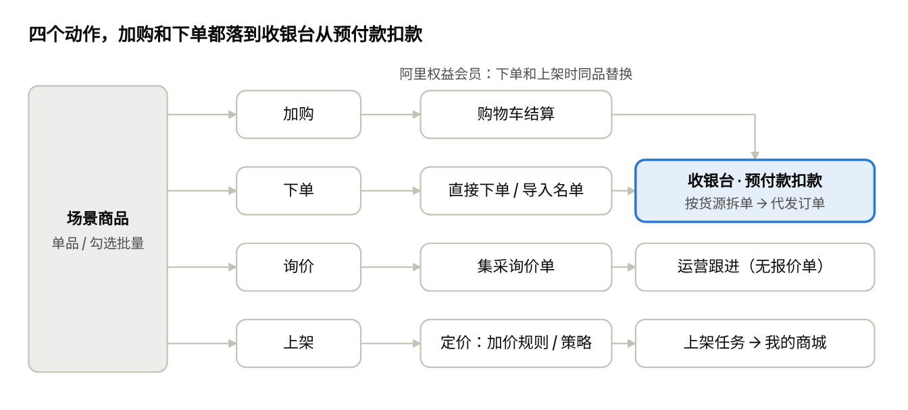

# 采发发会员端 V1.0 年货节版 · 场景运营与交易链路 产品 Spec（前台+后台）

Nov 5, 2026 · @sanyuan

## 文档信息与范围

本 Spec 定义 V1.0（2026-11-20 上线）会员端场景首页与交易链路的前后台行为：服务商在场景里选品，直接加购、询价、代发或上架到自己的商城；商城模板是辅助入口。它合并了版本计划中的 B 场景运营、C 全品类代发、D 定价策略兼容三组任务，并按 11/02–11/05 的最新口径更新。

| 项           | 内容                                                                                         |
|--------------|----------------------------------------------------------------------------------------------|
| 版本         | V1.0 年货节版（存量营销增长），2026-11-20 全量上线                                           |
| 端           | 会员端（PC）· 运营管理后台 · 商城运营中心（上架定价）                                        |
| 一句话价值   | 服务商进首页就拿到春节方案，选好的货当场变成代发单或商城商品                                 |
| 产品形态参考 | 采发发场景运营首页 Demo v2（canvas），本文与 Demo 不一致时以本文为准                         |
| 前置文档     | 分采通 V1.0 年货节版：产品架构与工作台栏目改版（任务拆解 A–H）· 分采通 V1.0 场景运营产品需求 |

**本期做**

- 运营后台：一级 / 二级场景、可见范围、商品池绑定、运营位（Banner / 专题卡 / 腰部广告 / 时令入口）、商城模板关联与上新弹窗规则、场景标签、场景数据。

- 会员端：场景首页、场景商品池（筛选 / 排序 / 分页）、单品与批量的加购 / 询价 / 下单（直接下单、导入名单代发）/ 一键上架、商城模板（入口、上新弹窗、列表、两级预览、用模板新建商城）、场景列表页、右侧会员面板。

- 交易链路：全品类代发统一入口、收银台按预付款账户扣款、同品替换、上架任务。

**本期不做（去向）**

| 事项                                          | 去向                                             |
|-----------------------------------------------|--------------------------------------------------|
| 报价单（询价后生成报价推给会员）              | 后续版本；V1.0 只做集采询价单                    |
| AI 建商城向导、会员端 AI 选品、场景内 AI 对话 | Q1；本期只留入口位置                             |
| 场景加价 / 场景专属会员价、商品池定价         | 不做（11/05 已删除商品池定价需求）               |
| 终端企业直接入驻、个人版注册升级              | 明年再议                                         |
| C 端商城改造、平台商家选品适配                | 各自版本单独写                                   |
| 项目报备与项目维度经营数据                    | 11/20 版本另文，本文只在代发和建商城处留关联字段 |

## 术语与核心业务规则

场景只负责「组织商品和模板」，不带任何价格规则；同一商品在任意场景里会员价相同。

### 对象

| 对象     | 定义                                                       | 关系                                                                 |
|----------|------------------------------------------------------------|----------------------------------------------------------------------|
| 一级场景 | 档期或主题，首页场景 Tab（新春年货节、员工福利、工会慰问） | 包含 ≥ 1 个二级场景                                                  |
| 二级场景 | 一级场景下的细分用途（员工年货、客户送礼）                 | 绑定 1–N 个商品池、关联 0–N 个商城模板，带预算 / 客户 / 发放方式标签 |
| 商品池   | 统一商品库上的规则选品集合，前台显示为「商品分组」         | 多条商品规则，满足任一条即上架、都不满足即下架；带指定会员可见       |
| 运营位   | Banner、专题卡、腰部广告、时令入口                         | 「图片 + 链接」，跳转目标由运营选                                    |
| 商城模板 | 老系统整套商城方案（微页面 + 特色专题），字段本次不变      | 可被多个二级场景关联                                                 |
| 权益包   | 会员已开通的权益组合（如「阿里权益」）                     | 决定场景可见、是否发生同品替换                                       |

### 价格口径（会员端可见范围）

| 字段                       | 口径                              | 会员端               |
|----------------------------|-----------------------------------|----------------------|
| 会员价                     | 平台 → 会员的结算价，即代发扣款价 | 显示，并标「会员价」 |
| 市场价                     | 供应链定义的市场价                | 划线显示             |
| 市场价利润率               | (市场价 − 会员价) ÷ 市场价        | 显示                 |
| 平均到手价                 | 天猫超市部分商品，T+1 更新        | 有则显示             |
| 接口价、结算价、平台利润率 | 平台内部                          | 永不显示             |

### 业务规则

| 规则         | 内容                                                                                                                                    |
|--------------|-----------------------------------------------------------------------------------------------------------------------------------------|
| 场景可见     | 场景只有「可见 / 不可见」：可见 = 场景可见权益包 ∩ 商品池指定会员可见；不可见的场景前台不出现，也不提供咨询开通入口；子账号跟随所属会员 |
| 档期         | 只展示生效中的场景；多个同时生效按排序值，第一个为默认 Tab                                                                              |
| 库存         | 无货商品由商品池规则自动下掉；库存 \< 50 显示「库存紧张」；下单时再校验一次                                                             |
| 同品替换     | 只对开通阿里权益、有自有猫超 / 自有优品的会员生效；下单和上架时按 SKU ID 全量替换为自有同品；不记替换日志                               |
| 自有货源     | 自有猫超 / 优品不进场景；有自有权限的会员在资源广场只看自有，不看对应的平台猫超 / 优品                                                  |
| 卡券         | 可进场景、可代发、可询价；不可上架到商城；批量上架时自动跳过并提示                                                                      |
| 付款         | 加购结算和代发均走收银台，全部从预付款账户按会员价扣款；余额不足时保留订单并引导充值                                                    |
| 一键上架     | 只能上架到自己管理的、未过期的商城；上架前必须定价（加价规则或定价策略）；商城已有的商品跳过                                            |
| 一键创建商城 | 只新建不覆盖；套用模板装修与内容；归创建人管理；与模板 / 商品池动态绑定（同步性能待确认）                                               |
| 已有能力     | 一键代发、一键上架、一键创建商城都是现有功能，本期只做全渠道货源兼容与场景入口                                                          |

## 角色与权限

浏览场景不需要权限；花钱、上架、建商城、看余额各是一个权限点，在企业控制台按角色配置。

| 角色                   | 端       | 本期关心的事                                    |
|------------------------|----------|-------------------------------------------------|
| 服务商管理员           | 会员端   | 给子账号分配下单 / 上架 / 建商城 / 查看余额权限 |
| 服务商业务员（子账号） | 会员端   | 在场景里选品，询价、加购、代发、上架            |
| 场景运营               | 运营后台 | 配场景、运营位、模板关联、上新弹窗、场景标签    |
| 商品运营               | 运营后台 | 维护商品池规则、白名单 / 黑名单、处理询价单     |
| 会员运营               | 运营后台 | 按权益包控制场景可见、看场景数据                |

### 会员端权限点

| 权限点               | 控制的动作                                | 无权限时的表现                                                 |
|----------------------|-------------------------------------------|----------------------------------------------------------------|
| 代发下单             | 单品 / 批量下单、导入名单代发、购物车结算 | 按钮置灰，悬停提示「请联系管理员开通」                         |
| 一键上架             | 单品 / 批量上架到商城                     | 同上                                                           |
| 新建商城             | 用模板开商城                              | 同上                                                           |
| 查看账户余额（新增） | 首页会员面板的预付款账户余额与明细入口    | 显示锁图标 +「无查看权限，请联系管理员」，不显示金额和明细入口 |

加购和询价不设权限点：加购不产生费用，询价只生成询价单。老账号迁移时，管理员默认拥有全部权限点，子账号沿用原「代发」「商城管理」权限映射。

## 前台：场景首页

首页从上到下是「搜索 → 时令营销 → 场景运营 + 会员面板 → 腰部广告 → 场景商品池」；主菜单与场景切换分层，工作台只有一个入口。

### 模块结构

| \#  | 模块             | 内容                                                                                                              | 配置来源          |
|-----|------------------|-------------------------------------------------------------------------------------------------------------------|-------------------|
| 1   | 顶栏             | 采发发 Logo、搜索框（搜当前场景商品，热词在下）、购物车（数量角标）；不放主菜单、工作台、资源广场                 | 热词：运营配      |
| 2   | 时令营销         | 当前档期卡（档期名 + 距节日 N 天）+ 4 个时令入口                                                                  | 运营位            |
| 3   | 场景运营区       | 一级场景 Tab（档期中角标）、「本场景模板 N」入口、「更多场景 ›」；左侧二级场景列表；中部 Banner 轮播 + 4 个专题卡 | 场景配置 + 运营位 |
| 4   | 会员面板（右侧） | 企业名与切换账号、权益包卡、预付款账户、待办、企业工作台常用功能                                                  | 会员数据          |
| 5   | 腰部广告         | 「场景方案库」通栏，跳场景列表页                                                                                  | 运营位            |
| 6   | 场景商品池       | 商品分组 + 筛选 + 商品列表，见下一节                                                                              | 商品池            |
| —   | 底部卖点条       | 品类齐全 / 正品正规可开票 / 行业标杆供应链价 / 一体化履约                                                         | 固定文案          |

### 场景运营区交互

- 一级场景 Tab：只显示可见且生效中的场景，按排序值排列，默认选中第一个；切换后二级场景、Banner、专题、商品池、模板入口全部联动，筛选重置。

- 二级场景列表：第一项为「全部 + 一级场景名」，每项显示名称、商品数、所含分组名；点击后专题卡和商品池只显示该二级场景的内容。

- Banner：只是「图片 + 链接」，不放按钮；整张可点，6 秒自动轮播，打开弹窗或离开首页时暂停；圆点切换不触发跳转。

- 专题卡：名称 + 一句卖点 + 3 个商品缩略图与会员价；优先取有图商品；点击按运营配置跳转，默认是定位到下方商品池并显示「专区：xx ✕」；悬停显示专区规则。

- 「更多场景 ›」和腰部广告都进场景列表页；从 Tab 行进入时自动选中当前一级场景。

### 会员面板

| 区块       | 内容与规则                                                                                                     |
|------------|----------------------------------------------------------------------------------------------------------------|
| 身份       | 企业名、会员身份、切换账号                                                                                     |
| 权益包卡   | 按权益包配置展示，例：「阿里权益 · 已开通；平台资源 10+ · 阿里资源；享官方项目直签授权」，右上角「权益详情 ›」 |
| 预付款账户 | 余额默认显示「¥ \*\*\*\*」，眼睛按钮切换显示 / 隐藏，旁边「明细 ›」；无「查看账户余额」权限时只显示无权限提示  |
| 待办       | 2 × 2 格：站点待支付订单、待审批售后、代发异常单、询价单（待处理）；数字 \> 0 标红，点击进对应列表             |
| 企业工作台 | 工作台唯一入口（「全部 ›」）+ 6 个常用功能：全品类代发、代发订单、我的商城、售后管理、定价策略、数据看板       |

### 状态

- 一个可见场景都没有：场景区显示空状态「去资源广场选品」，不提示开通。

- 二级场景的商品池全为空：该二级场景不显示；一级场景下没有可显示的二级场景时，该 Tab 不显示。

- 运营位未配置：Banner 用场景头图兜底；专题卡不足 4 个时按实际数量排；腰部广告不显示。

- 加载中各模块显示骨架屏；接口失败时模块内显示「加载失败，重试」，不影响其他模块。

## 前台：场景商品池

商品池直接从分组开始，不再重复场景标题；列表用分页，支持「全选本页」后批量操作。

### 分组与资源广场入口

- 分组 Tab = 当前二级场景绑定的商品池，组名和副标题取绑定时配置（如「粮油米面 · 电商仓直发」）；首项「全部商品」合并去重。

- 分组行最右端用竖线隔开放「资源广场 › 场景外的全部货源」，跳资源广场。

- 从专题卡进入时不选中任何分组，排序栏旁显示「专区：xx ✕」，关闭后回到全部商品。

### 筛选（属性面板 + 排序栏）

| 层               | 字段                           | 选择方式 | 说明                                                                                     |
|------------------|--------------------------------|----------|------------------------------------------------------------------------------------------|
| 属性面板         | 货源                           | 单选     | 只列当前结果中出现的货源：天猫超市 / 天猫优品 / 京东 / 1688 / 平台精选 / 入驻商家 / 卡券 |
| 属性面板         | 品牌                           | 多选     | 只列当前结果中的品牌，「其他品牌」排最后                                                 |
| 属性面板         | 类目                           | 单选     | 商品库一级类目                                                                           |
| 属性面板         | 猫超标签、价格力               | 单选     | 货源选中天猫超市时才出现                                                                 |
| 更多筛选（折叠） | 市场价利润率、发货仓、商品形态 | 单选     | 利润率 ≥ 20 / 30 / 40%；电商仓 / 商家仓；实物 / 卡券                                     |
| 排序栏           | 排序                           | 单选     | 综合（池排序值）/ 会员价升降 / 利润率降                                                  |
| 排序栏           | 会员价区间                     | 手填     | 最低价 – 最高价                                                                          |
| 排序栏           | 仅看有货、仅看可上架           | 勾选     | 仅看可上架 = 排除卡券                                                                    |
| 排序栏           | 在结果中搜索                   | 输入     | 匹配商品名和品牌                                                                         |

任一条件变化时回到第 1 页；有筛选时显示「清空筛选」；结果为空显示「当前筛选下没有商品」+ 清空按钮。

### 分页

- 分页浏览，不用下拉加载：服务商要比价、勾选、回到原页。

- 底部：上一页 / 页码 / 下一页、共 N 页、每页 20 / 40 / 60 件（默认 20）、全选本页；排序栏右侧放迷你翻页和总件数。

- 勾选在翻页、切换分组、切换二级场景时保留；切换一级场景时保留并提示。

### 商品卡

| 字段                      | 货源     | 规则                                                                                                 |
|---------------------------|----------|------------------------------------------------------------------------------------------------------|
| 勾选框                    | 全部     | 主图左上角                                                                                           |
| 主图、货源标 + 名称、规格 | 全部     | 货源标统一一种样式；名称最多 2 行                                                                    |
| 第三行信息                | 天猫超市 | 平均到手价 · 价格力                                                                                  |
| 第三行信息                | 其他     | 库存状态 · 发货仓；卡券显示「仅支持代发 · 不可上架」；发生同品替换时显示「下单与上架将使用自有同品」 |
| 会员价、市场价、利润率    | 全部     | 一行：红色会员价 + 划线市场价 + 橙色利润率标签                                                       |
| 操作行                    | 全部     | 加购（图标，已加购显示件数）· 询价 · 上架（卡券置灰）· 下单                                          |
| 好评率                    | 京东     | 接入京东评价组件后显示，本期不占位                                                                   |

没有的字段不占位、不显示「-」；没有图的商品显示「商品图待上传」占位。点击主图或名称打开商品详情抽屉。

## 前台：交易动作

四个动作都支持单品和批量：单品在商品卡上发起，批量在勾选后吸底的操作条上发起；下单、导入名单代发、购物车结算共用一个下单弹窗。

交易动作流向 · 4 个动作，3 个结果

加购和下单最终都进收银台从预付款账户扣款；询价只生成询价单，上架生成上架任务，都不扣款。

### 入口一览

| 动作 | 单品入口         | 批量入口                                           | 结果                          |
|------|------------------|----------------------------------------------------|-------------------------------|
| 加购 | 商品卡购物车图标 | 操作条「批量加购」                                 | 进购物车，数量 +1，toast 提示 |
| 询价 | 商品卡「询价」   | 操作条「批量询价」                                 | 生成集采询价单                |
| 下单 | 商品卡「下单」   | 操作条「批量下单」「导入名单代发」；顶栏购物车结算 | 生成代发订单，预付款扣款      |
| 上架 | 商品卡「上架」   | 操作条「批量上架」                                 | 生成上架任务                  |

操作条显示：已选 N 件（含卡券时提示「含 M 件卡券，仅可代发，上架时自动跳过」）· 全选本页 · 清空 · 批量询价 · 批量加购 · 批量上架 · 批量下单 · 导入名单代发。单次勾选上限待定（建议 200）。

### 询价（V1.0 只做询价单）

| 区域     | 字段                                                                       | 规则                                                          |
|----------|----------------------------------------------------------------------------|---------------------------------------------------------------|
| 询价类型 | 大批量采购 / 定制需求 / 价格咨询 / 货期咨询                                | 单选，必填；选定制需求时补充说明的示例换成 LOGO / 包装 / 礼盒 |
| 商品清单 | 商品、当前会员价、采购数量、期望单价                                       | 数量必填，默认 100；期望单价选填                              |
| 公共信息 | 期望交付日期、收货地区、是否开票（专票 / 普票 / 不需要）、联系人、补充说明 | 联系人默认当前账号；补充说明 ≤ 500 字                         |
| 提交后   | toast「询价单已提交」；会员面板待办「询价单」+1                            | 报价单推送、报价后下单在后续版本                              |

### 下单弹窗

标题按来源显示「下单 / 批量下单 / 购物车结算 · N 种商品」，顶部两个页签：

| 方式                     | 用户填什么                                                           | 预计扣款                   | 按钮                             |
|--------------------------|----------------------------------------------------------------------|----------------------------|----------------------------------|
| 直接下单（发到一个地址） | 每行数量；从地址簿选一个收货地址或新增                               | Σ 会员价 × 数量 + 运费     | 确认下单                         |
| 导入名单代发（一人一份） | 每行数量；下载模板 → 上传 .xlsx（姓名 / 手机号 / 省市区 / 详细地址） | 每人金额 × 有效人数 + 运费 | 提交代发（N 人），未上传前不可点 |

- 上传后显示识别结果：识别 N 位、有效 M 位、异常 K 行（地址不全 / 不可配送 / 重复），可「查看并修正」；异常行提交时跳过；单次 ≤ 5000 行；兼容老 .csv。

- 含卡券时：卡密发到名单手机号，无需地址；卡券交付方式未定前卡券不开放代发（沿用任务 C6）。

- 发生同品替换时提示「其中 N 件将替换为自有同品下单」。

- 底部显示预计扣款和预付款账户余额（无余额权限时只显示「余额充足 / 不足」）。

- 确认后进收银台：逐行校验库存、可配送、会员价变动，按货源拆子单，从预付款账户扣款；余额不足时保留为待支付并引导充值。

### 一键上架弹窗

| 步骤     | 内容                                                                                                     | 规则                                                                 |
|----------|----------------------------------------------------------------------------------------------------------|----------------------------------------------------------------------|
| 1 选商城 | 我管理的、未过期的商城，单选                                                                             | 右上角「没有合适的商城？用场景模板新建 ›」，进模板列表并定位当前场景 |
| 2 定价   | 加价规则：基准（会员价 / 平均到手价 / 市场价）+ 统一上调百分比；或定价策略：按该商城已启用的规则自动计算 | 必选其一；平均到手价缺失时回退基准待定                               |
| 3 预览   | 前 4 件的基准价与售价                                                                                    | 售价低于会员价时走现有「亏本下单配置」                               |
| 4 确认   | 生成上架任务，结果进导入导出                                                                             | 一次性复制；卡券和商城已有商品跳过并在结果里列出                     |

## 前台：商城模板与场景列表页

模板不在首页占固定版面，只在三个「需要它的时刻」出现：场景 Tab 行的「本场景模板」、运营位配置为跳模板、上架弹窗里没有合适商城时；另加一个上新弹窗。

### 上新弹窗

| 项           | 规则                                                                                                                         |
|--------------|------------------------------------------------------------------------------------------------------------------------------|
| 触发（默认） | 有用户未看过的上新 / 更新模板即弹；「看过」按人 × 模板版本记录，同一版本每人只弹一次；模板内容更新算新版本                   |
| 范围         | 只弹该会员可见场景下的模板                                                                                                   |
| 合并         | 多个新模板合为一个弹窗左右翻页，最多 3 个，多出显示「还有 N 个新模板」                                                       |
| 时机         | 首页首屏渲染后约 1 秒；排在其他强制弹窗后；同一次访问只弹一次                                                                |
| 有效期       | 上新后 14 天，过期不弹但列表仍标 NEW                                                                                         |
| 运营覆盖     | 运营可按模板改为「只弹一次」或「不弹窗」                                                                                     |
| 内容         | 封面 + 「模板上新 · 1/3」+ 名称、类型、简介与推荐理由、特色标签、适合客户、特色专题；按钮「查看详情」「用它开商城」          |
| 关闭         | 弹窗缩小飞进「本场景模板」入口（约 650 ms），入口描边高亮，下方气泡「新模板已收进这里」约 4.5 秒；系统「减少动效」时直接收起 |
| 角标         | 入口带 NEW，打开模板列表后消失                                                                                               |

### 模板列表页

- 进入即定位到当前场景的模板组（描边 +「当前场景」标签）；左侧固定场景导航（场景名、模板数、有新模板红点）；顶部按商城类型筛选、按「客户选择最多 / 最新上架」排序。

- 一行一套：左侧手机小窗（嵌入模板 H5 微页面，可上下滚动，点击进完整预览）；中间老系统全部字段（名称、热门 / NEW、商城类型、方案简介、特色标签、适合客户、推荐理由、微页面、特色专题）+「预览商城」「用它开商城」；右侧客户选择数、浏览数、近 7 天新开数、二维码。

- 一个模板可同时出现在多个场景组（待确认）。

### 两级预览

| 级   | 形态             | 能做什么                                                                                                                                                                                             |
|------|------------------|------------------------------------------------------------------------------------------------------------------------------------------------------------------------------------------------------|
| 一级 | 列表行内手机小窗 | 滚动看首页装修                                                                                                                                                                                       |
| 二级 | 全屏预览层       | 顶部切换首页 / 专题页 / 商品详情、手机 / PC；中间可点开专题、商品，商品显示商城售价和「服务商可见 · 利润率」；右侧模板信息、特色专题（可点）、扫码预览、「用它开商城」；提示「预览模式不会产生订单」 |

实现前提：模板预览二维码指向的 H5 地址可以被公开访问和 iframe 嵌入；否则改为后端生成长图 + 热区。

### 用模板新建商城

弹窗：模板缩略图与名称、商城名称（默认「场景名 · 模板名」）、商城类型（取模板，不可改）、定价方式。确认后只新建、套用模板装修与内容、归创建人管理，完成后跳到我的商城并高亮；我的商城卡片加「来自场景模板」标识。

### 场景列表页

- 入口：首页腰部广告、场景 Tab 行「更多场景 ›」。只列可见场景。

- 一级场景 Tab（全部场景 + 各一级场景，带二级场景数）。

- 筛选（单选、可组合）：二级场景（随一级联动）、预算类型（人均 ¥100 以内 / 100–300 / 300–500 / 500 以上）、客户类型（国企 / 事业单位 / 金融 / 车企 / 制造业 / 互联网）、发放方式（实物代发 / 卡券 / 商城自选）；排序：推荐 / 服务商在用最多 / 平均利润率。

- 场景方案卡（一张 = 一个二级场景）：所属一级场景、档期中角标、在用服务商数、名称与描述、4 个商品、预算 / 适合客户 / 发放方式、商品数 / 专题数 / 模板数 / 平均利润率；「看商品」回首页定位商品池，「进入场景」回首页并切换到该场景。

- 首页中部不再展示「更多场景」卡片区。

## 后台：场景与运营配置

新功能放在新的运营管理后台，新增菜单「场景运营 → 场景管理 / 运营位 / 模板与弹窗 / 场景数据」；商品池复用现有能力，不重建。场景换档期、换货盘不需要发版。

### 场景管理（一级 / 二级）

| 对象     | 字段                                                                                                                  | 规则                                                 |
|----------|-----------------------------------------------------------------------------------------------------------------------|------------------------------------------------------|
| 一级场景 | 名称、图标、描述、档期（开始–结束 / 常驻）、「档期中」角标开关、排序值、可见范围（全部会员 / 指定权益包，多选）、热词 | 名称必填；至少 1 个二级场景才能上线                  |
| 二级场景 | 名称、描述、排序值、绑定商品池（多个，每个可改组名和副标题、可排序）、关联模板（多个、可排序）、场景标签              | 至少绑定 1 个商品池                                  |
| 场景标签 | 预算类型（多选）、客户类型（多选）、发放方式（多选）                                                                  | 由场景运营打标，供场景列表页筛选；选项值在字典里维护 |

列表：名称、档期、状态、排序、可见权益包、二级场景数、商品数（有货 / 全部）、模板数、更新人、更新时间。操作：新建、编辑、按权益包视角预览、上线、下线、复制、删除（仅草稿）。

状态：草稿 → 待生效（已上线但未到档期）→ 生效中 → 已结束（过档期自动）；任何时候可手动下线。下线后前台立即消失，已产生的代发单、上架商品、商城不受影响。

### 商品池（复用，按 11/04 评审结论）

- 多条商品规则，满足任一条即上架、都不满足即下架；规则字段：货源（多选）、品类（多选）、关键词、品牌（多选）、库存（全国 / 指定省份）、发货方式（电商发货 / 厂家发货）、利润率、会员价区间；排他规则可排除分类 / 品牌。

- 白名单 / 黑名单手动矫正，手动加入的商品带排序值；指定会员可见用可搜索穿梭框选。

- 「规则检测」显示预估商品数，\< 1 万才能保存（临时性能限制）。

- 本期新增：绑定时只列可用于会员端的池，并显示商品数、有货数、货源分布；商品池不带定价。

### 运营位

| 运营位   | 位置       | 数量                  | 素材                                                   |
|----------|------------|-----------------------|--------------------------------------------------------|
| 时令营销 | 首页顶部   | 1 个档期卡 + 4 个入口 | 档期名、节日日期（算倒计时）；入口：标题、一句卖点、图 |
| Banner   | 场景运营区 | 每个一级场景 1–5 张   | 图片 + 链接                                            |
| 专题卡   | 场景运营区 | 每个二级场景 ≤ 4 张   | 名称、卖点、关联商品池（取前 3 件）、规则说明          |
| 腰部广告 | 商品池上方 | 1 条                  | 图片 + 链接，默认跳场景列表页                          |

每个运营位均可设生效时间、排序、可见权益包；跳转类型由运营选：专题（定位商品池）、商品分组、模板详情（打开预览）、场景列表页、资源广场、外部链接。后台提供「按权益包视角预览」。

### 模板关联与上新弹窗

- 二级场景从现有模板里选、只存关联关系；模板字段与内容沿用老系统；模板被下线时前台自动隐藏、后台标红。

- 模板新增字段：上新时间、版本号（内容更新自动 +1）、弹窗规则（默认 / 只弹一次 / 不弹窗）、弹窗有效期（默认 14 天）、H5 预览地址。

- 客户选择数、浏览数、近 7 天新开数由系统统计，不支持手填。

### 场景数据与操作日志

- 按场景 / 二级场景、日期统计并支持导出：浏览会员数、商品点击、加购数、询价单数、代发单量与金额、上架商品数、模板预览数、新建商城数；商品 Top 榜（P1）。

- 场景、运营位、模板关联、弹窗规则的新增、编辑、上下线全部记日志（操作人、时间、前后内容）。

## 后台：交易与履约

交易链路复用现有的全品类代发、上架任务和建商城能力，本期只补三件事：全渠道货源兼容、收银台统一从预付款账户扣款、新增集采询价单。

### 代发下单（任务 C1–C4、C6–C8）

| 环节     | 后端行为                                                                                                                |
|----------|-------------------------------------------------------------------------------------------------------------------------|
| 入参     | 商品 SKU ID / 商品 ID、数量、收件信息（单地址或名单）、来源（场景 ID + 二级场景 ID / 资源广场 / 购物车）                |
| 同品替换 | 会员有阿里权益且有自有猫超 / 优品时，按 SKU ID 全量替换为自有同品下单；不写替换日志；匹配不到时按平台货源下单（待确认） |
| 校验     | 逐行校验库存、可配送、起订量、合单规则、会员价是否变动；不通过的行标记异常不下单                                        |
| 拆单     | 一个批次按货源拆子单，名单代发按收件人拆单                                                                              |
| 收银台   | 加购结算和代发都进收银台，从预付款账户按会员价 + 运费扣款；余额不足时保留待支付并引导充值（对公转账 / 扫码付）          |
| 订单列表 | 猫超下单管理与其他代发历史合为一页；增加来源入口、场景名；子单级发起售后                                                |
| 卡券     | 卡密发到名单手机号；交付方式、开票方式定下来前不开放代发                                                                |
| 迁移     | 两套代发的批次、已选商品原样保留；老路由重定向                                                                          |

### 购物车

- 存商品 ID / SKU ID、数量、加入时会员价、来源场景；支持全部货源和卡券；与「已选商品」合并为一个数据源。

- 价格或库存变更时发送商品变更通知（P1）；商品被商品池下掉后在购物车里标记「已失效」。

### 上架任务（任务 D1–D7）

| 规则     | 内容                                                                                                                                                 |
|----------|------------------------------------------------------------------------------------------------------------------------------------------------------|
| 定价     | 加价规则 = 对会员价 / 市场价 / 平均到手价统一上调一个百分比；定价策略 = 按规则自动调价；两套逻辑独立，定价策略覆盖平台货源（按货源、类目、价格区间） |
| 执行     | 异步任务，结果进导入导出：成功 N、跳过 M（已存在 / 卡券）、失败 K 及原因                                                                             |
| 同品替换 | 同代发，上架的是自有同品                                                                                                                             |
| 商品来源 | 我的商品增加平台货源 Tab：会员价、市场价、平均到手价、分销价、销售价、利润率；支持批量改价、上下架                                                   |
| 联动     | 会员价或基准价变动后是否重算售价待定；售价 \< 会员价时接入「亏本下单配置」                                                                           |
| 卡券     | 不进我的商品、不参与定价策略                                                                                                                         |

### 集采询价单（新增）

- 字段：询价单号、会员、提交人、询价类型、商品明细（商品、货源、提交时会员价、数量、期望单价）、交付日期、收货地区、开票需求、联系人、补充说明、来源场景、状态。

- 状态：待跟进 → 跟进中 → 已关闭（带关闭原因）；V1.0 不生成报价单。

- 运营后台新增「询价单」列表：筛选状态 / 询价类型 / 会员 / 提交时间，支持分配跟进人、写跟进记录、导出；新询价单通知商品运营。

- 会员端工作台新增「我的询价单」列表（只读 + 状态）。

### 用模板新建商城

复用现有一键创建商城：新建商城记录来源模板 ID、来源场景 ID；与模板 / 商品池动态绑定，同步频率和性能方案待技术评估。

## 数据埋点与验收指标

验收看场景是否带来交易：来自场景的代发单量与金额、上架商品数、询价单数；目标值待与运营商定。

| 指标                 | 口径                                          |
|----------------------|-----------------------------------------------|
| 场景首页活跃会员占比 | 周内打开场景首页的会员 ÷ 周内登录会员         |
| 场景交易转化         | 产生代发 / 上架 / 询价的会员 ÷ 浏览场景的会员 |
| 场景代发 GMV         | 来源 = 场景的代发订单金额（按会员价）         |
| 上架商品数           | 来源 = 场景的成功上架商品数                   |
| 询价单数             | 来源 = 场景的询价单数                         |
| 模板转化             | 用模板新建商城数 ÷ 模板预览会员数             |

### 埋点事件

| 事件                                               | 属性                                              |
|----------------------------------------------------|---------------------------------------------------|
| 场景 Tab 曝光 / 点击                               | 场景 ID、位置                                     |
| 二级场景切换                                       | 场景 ID、二级场景 ID                              |
| 运营位曝光 / 点击                                  | 运营位类型、素材 ID、跳转类型、场景 ID            |
| 商品曝光 / 点击详情                                | 商品 ID、货源、分组、场景 ID、页码                |
| 筛选 / 排序 / 翻页                                 | 字段、值、场景 ID                                 |
| 勾选 / 全选本页                                    | 商品数、场景 ID                                   |
| 加购 / 询价 / 下单 / 上架点击                      | 单品或批量、商品数、场景 ID                       |
| 下单提交                                           | 方式（直接 / 名单）、人数、金额、是否发生同品替换 |
| 上新弹窗曝光 / 翻页 / 关闭 / 查看详情 / 用它开商城 | 模板 ID、版本、位置                               |
| 模板预览（一级 / 二级）                            | 模板 ID、页面、设备                               |
| 场景列表页筛选 / 进入场景                          | 筛选值、二级场景 ID                               |
| 账户余额显示切换                                   | 显示 / 隐藏（不记金额）                           |

## 异常、边界与非功能要求

| 场景                          | 处理                                                         |
|-------------------------------|--------------------------------------------------------------|
| 勾选中的商品被商品池下掉      | 动作时提示「N 件已失效」并移除，其余继续                     |
| 全部勾选都是卡券时点上架      | 不开弹窗，toast「卡券仅支持代发，不能上架」                  |
| 下单时会员价变动              | 收银台前弹出变动明细，确认后按新价扣款                       |
| 下单时无货 / 不可配送         | 该行标异常不下单，其余行可继续                               |
| 预付款余额不足                | 订单保留为待支付，引导充值；会员面板待办「站点待支付订单」+1 |
| 名单文件格式错误 / 超 5000 行 | 上传即拦截并提示原因                                         |
| 上架时商城已过期或被移交      | 商城不出现在列表；任务执行中发生则整个任务失败并说明         |
| 场景在用户浏览中下线          | 下次刷新消失；已勾选商品保留，动作按商品状态校验             |
| 模板 H5 无法嵌入              | 预览回退为长图 + 二维码                                      |
| 子账号无权限                  | 按钮置灰 + 提示，接口同样校验，不只靠前端                    |

**非功能**

- 性能：首页首屏（到场景运营区）≤ 2 秒；商品池翻页 / 筛选响应 ≤ 1 秒；商品池规则数量受 \< 1 万的临时限制。

- 安全：会员端接口不返回接口价、结算价、平台利润率字段（后端裁剪，不靠前端隐藏）；余额接口按权限点校验。

- 兼容：PC Chrome / Edge 最新两个大版本，最小宽度 1280。

- 可访问性：动效尊重「减少动效」设置；弹窗可用 Esc 关闭。

- AI 预留：场景、商品池、商品卡、交易动作均以结构化接口提供，供 Q1 的 AI 选品和 AI 建商城调用；搜索框位置预留 AI 入口。

## 任务拆解映射与依赖

本文覆盖版本计划中的 B、C、D 三组任务，并新增 7 项（编号接续）；变更项标「已更新」。

| 编号  | 任务                                      | 本文章节              | 端                | 优先级  | 说明                                                   |
|-------|-------------------------------------------|-----------------------|-------------------|---------|--------------------------------------------------------|
| B1    | 场景管理                                  | 后台：场景管理        | 运营后台          | P0      | 已更新：加场景标签、可见只分可见 / 不可见              |
| B2    | 场景商品池                                | 后台：商品池          | 运营后台          | P0      | 按 11/04 评审结论；不带定价                            |
| B3    | 场景模板关联                              | 后台：模板关联        | 运营后台          | P0      | 已更新：加版本号、H5 预览地址                          |
| B4    | 场景数据                                  | 后台：场景数据        | 运营后台          | P1      | 加加购数、询价单数                                     |
| B5    | 场景首页                                  | 前台：场景首页        | 会员端            | P0      | 已更新：顶栏只留 Logo / 搜索 / 购物车                  |
| B6    | 一键动作栏                                | 前台：交易动作        | 会员端            | P0      | 已更新：加询价、加购、导入名单代发                     |
| B7    | 用模板新建商城                            | 前台：用模板新建商城  | 会员端            | P1      | 动态绑定待评估                                         |
| B8    | 资源广场改造                              | 不在本文              | 会员端            | P0      | 入口改到商品分组行右端                                 |
| B9    | 权益包可见                                | 术语与规则            | 会员端 + 后端     | P0      | 已更新：去掉咨询开通                                   |
| B10   | 模版广场下线                              | 不在本文              | 会员端            | P0      | 模板列表页替代                                         |
| B11   | 首批场景配置                              | 不在本文              | 运营              | P0      | 含场景标签、运营位素材                                 |
| B12   | 运营位（新增）                            | 后台：运营位          | 运营后台 + 会员端 | P0      | Banner / 专题卡 / 腰部 / 时令                          |
| B13   | 模板上新弹窗与列表（新增）                | 前台：商城模板        | 会员端 + 运营后台 | P1      | 含两级预览                                             |
| B14   | 场景列表页（新增）                        | 前台：场景列表页      | 会员端            | P1      | 依赖 B1 场景标签                                       |
| B15   | 会员面板（新增）                          | 前台：会员面板        | 会员端            | P0      | 权益包卡、余额显隐与权限、待办                         |
| C1–C4 | 已选统一 / 批量下单 / 校验扣款 / 下单管理 | 后台：代发下单        | 会员端 + 后端     | P0      | 已更新：扣款改为预付款账户、走收银台；已选与购物车合并 |
| C5    | 商品变更通知                              | 后台：购物车          | 会员端            | P1      | —                                                      |
| C6    | 卡券代发                                  | 后台：代发下单        | 产品 + 后端       | P0      | 交付方式未定前不开放                                   |
| C7–C8 | 万鲤会员兼容 / 老功能迁移                 | 后台：代发下单        | 后端 / 会员端     | P0      | —                                                      |
| C9    | 集采询价单（新增）                        | 前台询价 + 后台询价单 | 会员端 + 运营后台 | P0      | 不含报价单                                             |
| C10   | 购物车与收银台（新增）                    | 后台：购物车          | 会员端 + 后端     | P0      | 预付款扣款                                             |
| D1–D7 | 定价策略兼容                              | 后台：上架任务        | 运营中心          | P0 / P1 | 与版本计划一致                                         |

**依赖**

- 商品库：3.0 商品数据按新标准清洗完成，商品池规则可用（A 组）。

- 收银台与预付款账户：对公转账 + 扫码付充值就绪。

- 模板 H5 地址可公开访问、可嵌入（两级预览的前提）。

- 首批场景素材：Banner、模板封面、场景标签由运营在 11/18 前配好（建议）。

## 待确认问题

- [ ] 同品替换匹配不到自有同品时，是按平台货源下单，还是拦住不让下单？

- [ ] 卡券在商品类型不再区分后如何识别；卡券交付方式（电子卡密 / 实体卡）和开票方式何时定？

- [ ] 名单代发是否允许「一人一单不同商品」（模板加 SKU 列），还是只做「每人同一份」？

- [ ] 预付款余额不足时，整单待支付，还是允许部分提交？

- [ ] 询价单由平台采购顾问跟进，还是推给对应货源商家？响应时效对会员怎么写？精选商品是否直接展示集采价？

- [ ] 平均到手价缺失时上架定价的回退基准；会员价变动后已上架商品是否重算售价？

- [ ] 一键创建商城与模板 / 商品池动态绑定的同步频率与性能方案。

- [ ] 模板预览 H5 是否可公开访问和 iframe 嵌入；一个模板在多个场景里重复展示，还是只归一个主场景。

- [ ] 场景标签（预算 / 客户 / 发放方式）由运营打标，还是从场景商品自动计算；场景列表页筛选是否支持多选。

- [ ] 运营位跳转类型是否要加「品牌馆」（点击进入该品牌的商品列表）。

- [ ] 余额显示 / 隐藏是否按账号记住上次选择，还是每次默认隐藏。

- [ ] 单次勾选上限（建议 200）和每页默认条数（建议 20）。

- [ ] 场景交易的验收目标值。
