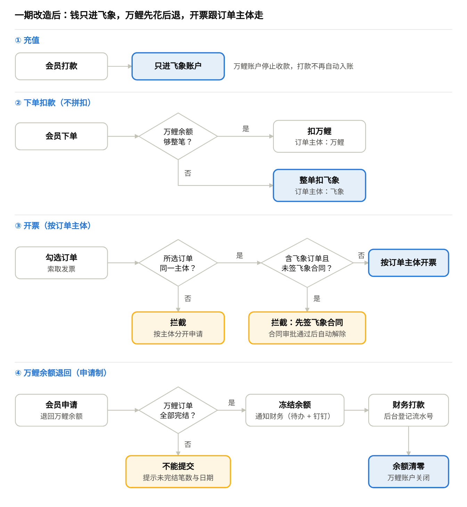

# 预付款升级（一期）改造说明

2026-11-25

一期把商品预付款从万鲤切到飞象：**新钱只进飞象，万鲤余额先花、花不完的退回，开票跟着订单主体走**。2026-12-15 前开发测完，2026-12-31 前灰度上线并全部切换。

## 一、范围与原则

| | 内容 |
| --- | --- |
| 一期做 | 关闭万鲤收款、双账户展示、扣款规则、订单记录预付款主体、按主体开票与拦截、老客户飞象合同审批、万鲤余额退回、内部通知、灰度开关 |
| 一期不做 | 技术服务账户和短信套餐（已属飞象）；结算单与自动开票（暂缓）；代付（维持现状）；注册开户流程（二期） |

四条规则：

1. **不拼扣**：一笔订单只从一个账户扣款。万鲤余额够整笔就扣万鲤，不够就整单扣飞象。
2. **不划转**：万鲤余额不转入飞象，用不完的由会员申请退回。
3. **按订单主体开票**：订单的扣款账户就是它的结算主体和开票主体；一张发票只开一个主体。
4. **飞象开票先签合同**：老客户的飞象新合同走合同审批，审批通过前，飞象主体订单不能开票。

## 二、改造流程

蓝色是改造后的正常结果，橙色是系统拦截。四段各自独立：充值只影响钱进哪里，扣款决定订单主体，开票按订单主体判断，退款只针对万鲤余额。

## 三、需求清单

共 19 项，全部属一期范围。

| 编号 | 模块 | 功能点 | 端 | 验收标准 |
| --- | --- | --- | --- | --- |
| Z1 | 资金 | 关闭万鲤对公账户收款，停止自动认账 | 资金 / 后台 | 上线后向万鲤账户打款不自动入账；1 分钱验证通过 |
| Z2 | 资金 | 新充值只进飞象 | 会员端 · 充值页 | 汇款认账、在线充值全部入飞象账户（现有银行已属飞象，只需确认没有万鲤入口） |
| Z3 | 账户 | 双账户余额展示 | 会员端 · 账户管理 | 商品结算账户显示飞象、万鲤两个余额；万鲤标「优先使用」并常驻退款说明；万鲤退回后只剩飞象 |
| Z4 | 扣款 | 先扣万鲤、不拼扣 | 后台 | 万鲤余额 ≥ 订单金额扣万鲤，否则整单扣飞象；万鲤已申请退回后只扣飞象 |
| Z5 | 扣款 | 订单记录预付款主体 | 后台 | 每笔订单写入扣款账户（= 结算主体 = 开票主体）；上线前历史订单记为万鲤 |
| Z6 | 扣款 | 展示扣款账户 | 会员端 · 账户明细 / 交易明细 / 订单详情 | 增加「扣款账户」字段 |
| K1 | 开票 | 可开票列表加结算主体 | 会员端 · 发票管理 | 增加「结算主体」列和筛选 |
| K2 | 开票 | 同一次申请只能一个主体 | 会员端 · 发票管理 | 混选时「索取发票」不可点，提示按主体分开申请 |
| K3 | 开票 | 飞象订单开票拦截 | 会员端 · 发票管理 | 选了飞象订单且未签飞象合同：按钮不可点，提示「主体变更需签订新合同」并附客户运营联系方式 |
| K4 | 开票 | 展示开票主体 | 会员端 · 发票第 2 步 / 开票记录 | 显示开票主体 |
| K5 | 开票 | 更新温馨提示 | 会员端 · 发票管理 | 删掉 2024-02-01 的过期说明，改为结算主体说明 |
| H1 | 合同 | 老客户飞象合同走审批 | 运营后台 | 合同审批通过后自动标记「飞象合同已签」，并解除 K3 拦截 |
| H2 | 合同 | 客户详情展示合同状态与双账户余额 | 运营后台 | 客户运营能查到飞象合同是否已签、两个账户余额 |
| T1 | 退款 | 万鲤余额退回申请 | 会员端 · 账户管理 | 提交时校验万鲤订单全部完结；不满足时提示未完结笔数和预计可申请日期 |
| T2 | 退款 | 申请后冻结万鲤余额 | 后台 | 申请提交即冻结，之后下单只扣飞象 |
| T3 | 退款 | 退款申请列表与登记 | 运营后台（财务） | 财务登记打款流水号后，万鲤余额清零、账户关闭、通知会员 |
| N1 | 通知 | 待办 + 钉钉群机器人 | 运营后台 | 飞象合同待审批 → 客户运营；万鲤余额退款申请 → 财务 |
| P1 | 提示 | 充值页迁移提示 | 会员端 · 充值页 | 显示「已切换为飞象，请勿再向万鲤打款」，附合同变更说明和客户运营联系方式 |
| G1 | 灰度 | 灰度开关 | 后台 | 可按客户分批启用以上全部规则 |

## 四、里程碑

| 节点 | 时间 | 完成标准 |
| --- | --- | --- |
| 开发测试完成 | 2026-12-15 前 | 需求清单全部验收通过 |
| 上线前验证 | 上线前 | 选一个万鲤账户会员记录在案；关闭后个人打 1 分钱，确认不再自动入账 |
| 通知老客户 | 上线前 | 客户运营告知打款账户变更、需签飞象合同、万鲤余额退回规则 |
| 灰度上线并全部切换 | 2026-12-31 前 | 全部客户切换完成，万鲤停止收款 |
| 过渡期 | 上线后，直到客户万鲤余额用完或退回 | 两个账户并存；第一批退款要等万鲤订单售后期结束 |

## 五、上线后各角色职责

内部通知统一走「后台待办 + 钉钉群机器人」。

| 角色 | 负责什么 | 日常动作 | 不负责 |
| --- | --- | --- | --- |
| 会员（客户） | 向飞象充值、开票、申请退回万鲤余额 | 只向飞象账户打款；按结算主体分开索取发票；万鲤订单全部完结后提交退回申请；与飞象签新合同 | 不能再向万鲤充值 |
| 销售 | 推动老客户签飞象新合同 | 签约后把合同扫描件上传后台；合同被驳回时按原因修改重传 | 不审核合同 |
| 客户运营 | 老客户的迁移沟通与合同审批 | 上线前通知老客户；处理「飞象合同待审批」待办，按法务标准审核；解答双账户、开票拦截、退款的咨询 | 不操作退款打款 |
| 财务 | 两个主体的对账、开票和万鲤余额退款 | 按万鲤 / 飞象分别对账开票；处理「万鲤余额退款」待办：核对金额、线下打款、后台登记流水号；处理误打到万鲤账户的款项 | 不审核合同 |
| 法务 | 合同审核标准 | 维护合同审核标准；签约主体错误时推动重新签约 | 不逐单审核 |
| 研发 / 技术支持 | 系统规则正确运行 | 监控扣款、主体记录和开票拦截是否正确；管理灰度开关；配合财务处理误打款 | 不处理业务审批 |

## 六、待确认事项

- [ ] 灰度按什么维度分批，第一批名单。
- [ ] 万鲤余额退到哪个账户（建议退到会员认证主体的对公账户）。
- [ ] 「订单完结」和售后期的口径，虚拟卡券类订单是否同样等待。
- [ ] 财务处理退款的时效要求。
- [ ] 误打到万鲤账户的款项能否主动退回。
- [ ] 客户运营、财务各推到哪个钉钉群；页面提示里展示的客户运营联系方式。

完整需求见《会员开通与财务结算改造 需求文档》第五节。
