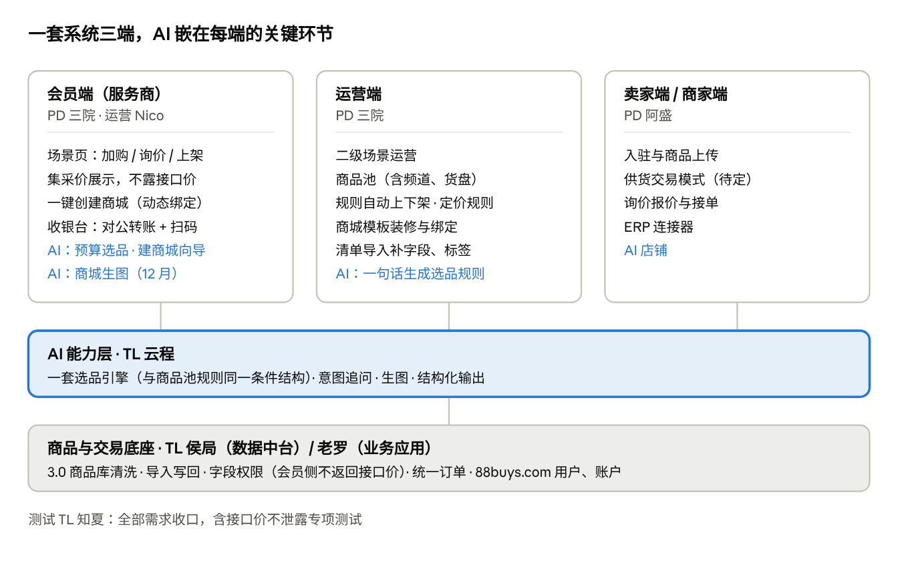
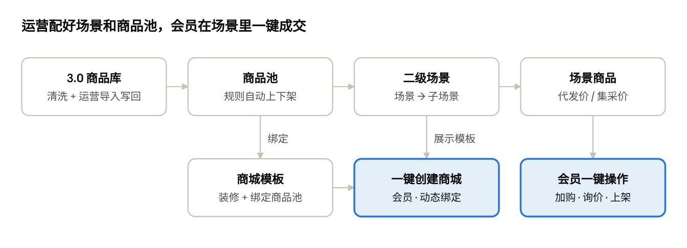
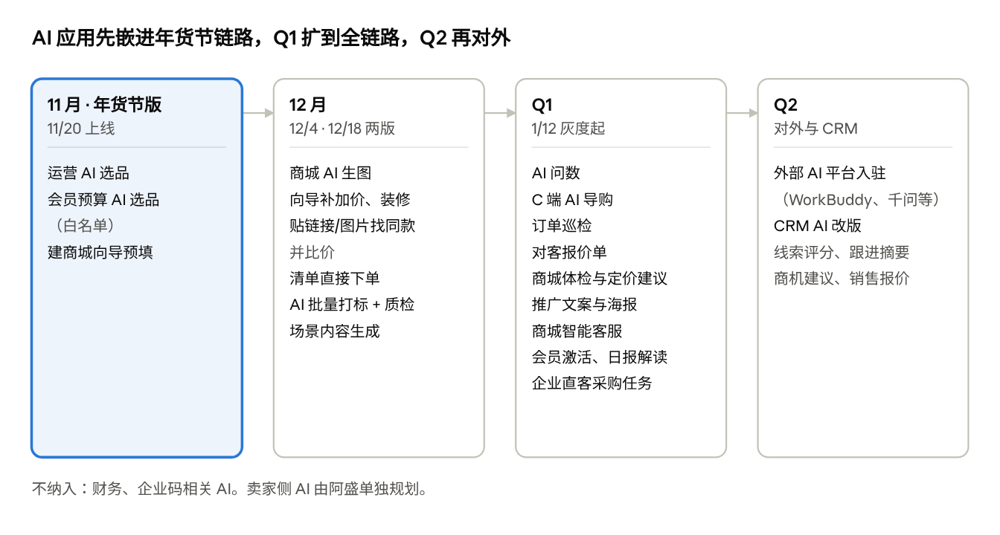
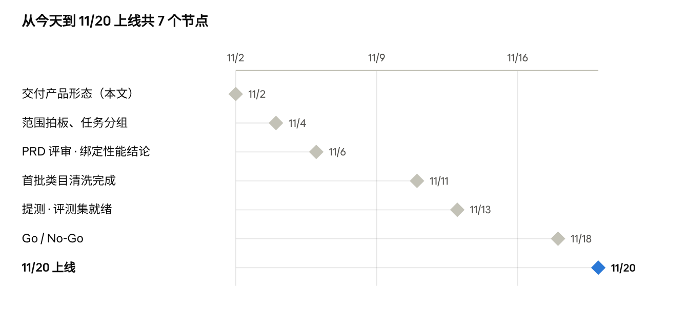

# 采发发产品形态与Q4迭代思路（会员侧）

Nov 2, 2026 · @sanyuan

## 一、定位：一套系统，AI 嵌进存量交易

**采发发 = 88buys.com 这一套系统，帮政企采购服务商选对品、报准价、把单子交付好。** AI 是贯穿会员、卖家、运营三端的能力层，不单独成一个产品。分采通的名字暂不处理。

| 维度             | 10/31 之前                           | 10/31 之后                                                       |
|------------------|--------------------------------------|------------------------------------------------------------------|
| 系统             | 新建独立的采发发 Agent，和老系统并行 | 沿用 88buys.com 老系统的底座（用户、账户、订单），只补差异       |
| AI 形态          | 开放式“新建任务”大对话框             | 嵌在具体环节里：选品、建商城、装修、下单，每处都有规则或手动兜底 |
| 外部 AI 平台入驻 | Q4 推进                              | 移到 Q1–Q2                                                       |
| 重心             | 春节福利应用 + AI 探索               | 场景运营 + 一键成交（年货节）+ AI 选品闭环                       |

用户顺序：服务商（存量会员，圆心）→ 内部运营（AI 先给自己人用）→ 企业直客（行政采购，Q1 验证）→ 商家（供给）。

## 二、产品形态与分工

**三端共用一个商品和交易底座，AI 能力层只做一套，分别嵌进三端。**

产品形态 · 三端 + AI 能力层 + 底座

蓝色字是 AI 应用。选品引擎和商品池规则用同一套条件结构，所以规则选品天然就是 AI 的兜底。

## 三、11 月版本（11/20）：场景运营 + 一键成交

**11/20 交付一条完整链路：运营配场景和商品池，会员在场景里一键加购、询价、上架、创建商城。** 频道和货盘统一用商品池实现。

11 月版本主流程

| 模块              | 内容                                                                   | 研发                   | 优先级 |
|-------------------|------------------------------------------------------------------------|------------------------|--------|
| 3.0 商品库清洗    | 类目、品牌、规格、库存效期、同品关系、价格字段分级；先保年货节相关类目 | 侯局、老罗             | P0     |
| 导入补数据        | 按模板导入字段和标签，校验、预览差异后写回，可按批次回滚               | 老罗、侯局             | P0     |
| 二级场景运营      | 场景、子场景、档期上下线、按权益包可见                                 | 老罗                   | P0     |
| 商品池 + 定价规则 | 规则自动上下架、手动增删和排序、指定会员可见；接口价加价算会员价       | 老罗、侯局             | P0     |
| 场景首页（会员）  | 场景 Tab、子场景、场景商品、场景商城模板                               | 老罗                   | P0     |
| 一键加购 / 上架   | 按来源拆单、预付款扣款；上架时会员选定价基准，按 SKU ID 同品替换       | 老罗                   | P0     |
| 一键询价 + 集采价 | 提交询价单 → 线下跟进 → 回写状态；报价转订单 12 月                     | 老罗（供给侧配合阿盛） | P0     |
| 商城模板装修      | 运营装修模板并绑定商品池                                               | 老罗                   | P0     |
| 一键创建商城      | 动态绑定商品池；同步性能方案待定                                       | 老罗                   | P1     |
| 收银台 + 扫码付   | 对公转账沿用，新增收银台、扫码付、代付确认                             | 老罗                   | P0     |
| 埋点              | 场景浏览、加购、询价、上架、建商城、AI 选品全链路                      | 老罗                   | P0     |

工时不够时的裁剪顺序：先顺延一键创建商城，再把询价工单后台改用线下表单承接。

## 四、11 月版本的 AI 应用

**11 月的 AI 都挂在上面这条链路上，共用一套选品引擎；应用 1、2 和应用 4 的预填部分随 11/20 上线，应用 3 放到 12/4。**

| AI 应用            | 嵌在哪里         | AI 做什么                                                        | 兜底                | 版本         |
|--------------------|------------------|------------------------------------------------------------------|---------------------|--------------|
| 1 运营 AI 选品     | 商品池规则配置   | 一句话转成规则条件，预览命中数和样品后存为商品池规则             | 手动配规则          | 11/20        |
| 2 会员预算 AI 选品 | 场景页、选品页   | 按预算、人数、场景、偏好选品，缺信息追问；结果可加购、上架、询价 | 场景商品 + 手动筛选 | 11/20 白名单 |
| 4 建商城向导 AI    | 创建商城五步向导 | 一句话预填模板、名称和短信签名、选品；加价建议和装修 12/4 补     | 手动向导            | 11/20 部分   |
| 3 商城 AI 生图     | 装修图片组件     | 按商城名、logo、主题、主色生成 banner 和氛围图                   | 模板原图或手动上传  | 12/4         |

共用规则：

- **一套条件结构**：AI 选品和商品池规则都用来源、类目、品牌、价格带、利润率、库存、标签这套条件。

- **会员侧只在可见商品池里选**：运营控制货盘，数据都是清洗过的。

- **输出结构化数据**：条件、商品卡、向导预填值都按固定格式返回，前端直接渲染成可编辑的表单或卡片。

- **动态绑定与生图分层**：页面结构和商品池绑定跟随模板同步；商城名、logo、主色、banner 归会员私有，AI 生图只生成这一层。

- **生图边界**：只生成氛围图，不生成商品实物图和他人 logo；结果过内容审核；用积分或配额控制成本。

- **短信签名**：AI 只给建议，仍走报备审核。

- **评测**：约 100 条评测 case（Nico 和商品运营收集），知夏验收；接口价泄露数必须为 0。

## 五、AI 应用路线图

**11 月先把 AI 嵌进年货节链路，12 月补齐选品和商城的 AI，Q1 扩到订单、数据、营销全链路，Q2 再对外入驻并做 CRM AI 改版。**

AI 应用路线图 · 11 月到 Q2

排序依据：使用频率高、数据已经就绪、不依赖新底座的先做。贴链接找同款并比价对应 10/31 会上定的价格壁垒，放在 12 月。

## 六、关键规则

**价格可见性：会员侧任何入口都不展示接口价，在数据层拦截。**

| 商品来源             | 会员看到的价格              | 可做的操作                             |
|----------------------|-----------------------------|----------------------------------------|
| 京东、猫超等接口货源 | 代发价（会员价）、市场价    | 加购、上架；集采只能询价，不显示集采价 |
| 平台精选（采销定价） | 代发价 + 集采价（含起订量） | 加购、上架、集采询价                   |

- 会员侧 AI 工具只返回白名单字段（会员价、市场价、市场价利润率、库存、时效），“毛利”统一按市场价利润率解释。运营侧可看全部价格口径。

**支付：对公转账沿用老系统，新增收银台和扫码付。**

- 只有已认证的企业账户能下单；个人扫码只能是“替企业代付”，弹代付确认并记录付款人和协议版本。

- 发票只开给认证企业；退款原路退回付款账户。

- 扫码充值预付款是否设单笔上限，待财务确认；先拉出现有个人充值的客户和金额。

**一键创建商城做动态绑定，同步性能待评估。** 建议会员商城只保存“引用商品池 + 会员覆盖项（加价、隐藏、排序）”，展示时再合并，商品池变更走增量事件。老罗、侯局 11/6 前给结论，否则 11 月先用快照。

## 七、分工、节点与待拍板

**最晚周三 11/4 拍板范围，11/20 运营侧全量、会员侧 AI 对白名单上线。**

| 角色               | 人   | 11 月版本负责                                  |
|--------------------|------|------------------------------------------------|
| 会员侧 / 买家侧 PD | 三院 | 会员端和运营端 PRD、价格展示规则、收银台       |
| 卖家侧 PD          | 阿盛 | 卖家端、交易模式、询价供给侧                   |
| 业务应用 TL        | 老罗 | 会员端、运营后台页面，导入，动态绑定方案       |
| 数据中台 TL        | 侯局 | 清洗标准与执行、字段权限、写回、对 AI 开放接口 |
| AI 底层 TL         | 云程 | 选品引擎、意图追问、生图接入、评测指标         |
| 测试 TL            | 知夏 | 全部需求收口、接口价泄露专项、评测验收         |
| 会员侧产品运营     | Nico | 白名单、评测 case、标签字典、培训宣发          |

11 月版本节点

待拍板：

- [ ] 11 月范围和裁剪顺序（加入 AI 后研发重新评估工时）

- [ ] 卖家侧交易模式：平台供货还是入驻分账，决定会员端支付流向和开票主体

- [ ] 一键创建商城动态绑定的性能方案（11/6）

- [ ] 扫码充值是否设上限、代付协议文本（财务、法务）

- [ ] 3.0 清洗首批类目范围和标签字典
