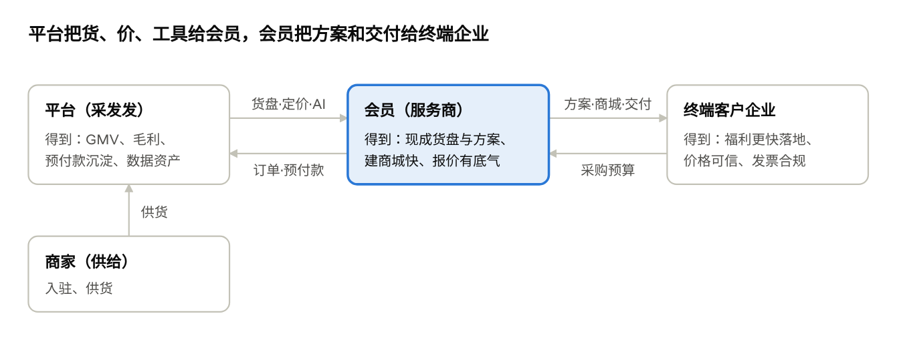
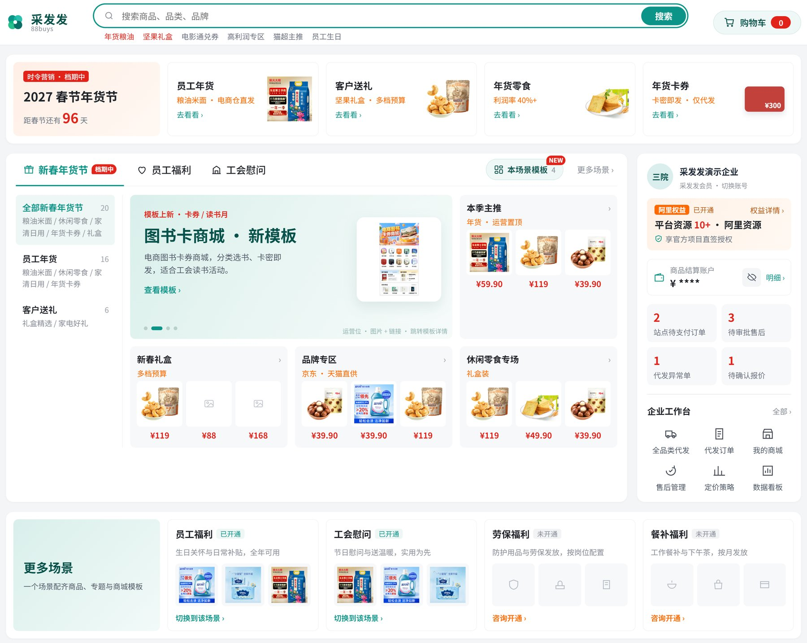
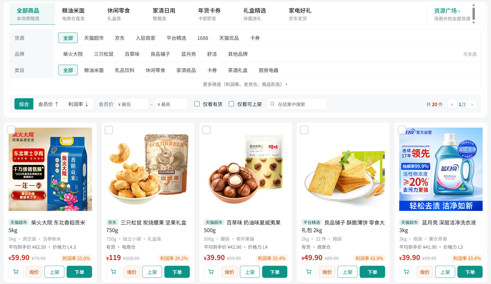
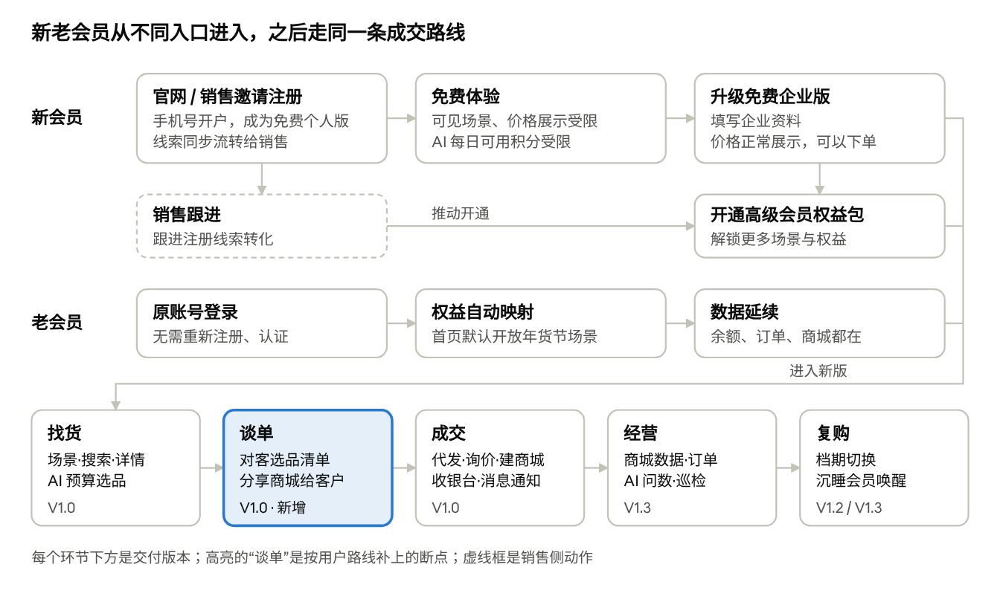
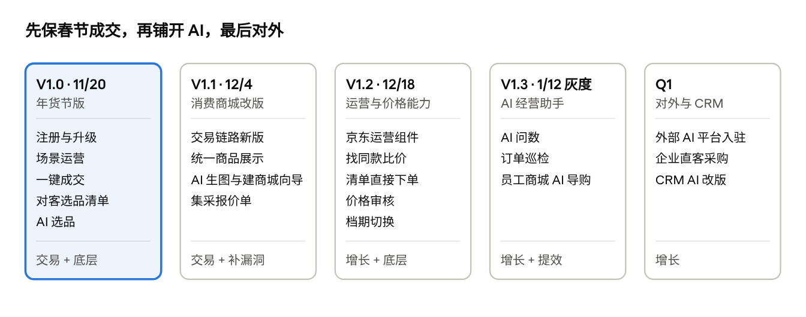

# 采发发产品形态与版本规划（汇报稿）

Nov 2, 2026 · @sanyuan

## 一、结论

**采发发不再另起一套 AI-native 系统，而是以 88buys.com 的存量交易为圆心，把 AI 一步步嵌进会员端和新的运营管理后台。** 第一个落点是 11/20 年货节版：注册升级、场景运营加一键成交，AI 选品同时给运营和会员用。

三条迭代原则：

1.  **围绕确定性业务**：每个版本都答“对平台、会员、终端企业各有什么业务价值”，并标明解决的是交易、增长、底层还是补漏洞。

2.  **该用 AI 用 AI，该用工程用工程**：AI 只做选品闭环及其周边，每个 AI 功能都有规则或手动兜底。

3.  **底座先行**：3.0 商品库清洗、商品池规则、定价规则先做好，2~3 个月内商品和订单可被 Agent 调用。

## 二、产品形态

**运营在新的运营管理后台配好场景、商品池和商城模板，会员在场景里一键成交，AI 嵌在每个环节。**

价值链 · 平台、会员、终端企业、商家

| 层               | 内容                                                                                                                                                                                                                       |
|------------------|----------------------------------------------------------------------------------------------------------------------------------------------------------------------------------------------------------------------------|
| 新运营管理后台   | 按角色用 AI：商品运营（AI 选品、AI 查商品和订单、商品池效果与 GMV）；场景运营（配二级场景、装修商城模板，AI 生成场景头图和卖点）；会员运营（AI 找出沉睡会员并生成触达话术）；管理员（AI 问数看全平台、经营日报与异常解读） |
| 会员端（服务商） | 场景首页（春节年货、员工福利、工会慰问等二级场景）；场景商品（代发价、集采价、市场价，AI 按预算和人数选品）；一键加购 / 询价 / 上架 / 建商城；收银台（对公转账、扫码付）                                                   |
| 商品与 AI 底座   | 3.0 商品库清洗 + 运营导入补字段标签；统一选品引擎（AI 选品与商品池规则用同一套条件）；字段权限、统一订单、对 AI 开放接口                                                                                                   |

会员侧任何入口都不展示接口价。资金流：会员付款给平台，平台再与入驻商家结算。卖家端由卖家侧另行规划。

**会员端长这样（11/20 年货节版示意，Demo 演示数据）：**

① 场景首页：运营配好的二级场景和货盘，会员开通的场景一屏可见。

② 场景商品：会员价、市场价、利润率一目了然，加购、询价、上架、下单一键完成；不展示接口价。

## 三、会员用户路线图

**新会员走“官网或销售邀请链接手机号开户免费个人版 → 免费体验 → 升级免费企业版”，注册线索同步流转给销售，由销售跟进开通高级会员权益包，老会员用原账号直接进入、权益和数据自动延续；进入后两类会员走同一条“找货 → 谈单 → 成交 → 经营 → 复购”的路线。**

会员用户路线图 · 新老会员

按这条路线走一遍，原规划有几处断点，已补进 V1.0：

- **谈单**：会员拿到货盘后没有可以给客户的东西。补上对客选品清单（只显示对客价）和分享商城给客户。

- **成交**：集采只到“提交询价”，补上报价回复通知；商品池自动下架会影响会员商城，补上消息通知。

- **进入**：新用户从官网（市场做 SEO 推广）或销售邀请链接进入，输入手机号即开户为免费个人版，注册线索自动流转给销售，由销售跟进转化为高级会员权益包；个人版的可见场景、价格展示和 AI 每日可用积分受限，填写资料升级为免费企业版后价格正常展示、可以下单。AI 积分暂不开放购买，Q1 之后再考虑。老会员的权益自动映射。

- **复购**：春节档结束后的场景和商城切换，放在 V1.2。

## 四、版本总览

**五个版本：12 月底前保春节成交，1/12 灰度 AI 经营助手，Q1 春节后对外与 CRM。** 主线是选品与价格能力：11/20 AI 选品（运营 + 会员）→ 12/18 贴链接找同款比价 → 之后对客报价单。每栏底部是该版本主要解决的问题类型。

版本路线图 · 11/20 到 Q1

## 五、V1.0 年货节版（11/20）：场景运营 + 一键成交 + AI 选品

**解决的问题：交易 + 底层。让会员在春节高峰前（12 月中旬至 1 月下旬）拿现成场景货盘去谈单、建商城、下单。**

核心功能：

- **会员进入**：自主注册免费个人版（可见场景、价格展示、AI 每日积分受限），填写资料升级免费企业版；注册线索流转销售，跟进开通高级会员权益包；老会员原账号登录、权益自动映射。

- **新运营管理后台**：二级场景运营；商品池按规则自动上下架（频道、货盘统一用商品池）；定价规则自动算会员价；商城模板装修；清单导入补字段和标签；权益包配置。

- **会员端**：场景首页一键加购、一键询价、一键上架到商城、一键创建商城；精选商品展示集采价；对客选品清单和分享商城（只显示对客价）；集采询价单（报价先走线下或老系统猫超集采报价）和消息通知；收银台和扫码付。

- **AI**：运营 AI 选品（一句话生成商品池规则）；会员按预算 AI 选品（白名单）。

- **底座**：3.0 商品库清洗（先保年货节类目），可被 AI 调用；全链路埋点。

| 对谁           | 业务价值                                                                                                                                                     | 对应功能                                                           |
|----------------|--------------------------------------------------------------------------------------------------------------------------------------------------------------|--------------------------------------------------------------------|
| 平台           | 拿下春节档 GMV、预付款充值和新会员线索；选品和定价从人工改为规则，换货盘快、毛利可控、会员价可解释；集采询价带来大单线索；商品数据开始变成可被 AI 调用的资产 | 注册与线索流转、商品池规则、定价规则、询价、清洗导入、运营 AI 选品 |
| 会员（服务商） | 不用自己组货，拿场景货盘和对客选品清单直接谈春节单；一键建商城、上架，商城跟着商品池自动更新；按预算和人数用 AI 出选品清单；大单能拿集采价                   | 场景首页、一键操作、对客选品清单、会员 AI 选品、集采价             |
| 终端客户企业   | 春节福利方案和员工商城更快上线；商品来自京东、猫超等可信渠道，有市场价参照；支付合规，发票只开给企业                                                         | 一键建商城、收银台、代付确认                                       |

**衡量指标**：春节档 GMV、预付款充值、场景转化（浏览 → 加购 / 上架）、新建商城数、询价单数、AI 选品采纳率。注册和升级企业版人数。具体目标值待业务给出。

## 六、12 月两版：商城体验 + 价格能力

**12 月两版分别解决“员工商城好不好用”和“价格可不可信”，正好赶在春节下单高峰前。**

### V1.1 消费商城改版（12/4）

解决的问题：交易 + 补漏洞。

核心功能：购物车、订单、支付、售后新版（对标天猫超市）；各货源商品在会员商城统一展示；已有商城灰度切换；商城 AI 生图；建商城向导补上加价建议、装修和 AI 一句话预填；集采报价单（运营生成推送、会员在线确认、转集采订单）；对客选品分享页、短信通知。

| 对谁         | 业务价值                                                                                               |
|--------------|--------------------------------------------------------------------------------------------------------|
| 平台         | 各货源在会员商城统一展示，商城转化提升；集采大单线上成单，可统计询价转化；交易链路的客诉和人工处理减少 |
| 会员         | 商城看起来专业，终端客户更愿意采纳；建商城、装修、换图不用自己做设计；报价在线确认即可下单             |
| 终端客户企业 | 员工下单和售后更顺；商城带企业自己的名称、logo 和主题图                                                |

### V1.2 运营与价格能力（12/18）

解决的问题：增长 + 底层。

核心功能：京东装修组件（企业热卖、超级大牌等 6 个）、京东评价和相似品；精选商品价格审核（市场价虚高拦截）；AI 贴链接或图片找同款并比价；AI 清单直接下单；报价转订单；档期切换（运营换场景和商品池，会员已有商城一键换季）；AI 批量打标和商品质检；场景内容生成。

| 对谁         | 业务价值                                                                                                             |
|--------------|----------------------------------------------------------------------------------------------------------------------|
| 平台         | 价格可信成为卖点（即会上定的价格壁垒）；京东资源价值挖出来；商品数据质量提升，AI 选品更准                            |
| 会员         | 贴一个链接就知道平台上有没有更便宜的同款，报价有根据；客户清单上传即可下单，省掉导单、拆单的人工；春节后商城平滑换季 |
| 终端客户企业 | 价格透明可比对，有评价可参考；采购清单交付更快                                                                       |

**衡量指标**：商城下单转化率（改版前后对比）、交易类客诉数、找同款使用次数和转单率、清单下单占代发单比例。

## 七、V1.3 AI 经营助手（1/12 灰度）

**解决的问题：增长 + 提效。春节后把 AI 从“选品”扩到数据、订单和员工商城，让会员用得更深。**

核心功能：

- **会员经营**：AI 问数；订单巡检（缺货、发货超时、物流停滞主动提醒，并给出换同品等处理建议）；商城体检与定价建议；推广文案与海报。之后再做对客报价单。

- **员工商城**：AI 导购（按剩余额度推荐，先在春节模板商城灰度）；商城智能客服。

- **新运营管理后台**：会员运营找出沉睡会员并生成触达话术；管理员看经营日报与异常解读。

- **底座**：商品和订单可被 Agent 调用。

| 对谁         | 业务价值                                                                                       |
|--------------|------------------------------------------------------------------------------------------------|
| 平台         | 会员活跃和留存提升，采发发从“下单工具”变成“经营工具”；AI 积分或订阅收费有了使用基础            |
| 会员         | 不用看报表，问一句就知道经营情况；订单问题提前发现；推广内容和报价单自动生成；商城客服压力下降 |
| 终端客户企业 | 员工在商城里有导购、有客服，福利额度用得满                                                     |

**衡量指标**：会员月活和复购、AI 功能周活、员工商城下单转化。

## 八、Q1（春节后）：对外与 CRM

**解决的问题：增长。春节后开始把能力开放到外部 AI 平台获客、验证企业直客，并把会员的客户管理改成 AI 方式。**

核心功能：入驻 WorkBuddy、千问等外部 AI 平台（选品、下单、查订单通过 MCP 开放）；企业直客“新建采购任务”（面向企业行政采购，说需求 → 选品比价 → 下单）；CRM AI 改版（线索评分、跟进摘要、商机建议、销售报价）。

| 对谁         | 业务价值                                                                                               |
|--------------|--------------------------------------------------------------------------------------------------------|
| 平台         | 多一个获客渠道，借外部平台流量反向引流；新增企业直客客群；采发发成为政企采购场景里能被 AI 调用的供给方 |
| 会员         | 客户和商机跟进有 AI 帮忙整理和提醒，销售人均能跟更多客户                                               |
| 终端客户企业 | 说需求就能采购：在采发发或常用的 AI 工具里比价下单                                                     |

不纳入本期规划：财务、企业码相关 AI。卖家端由卖家侧另行规划。

## 九、请徐总拍板

- [ ] **认可产品形态与版本节奏**：11/20 版本带上 AI 选品；工时不够时，先顺延一键创建商城，保场景运营和一键成交。

- [ ] **春节档目标**：请给出 GMV 和预付款充值的目标值。产品侧将按这个目标反推各版本的验收标准。
