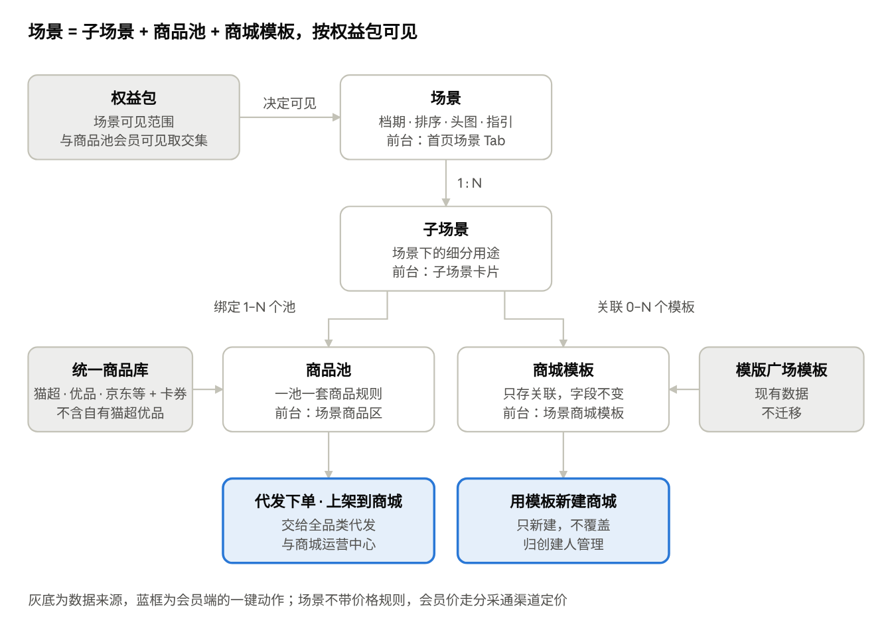

# 分采通 V1.0 场景运营产品需求

Oct 30, 2026 · @sanyuan

## 背景与目标

场景运营把分采通前台从「货架 + 模板库」改成「按场景给方案」：运营在统一商品库上按场景配好商品池和商城模板，服务商打开首页就能拿到一套春节方案，并直接代发、上架或开商城。V1.0 随年货节版 2026-11-20 上线。

现在的问题：

- 首页是 Banner + 资源中心 +「大家都在用」8 个类目，只给货不给方案；服务商要自己在 50 多万个 SKU 里挑春节货。

- 货盘只有自有猫超 / 自有优品；京东、平台精选等货源散在「其他代发」里，和首页、资源广场不互通。

- 模版广场是独立页面，模板和货盘脱节，开商城后还要重新选品。

- 运营换档期（春节 → 端午）要靠研发改页面。

| 目标                         | 衡量方式                                                        |
|------------------------------|-----------------------------------------------------------------|
| 服务商进首页就能拿到春节方案 | 场景首页活跃会员占比、场景商品勾选率                            |
| 选品直接变成交易             | 来自场景的代发单量与金额、上架商品数、用模板新建商城数          |
| 运营自己换档期和货盘         | 场景上下线、换池不需要发版                                      |
| 为 AI 留接口                 | 场景、商品池、商品卡按结构化数据设计，V1.3 之后可被对话直接调用 |

具体目标值待与运营商定。

## 用户与场景

场景运营有两类用户：在会员端用场景的服务商，和在运营管理后台配场景的平台运营。

| 角色         | 我要……                                                           | 以便……                             |
|--------------|------------------------------------------------------------------|------------------------------------|
| 服务商业务员 | 打开首页就看到当前档期（春节）的场景和子场景                     | 不用自己在全量货盘里找货           |
| 服务商业务员 | 在子场景里按价格、库存、发货仓挑商品并看到我的成本和市场价利润率 | 快速判断能不能卖、有没有利润       |
| 服务商业务员 | 勾选商品后一键代发给客户的多个收件人                             | 把春节年货直接发到客户员工手里     |
| 服务商业务员 | 勾选商品后一键上架到我管理的商城                                 | 让客户员工在商城里自选兑换         |
| 服务商业务员 | 用场景里的商城模板一键新建商城                                   | 当天就能给客户开出春节商城         |
| 服务商管理员 | 控制哪些子账号能代发、上架、新建商城                             | 管住钱和商城                       |
| 商品运营     | 为子场景绑定商品池，商品按规则自动上下架                         | 货盘不靠手工维护，无货商品自动下掉 |
| 内容运营     | 配场景、档期、场景说明和关联模板，并控制上下线                   | 按节点换场景，不依赖研发           |
| 客户运营     | 按权益包控制哪些服务商看得到哪些场景                             | 区分付费权益，推动升级             |
| 运营负责人   | 看每个场景的浏览、代发、上架、开商城数据                         | 年货节中途调货盘、节后复盘         |

## 本期范围

| 本期做                                                                            | 本期不做（去向）                                       |
|-----------------------------------------------------------------------------------|--------------------------------------------------------|
| 运营后台：场景 / 子场景管理、子场景绑定商品池、关联商城模板、可见权益包、场景数据 | 场景加价 / 场景专属会员价（节后看数据再定）            |
| 会员端：首页改为场景页、场景商品卡、一键动作栏、场景商城模板与用模板新建商城      | 用模板覆盖已有商城的装修（后续）                       |
| 资源广场：增加平台货源和卡券、按场景筛选，与首页共用商品卡和一键动作              | 场景内 AI 对话与推荐（V1.3 之后），本期只留位置        |
| 模版广场下线并重定向，模板详情页保留                                              | 模板内容迁入运营后台、模板专题改绑商品池（后续）       |
| 按权益包控制场景可见                                                              | 上架商品与场景商品池动态同步（待确认，默认一次性上架） |
| 首批 3 个场景上线：春节年货、员工福利、工会慰问                                   | 企业码、猫超集采、礼包：不进场景                       |

代发执行（批量下单、扣款、拆单、售后）属于「全品类代发」，上架定价属于「定价策略兼容」，各自单独写需求；本文只写场景侧入口和交接。

## 核心概念与对象关系

场景是运营配置的最小发布单元：一个场景有多个子场景，子场景绑定商品池和商城模板；权益包决定谁看得到。

场景运营对象关系

| 对象     | 含义                                                                                                                             | 例子                         |
|----------|----------------------------------------------------------------------------------------------------------------------------------|------------------------------|
| 场景     | 档期或主题，首页一级 Tab                                                                                                         | 春节年货、员工福利、工会慰问 |
| 子场景   | 场景下的细分用途，决定商品和模板                                                                                                 | 员工年货、客户送礼           |
| 商品池   | 来自统一商品库（天猫超市、天猫优品、京东、1688、平台精选、入驻商家、卡券），一池一套商品规则，自动上下架，带排序值和指定会员可见 | 春节粮油池、春节零食池       |
| 商城模板 | 模版广场里的现有整套商城方案（微页面 + 特色专题），字段沿用老系统                                                                | 春节员工福利商城             |
| 权益包   | 会员已开通的权益组合，控制场景可见                                                                                               | 企业控制台 · 我的权益        |

## 运营后台需求

分采通在运营管理后台作为一个独立渠道接入：场景列表独立配置，商品池复用现有能力，定价走分采通渠道规则。新增菜单：分采通 → 场景管理 / 场景数据。

### 1. 场景列表

| 区域     | 内容                                                                                                                 |
|----------|----------------------------------------------------------------------------------------------------------------------|
| 筛选     | 场景名称、状态、档期范围、可见权益包                                                                                 |
| 列表字段 | 场景名称、档期（开始–结束）、状态、排序值、可见权益包、子场景数、关联模板数、商品数（有货 / 全部）、更新人、更新时间 |
| 操作     | 新建、编辑、预览（按指定权益包视角看会员端效果）、上线、下线、复制、删除（仅草稿）                                   |
| 状态     | 草稿 → 待生效（已上线但未到档期）→ 生效中 → 已结束（过档期自动）；任何时候可手动下线                                 |

### 2. 场景编辑

| 分组     | 字段                                           | 规则                                           |
|----------|------------------------------------------------|------------------------------------------------|
| 基本信息 | 场景名称、副标题、场景说明、适合客户标签、头图 | 名称必填，用作首页 Tab 名；字数上限交设计定    |
| 档期     | 开始时间、结束时间、是否常驻                   | 常驻场景不设结束时间；到期自动结束             |
| 可见范围 | 全部会员 / 指定权益包（多选）                  | 默认指定权益包；与商品池「指定会员可见」取交集 |
| 排序     | 排序值                                         | 越小越靠前，决定 Tab 顺序和默认场景            |
| 热销指引 | 文案若干条（如「500 元预算适合哪种商城」）     | 本期仅展示，后续作为 AI 提示词                 |
| 子场景   | 名称、图标、说明、排序值、绑定商品池、关联模板 | 至少 1 个子场景才能上线                        |

### 3. 子场景绑定商品池

- 从现有商品池中选择，一个子场景可绑多个池；前台按池分组展示，组名默认取池名、可改，组间可排序。

- 商品池沿用现有规则：每个池一套商品规则，所有货源都过这套规则并自动上下架；规则可按平台利润率筛选（仅内部可见）；池内手动加入的商品带排序值。

- 商品池增加「使用渠道」标注（发发福利 / 分采通 / 共用），绑定时只列可用于分采通的池。

- 绑定时显示池内商品数、有货数、货源分布，可跳转到商品池详情。

- 自有猫超 / 自有优品不入池（它们来自服务商自己的账号）。

### 4. 关联商城模板

- 从模版广场的现有模板里选，只存关联关系；模板的字段和内容沿用老系统，本次不做变更。

- 一个子场景可关联 0 至多个模板，可排序。

- 模板被下线或删除时，前台自动隐藏，后台标红提示。

### 5. 场景数据

按场景 / 子场景、日期范围统计，支持导出：浏览会员数、商品点击数、勾选商品数、代发批次数 / 单量 / 金额、上架商品数 / 上架会员数、模板预览数、新建商城数；另列商品维度 Top 榜（按代发单量、上架次数）。优先级 P1。

### 6. 操作日志

场景和子场景的新增、编辑、上下线、换池、换模板都记录操作人、时间和变更前后内容。

## 会员端需求

首页改为场景页；资源广场保留为全量货盘。两边共用同一套商品卡和一键动作栏。

### 1. 首页结构

| 顺序 | 模块                                 | 变化                     | 内容与交互                                                         |
|------|--------------------------------------|--------------------------|--------------------------------------------------------------------|
| 1    | 搜索栏                               | 保留                     | 搜当前场景内商品；位置预留给 AI 对话入口                           |
| 2    | 公告 Banner                          | 保留                     | 如出版物资质提醒                                                   |
| 3    | 会员卡 + 订单角标 + 快捷入口         | 保留                     | 快捷入口加「全品类代发」，企业码从资源中心挪到这里                 |
| 4    | 场景 Tab                             | 新增                     | 只显示当前会员有权益的、生效中的场景；按排序值排列；默认选中第一个 |
| 5    | 场景头部                             | 新增                     | 头图、场景说明、适合客户、档期、热销指引                           |
| 6    | 子场景卡片                           | 新增                     | 横向卡片，切换后下方商品和模板联动；默认第一个                     |
| 7    | 场景商品                             | 新增，替代「大家都在用」 | 见下文 2–3                                                         |
| 8    | 场景商城模板                         | 新增，替代模版广场       | 见下文 5                                                           |
| 9    | 一键动作栏                           | 新增                     | 勾选商品后吸底出现，见下文 4                                       |
| —    | 资源中心（猫超 / 优品 / 企业码 Tab） | 下线                     | 货源入口挪到资源广场                                               |

### 2. 场景商品区

- 按子场景绑定的商品池分组展示，组内按池的排序值排。

- 筛选：会员价区间、货源（天猫超市 / 天猫优品 / 京东 / 1688 / 平台精选 / 入驻商家 / 卡券）、发货仓（电商仓 / 商家仓）、市场价利润率区间、仅看可上架。货源选中天猫超市时，增加价格力标签和猫超商品标签筛选。无货商品由商品池规则自动下掉，前台不提供库存筛选。

- 排序：综合（池排序值）、会员价升 / 降、市场价利润率。

- 视图：卡片 / 列表，沿用资源广场习惯。

- 全选本组、全选本页。

### 3. 商品卡

| 字段             | 适用货源           | 说明                                                                       |
|------------------|--------------------|----------------------------------------------------------------------------|
| 主图、名称、规格 | 全部               | 多规格显示规格数，点开选规格                                               |
| 货源标           | 全部               | 天猫超市 / 天猫优品 / 京东 / 1688 / 平台精选 / 入驻商家 / 卡券             |
| 会员价           | 全部               | 分采通渠道会员价，价格旁标注「会员价」，即代发扣款价                       |
| 市场价           | 全部               | 划线价                                                                     |
| 市场价利润率     | 全部               | (市场价 − 会员价) ÷ 市场价；不显示平台利润率和接口价                       |
| 库存状态         | 全部               | 有货 / 库存紧张（库存 \< 50）                                              |
| 发货仓           | 全部               | 电商仓（京东、天猫超市）/ 商家仓                                           |
| 平均到手价       | 天猫超市           | 部分商品有，T+1 更新，有则显示                                             |
| 价格力标签       | 天猫超市           | 天猫超市给出的 L1–L4.5 标签，平台只展示                                    |
| 猫超商品标签     | 天猫超市           | 主推商品、时令节日、臻选商品、支持七无、猫超仓发货等，按供应链返回自动打标 |
| 好评率           | 京东               | V1.2 接入京东评价组件后显示；本期在卡片上预留位置                          |
| 同品替换提示     | 天猫超市、天猫优品 | 会员自有猫超 / 优品有同 SKU 时显示「下单与上架将使用自有同品」             |
| 操作             | 全部               | 勾选、查看详情（抽屉）、单品代发、单品上架（卡券无此按钮）                 |

卡片按货源显示特殊字段：没有的字段不占位，不显示「-」。

### 4. 一键动作栏

勾选至少 1 件商品后吸底出现：已选 N 件 · 加入已选商品 · 代发下单 · 上架到商城 · 清空。

| 动作         | 交互                                                                                                                                                                    | 交接给                  |
|--------------|-------------------------------------------------------------------------------------------------------------------------------------------------------------------------|-------------------------|
| 加入已选商品 | 加入后 toast 提示，可跳往已选商品                                                                                                                                       | 全品类代发 · 已选商品   |
| 代发下单     | 带着勾选商品进入批量下单页填收件人；本页不生成订单                                                                                                                      | 全品类代发 · 批量下单   |
| 上架到商城   | 弹窗：选商城（只列我管理的、未过期的）→ 选定价方式（加价规则或定价策略，基准会员价 / 平均到手价 / 市场价）→ 确认 → 生成上架任务，结果进导入导出；含卡券时提示卡券将跳过 | 商城运营中心 · 我的商品 |
| 清空         | 清除全部勾选                                                                                                                                                            | —                       |

- 勾选在切换子场景、翻页时保留，切换场景 Tab 时保留并提示；单次勾选上限待定。

- 没有对应权限点的账号，按钮置灰并提示「请联系管理员开通」。

### 5. 场景商城模板

- 模板卡片和详情页的字段沿用老系统模版广场，本次不做变更。

- 「预览」打开现有模板详情页。

- 「用此模板新建商城」弹窗：商城名称（默认模板名）、商城类型（取模板的，不可改）、定价方式 → 用户确认后创建；只新建、套用模板装修和内容、归创建人管理；完成后跳到我的商城并高亮新商城。

- 我的商城卡片增加「来自场景模板」标识。

- 子场景没有关联模板时，整个模块不显示。

### 6. 资源广场

| 区域     | 改动                                                                                                                                                                                            |
|----------|-------------------------------------------------------------------------------------------------------------------------------------------------------------------------------------------------|
| 货源 Tab | 自有猫超 · 自有优品 · 平台货源（二级：天猫超市 / 天猫优品 / 京东 / 1688 / 平台精选 / 入驻商家）· 卡券。开通了自有猫超的会员不显示平台天猫超市，开通了自有优品的不显示平台天猫优品，两者分别判断 |
| 筛选     | 保留现有筛选；新增「按场景」；平均到手价、价格力标签和猫超商品标签只在天猫超市货源（自有猫超、平台天猫超市）显示                                                                                |
| 成本列   | 自有猫超 / 自有优品显示接口价；平台货源和卡券显示会员价                                                                                                                                         |
| 商品卡   | 与首页共用，特殊字段按货源显示（见上文商品卡）                                                                                                                                                  |
| 动作     | 与首页共用一键动作栏；「挑选入方案」是否保留待确认                                                                                                                                              |
| 老入口   | 「其他代发 · 代发选品」重定向到平台货源 Tab                                                                                                                                                     |

### 7. 权益包可见与空状态

- 企业控制台「我的权益」增加「可见场景」展示。

- 一个场景都看不到时，首页场景区显示空状态：去资源广场选品 + 联系客服开通场景权益。

- 子场景商品池全部为空时，该子场景不显示；场景下没有可显示的子场景时，该场景 Tab 不显示。

### 8. 模版广场下线

顶部导航去掉「模版广场」；/shop/template 重定向到首页并提示「模板已按场景整理到首页」；模板详情页保留，供场景链接。

## 业务规则

| 规则             | 内容                                                                                                                                                                                                                          |
|------------------|-------------------------------------------------------------------------------------------------------------------------------------------------------------------------------------------------------------------------------|
| 价格展示         | 平台货源和卡券显示分采通渠道会员价；不显示接口价、结算价和平台利润率；只显示市场价利润率；每个价格都标清口径。天猫超市商品另显示平均到手价（有则显示）、价格力标签和猫超商品标签；京东商品接入评价组件后显示好评率            |
| 场景不加价       | 本期场景只组织商品和模板，不带任何价格规则；同一商品在不同场景里会员价相同                                                                                                                                                    |
| 库存             | 无货商品由商品池规则自动下掉；库存紧张（\< 50）显示标签；代发下单时再校验一次                                                                                                                                                 |
| 自有猫超 / 优品  | 不进场景（场景里的天猫超市、天猫优品是统一商品库里的平台货源）；代发和上架时按 SKU ID 匹配会员自有账号同品并替换，写入商品替换日志；有自有权限的会员在资源广场只看自有猫超 / 优品，不看对应的平台货源；匹配不到时的处理待确认 |
| 卡券             | 可进场景、可代发、可看详情；不可上架到商城；勾选中含卡券时，上架自动跳过并提示。商品类型已不区分卡券，如何识别卡券待确认                                                                                                      |
| 可见性           | 场景可见 = 场景的可见权益包 ∩ 商品池的指定会员可见；子账号跟随所属会员                                                                                                                                                        |
| 档期与默认场景   | 只展示生效中的场景；多个同时生效时按排序值，第一个为默认 Tab                                                                                                                                                                  |
| 场景下线         | 前台立即消失；已上架到商城的商品、已生成的代发批次、已新建的商城不受影响                                                                                                                                                      |
| 商品下架         | 商品池下掉的商品在前台消失；已勾选的在动作时提示失效并移除                                                                                                                                                                    |
| 一键上架         | 只能上架到我管理的、未过期的商城；一次性复制，不跟随商品池动态变化；上架前必须定价；商城已有的商品跳过                                                                                                                        |
| 新建商城         | 只新建，不覆盖；套用模板装修；归创建人管理；模板字段与内容沿用老系统，本次不变更；专题商品默认沿用模板原配置                                                                                                                  |
| 权限             | 代发下单、一键上架、新建商城各是一个角色权限点，在企业控制台配置；浏览场景不需要单独权限                                                                                                                                      |
| 企业码、猫超集采 | 不进场景，首页只保留企业码跳转入口                                                                                                                                                                                            |

## 首批场景与埋点

首批 3 个场景 11/20 前由运营配好。子场景和商品池下表为建议，由商品运营、内容运营定稿。

| 场景     | 建议子场景         | 档期                       | 可见 |
|----------|--------------------|----------------------------|------|
| 春节年货 | 员工年货、客户送礼 | 11/20 至春节（2027-02-06） | 待定 |
| 员工福利 | 待运营定           | 常驻                       | 待定 |
| 工会慰问 | 待运营定           | 常驻                       | 待定 |

老会员上线时按权益包默认开放至少一个场景，避免首页为空。

埋点：

| 事件                    | 属性                                              |
|-------------------------|---------------------------------------------------|
| 场景 Tab 曝光 / 点击    | 场景 ID、位置                                     |
| 子场景切换              | 场景 ID、子场景 ID                                |
| 商品曝光 / 点击详情     | 商品 ID、货源、商品池 ID、入口（首页 / 资源广场） |
| 勾选 / 取消勾选         | 商品 ID、场景 ID                                  |
| 一键动作点击            | 动作类型、商品数、是否含卡券                      |
| 上架完成                | 商城 ID、成功数 / 跳过数、定价基准                |
| 模板预览 / 新建商城提交 | 模板 ID、场景 ID                                  |
| 空状态曝光              | 会员 ID、权益包                                   |

代发批次和上架任务要带上「来源入口 + 场景 ID」，以便场景数据统计到成交。

## 待确认

前 3 条影响开发量，建议需求评审前定。

1.  卡券如何识别：商品类型已不区分卡券，用类目、货源还是虚拟商品属性来判断「不可上架」？

2.  同品替换匹配不到时：按平台货源下单上架，还是提示不可替换？

3.  权益包与场景的对应关系，以及老会员上线时默认看到哪些场景。

4.  商品池的「使用渠道」标注是否新增，还是发发福利与分采通的池完全共用。

5.  一键上架上限与勾选上限（单次多少件）。

6.  「挑选入方案」是否保留。

7.  首批 3 个场景的子场景、商品池和关联模板。

依据：[分采通 V1.0 年货节版：产品架构与工作台栏目改版](https://claude.ai/artifact/3SGnoqUDhFVwwMgaWYNY8h) · [分采通首页、资源广场与模板广场场景化重构：产品架构思路](https://claude.ai/artifact/3yXQ687oaajEzSmdjXmMby) · 2026-10-30 会员端实测
