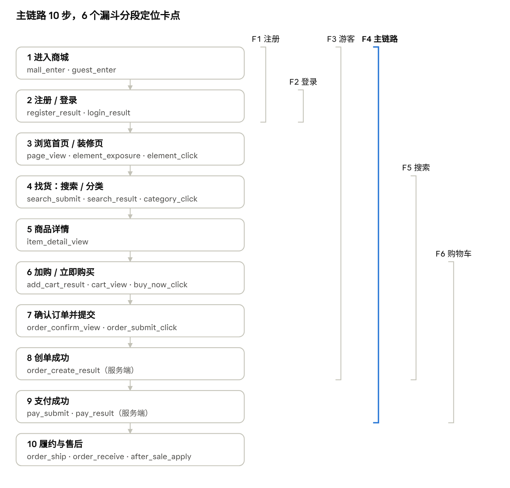

# C端商城用户行为埋点与漏斗分析需求 V1.0

Nov 23, 2026 · @xio

## 一、背景与目标

本需求把钉钉表《C端用户行为与漏斗分析》已列出的注册、登录、浏览三段，补全为「进入 → 登录 → 找货 → 加购 → 下单 → 支付 → 订单售后」整条链路，作为 Q4 规划 V2.3「全流程埋点与报表」的开发依据（评审 11/23，提测 11/30，测试完成 12/8）。

**要回答的业务问题**（前四条来自原表，后三条为本次补充）：

| # | 分析目标 | 关键漏斗 | 来源 |
| --- | --- | --- | --- |
| 1 | 用户注册链路成功率 | 注册 | 原表 |
| 2 | 游客浏览核心事件、游客转登录 | 游客转化 | 原表 |
| 3 | 用户登录成功率（分登录方式） | 登录 | 原表 |
| 4 | 用户下单成功率、下单习惯 | 交易主链路 | 原表 |
| 5 | 员工能否找到货：搜索无结果率、搜索点击率 | 找货 | 补充 |
| 6 | 加购后为什么没下单、下单后为什么没支付 | 购物车、交易 | 补充 |
| 7 | 履约与售后：签收、售后申请率、售后归因分析 | 订单售后 | 补充 |

**范围**：员工商城 H5 与小程序，覆盖新旧两套前端（V1-7.5 已要求带新旧前端标记）。会员端、运营端以及 C 端 AI 功能不在本需求内。

**原表需要修正的地方**：

- 「加购」「下单」两段在行为事件表里是空的，本文第四节补齐。
- 每个事件都重复记录「进入页面时间、浏览时长、上页页面ID」，改为统一的页面事件和公共字段，业务事件不再重复带。
- 「成功/失败」只记结果，没有失败原因，无法做流失分析；改为结果事件一律带 fail\_reason 枚举，且以服务端返回为准。
- 手机号、工号、账号、微信 openid 列在每个页面的属性里。改为只上报 user\_id，个人信息通过用户维表关联，日志里不出现明文。
- 漏斗表「用户登录」中「登录状态」出现两次，实为图形验证码登录和短信验证码登录两种方式，按 login\_type 区分即可。

## 二、核心链路总览

用户从进入商城到售后共 10 步，每一步都有至少一个 P0 事件；F4 覆盖进入到支付的整段，其余漏斗放大其中一段看卡点。

右侧每条竖线是一个漏斗覆盖的步骤范围：F1 注册与导入账号激活、F2 登录、F3 游客转化、F4 交易主链路、F5 搜索找货、F6 购物车。各步的精确定义见第五节。

## 三、埋点通用规范

所有事件共用一套命名、公共字段和上报规则；业务事件只带自己的私有属性。本节即 V2-5.1「事件字典：命名、公共字段、曝光口径、上报方式」的内容。

### 3.1 命名与事件类型

- 事件名：小写英文 + 下划线，格式为「对象\_动作」，如 login\_submit、order\_create\_result。属性名同样规则。
- 事件分五类：

| 类型 | 事件 | 上报端 | 说明 |
| --- | --- | --- | --- |
| 页面进入 | page\_view | 前端 | 每次进入页面报一次；底部 Tab 切换、页内 Tab 切换也算一次，记录切换后的当前页 |
| 页面离开 | page\_leave | 前端 | 离开、切后台、关闭时报，带 duration\_ms（即原表「浏览时长」） |
| 曝光 | element\_exposure | 前端 | 商品卡、Banner、装修组件等可见即报，口径见 3.4 |
| 点击 | element\_click 及业务点击事件 | 前端 | 用户点了什么 |
| 业务结果 | \*\_result | 服务端 | 注册、登录、加购、创单、支付是否成功，以接口返回为准，带 fail\_reason |

结果事件必须由服务端上报：前端可能在接口返回前被关闭，用前端结果算成功率会失真。前端的「提交」事件和服务端的「结果」事件用同一个 request\_id 关联。

### 3.2 公共字段（每条事件都带，由 SDK 自动填充）

| 字段 | 含义 | 示例 / 取值 | 必填 |
| --- | --- | --- | --- |
| event\_id | 事件唯一 ID，用于去重 | UUID | 是 |
| event\_name | 事件名 | login\_submit | 是 |
| client\_time / server\_time | 客户端发生时间 / 服务端接收时间（毫秒） | 1764000000000 | 是 |
| user\_id | 商城用户 ID；未登录为空 | — | 登录后必填 |
| device\_id | 设备/匿名 ID，游客与登录前行为靠它串联 | — | 是 |
| session\_id | 会话 ID；30 分钟无操作或跨自然日即新会话 | — | 是 |
| is\_guest | 是否游客身份（即原表「是否登录」） | true / false | 是 |
| login\_type | 本次登录方式 | 见 4.2 枚举 | 登录后必填 |
| site\_id | 站点 ID | — | 是 |
| mall\_id | 商城 ID | — | 是 |
| member\_enterprise\_id | 会员企业 ID。系统内的企业 ID 即服务商本身，用于按服务商统计 | — | 是 |
| client\_enterprise\_id | 项目对应的甲方企业 ID。系统暂无记录，本期预留字段、不上报 | — | 否（预留） |
| project\_id | 福利项目/发放批次 ID（有则填） | — | 否 |
| platform | 终端 | h5 / wx\_mini / alipay\_mini | 是 |
| fe\_version | 新旧前端标记 | new / old | 是 |
| app\_version | 前端发版号 | 2.3.0 | 是 |
| page\_id / page\_name | 当前页面，取值见 3.3 | item\_detail / 商品详情 | 是 |
| referrer\_page\_id | 上一页面 ID（原表「上页页面ID」） | home | 是 |
| entry\_source | 本次会话入口 | site\_link / qrcode / redeem\_card / wx\_menu / share / alipay | 是 |
| utm\_source / utm\_campaign | 投放/活动来源参数 | — | 否 |
| os / network / screen | 设备环境 | iOS / 4g / 390x844 | 是 |

**个人信息**：手机号、工号、账号、卡号、openid 不进行为日志明文。需要分析时，用 user\_id 关联用户维表；登录前必须上报的，用脱敏或哈希值（如手机号后 4 位、卡号哈希）。

**ID 打通**：用户登录成功时上报 device\_id 与 user\_id 的绑定关系，数仓据此把登录前的游客行为归到该用户。

### 3.3 页面清单（page\_id）

| page\_id | 页面 | page\_id | 页面 |
| --- | --- | --- | --- |
| register | 注册页 | cart | 购物车 |
| login | 登录页（含各登录方式） | order\_confirm | 确认订单 |
| home | 首页 | pay | 支付页/收银台 |
| decorate | 装修页/活动页（带 decorate\_page\_id） | pay\_result | 支付结果页 |
| category | 分类页 | order\_list | 订单列表 |
| search | 搜索前页 | order\_detail | 订单详情 |
| search\_result | 搜索结果页 | after\_sale | 售后申请/详情 |
| item\_list | 商品列表/频道页 | profile | 个人中心 |
| item\_detail | 商品详情 | other | 其他（带 page\_name） |

### 3.4 曝光、点击与上报规则

- **曝光**：元素面积 50% 以上进入可视区，且停留满 500ms 才算；同一页面生命周期内，同一元素只报一次。可批量合并上报。
- **点击**：必带 module\_id（所在模块）、element\_name（按钮/入口名称）、position（从 1 开始的位置）、target\_route（跳转页面路由）。
- **商品类事件**：统一带 item\_id、sku\_id（有则填）、goods\_channel（jd / tmall\_cs / youpin / self 等）、category\_id、price、point\_price。
- **搜索/推荐结果**：每次请求生成 list\_request\_id，该次结果的曝光、点击都带上，用来算点击率。
- **上报**：前端实时上报，失败本地缓存后重试；离开页面用 sendBeacon。服务端结果事件在业务事务完成后异步写入，不阻塞主流程。
- **去重**：数仓按 event\_id 去重。

## 四、事件字典

共 7 段 50 个事件，其中 P0 为漏斗和成功率计算必需的事件，验收要求 100% 覆盖。下表只列私有属性，公共字段见 3.2；「原表对应」列标出是哪一行需求在这里落地。

### 4.1 进入与注册

| 事件名 | 中文名 | 触发时机 | 上报端 | 私有属性 | 优先级 | 原表对应 |
| --- | --- | --- | --- | --- | --- | --- |
| mall\_enter | 进入商城 | 每个会话首次打开商城 | 前端 | entry\_source、landing\_page\_id | P0 | 新增 |
| account\_create\_result | 账号开通 | 站点创建/导入开通生成员工账号 | 服务端 | create\_source（import / site\_create / invite）、batch\_id | P0 | 注册-站点创建/导入开通 |
| register\_sms\_send | 获取注册验证码 | 点击获取验证码 | 前端 | request\_id | P0 | 获取验证码状态-获取时间 |
| register\_sms\_result | 验证码发送结果 | 短信接口返回 | 服务端 | request\_id、is\_success、fail\_reason | P0 | 获取验证码状态-成功/失败 |
| register\_submit | 提交注册 | 点击注册/授权 | 前端 | register\_type（phone / wechat）、request\_id | P0 | 注册状态 |
| register\_result | 注册结果 | 注册接口返回 | 服务端 | register\_type、request\_id、is\_success、fail\_reason、user\_id | P0 | 注册状态-成功/失败、注册时间 |

导入开通的账号没有「注册」动作，以「首次登录成功」作为激活（见 login\_result 的 is\_first\_login）。

### 4.2 登录

login\_type 枚举：account\_pwd（账号密码）、employee\_no（工号）、phone\_sms（手机短信）、redeem\_card（兑换卡）、wechat（微信授权）、sso（企业免登）、guest（游客）。

| 事件名 | 中文名 | 触发时机 | 上报端 | 私有属性 | 优先级 | 原表对应 |
| --- | --- | --- | --- | --- | --- | --- |
| captcha\_request | 获取图形验证码 | 图形验证码加载/刷新 | 前端 | is\_success、fail\_reason | P1 | 获取图形验证码状态 |
| login\_sms\_send | 获取登录短信 | 点击获取验证码 | 前端 | request\_id | P0 | 获取短信验证码状态-获取时间 |
| login\_sms\_result | 短信发送结果 | 短信接口返回 | 服务端 | request\_id、is\_success、fail\_reason | P0 | 获取短信验证码状态-成功/失败 |
| login\_submit | 提交登录 | 点击登录/授权/确认卡号 | 前端 | login\_type、request\_id、trigger（见下） | P0 | 登录状态 |
| login\_result | 登录结果 | 登录接口返回 | 服务端 | login\_type、request\_id、is\_success、fail\_reason、user\_id、is\_first\_login、card\_no\_hash（兑换卡） | P0 | 登录状态-成功/失败、登录时间 |
| guest\_enter | 游客进入 | 以游客身份打开商城 | 前端 | device\_id | P0 | 游客登录-设备ID、登录时间 |
| login\_guide\_show | 登录引导弹出 | 游客做需登录操作时弹出登录 | 前端 | trigger | P0 | 游客登录-是否登录 |
| logout | 退出登录 | 确认退出 | 前端 | — | P2 | 新增 |

trigger 枚举（谁把用户引到了登录页）：active（主动进入）、add\_cart、buy\_now、view\_price、profile、order、token\_expired。

### 4.3 浏览（首页、装修页、分类页、商详页）

| 事件名 | 中文名 | 触发时机 | 上报端 | 私有属性 | 优先级 | 原表对应 |
| --- | --- | --- | --- | --- | --- | --- |
| page\_view | 页面浏览 | 进入任一页面 | 前端 | is\_home、decorate\_page\_id（装修页）、load\_ms | P0 | 各页「上页页面ID、页面名称、是否首页、进入页面时间」 |
| page\_leave | 页面离开 | 离开/切后台/关闭 | 前端 | duration\_ms、max\_scroll\_depth | P0 | 各页「浏览时长」 |
| element\_exposure | 组件/商品曝光 | 满足 3.4 曝光口径 | 前端 | module\_id、component\_type（banner / nav / floor / goods\_card / coupon）、position、item\_id（商品卡）、list\_request\_id | P1 | 新增 |
| element\_click | 组件/按钮点击 | 点击任一入口或按钮 | 前端 | module\_id、component\_type、element\_name、position、target\_route、item\_id | P0 | 「点击事件：点击时间、按钮名称、跳转页面路由」 |
| tab\_switch | Tab 切换 | 底部 Tab 或页内 Tab 切换 | 前端 | tab\_name、from\_tab | P1 | 「tab切换则记录当前页」 |
| category\_click | 点击分类 | 点击一级/二级分类 | 前端 | category\_level、category\_id、category\_name | P1 | 分类页浏览 |
| item\_detail\_view | 商品详情浏览 | 商详页数据加载完成 | 前端 | item\_id、goods\_channel、price、point\_price、stock\_status、is\_saleable（当前地址是否可售）、from\_module | P0 | 商详页浏览 |
| item\_favorite | 收藏/取消收藏 | 点击收藏 | 前端 | item\_id、action（add / remove） | P2 | 新增 |
| sku\_panel\_open | 打开规格面板 | 商详弹出规格选择 | 前端 | item\_id、trigger（add\_cart / buy\_now） | P1 | 新增 |

原表「装修页浏览-用户基础信息」不再作为事件属性，改由 user\_id 关联用户维表。

### 4.4 找货（搜索）

| 事件名 | 中文名 | 触发时机 | 上报端 | 私有属性 | 优先级 | 原表对应 |
| --- | --- | --- | --- | --- | --- | --- |
| search\_submit | 发起搜索 | 回车、点热词/历史/联想词 | 前端 | keyword、keyword\_source（hot / manual / history / suggest / placeholder）、list\_request\_id | P0 | 搜索词、搜索词来源（热门搜索/手动输入） |
| search\_result | 搜索结果返回 | 搜索接口返回 | 服务端 | keyword、list\_request\_id、result\_count、is\_empty、sort\_type、filters、category\_constraint | P0 | 新增 |
| search\_result\_click | 点击搜索结果 | 点击结果里的商品 | 前端 | keyword、list\_request\_id、item\_id、position | P0 | 新增 |
| search\_filter\_change | 筛选/排序 | 改筛选或排序 | 前端 | sort\_type、filters | P2 | 新增 |
| empty\_recommend\_click | 无结果推荐点击 | 无结果页点推荐商品 | 前端 | keyword、item\_id、position | P1 | 新增（对应 V2-2.3 无结果兜底） |

### 4.5 加购与购物车

| 事件名 | 中文名 | 触发时机 | 上报端 | 私有属性 | 优先级 |
| --- | --- | --- | --- | --- | --- |
| add\_cart\_click | 点击加购 | 点击加入购物车（商详、列表快捷加购、订单里再来一单） | 前端 | item\_id、sku\_id、quantity、add\_source（detail / list / rebuy / recommend）、request\_id | P0 |
| add\_cart\_result | 加购结果 | 加购接口返回 | 服务端 | request\_id、item\_id、sku\_id、quantity、is\_success、fail\_reason | P0 |
| cart\_view | 查看购物车 | 进入购物车并加载完成 | 前端 | cart\_sku\_count、invalid\_sku\_count、cart\_amount | P0 |
| cart\_item\_change | 改数量/删除 | 步进器、删除、移入收藏 | 前端 | item\_id、sku\_id、action（qty\_change / delete / to\_favorite）、quantity | P1 |
| cart\_checkout\_click | 点击结算 | 购物车点结算 | 前端 | selected\_sku\_count、amount、point\_amount | P0 |
| buy\_now\_click | 点击立即购买/立即兑换 | 商详点立即购买（卡券、本地生活等只能走此路径） | 前端 | item\_id、sku\_id、quantity | P0 |

### 4.6 下单与支付

| 事件名 | 中文名 | 触发时机 | 上报端 | 私有属性 | 优先级 | 原表对应 |
| --- | --- | --- | --- | --- | --- | --- |
| order\_confirm\_view | 进入确认订单 | 确认订单页加载完成 | 前端 | order\_source、sku\_count、amount、point\_amount、has\_address、available\_points | P0 | 新增 |
| order\_submit\_click | 点击提交订单 | 点击提交 | 前端 | order\_source、request\_id、pay\_method\_selected | P0 | 点击创单时间 |
| order\_create\_result | 创单结果 | 创单接口返回 | 服务端 | request\_id、order\_id、parent\_order\_id、order\_source、is\_success、fail\_reason、sku\_count、total\_amount、point\_amount、cash\_amount、goods\_channel\_list | P0 | 实际创单时间（空=创单失败）、创单来源 |
| pay\_submit | 发起支付 | 收银台点确认支付 | 前端 | order\_id、pay\_method、pay\_channel | P0 | 支付方式 |
| pay\_result | 支付结果 | 支付回调到达 | 服务端 | order\_id、pay\_method、pay\_channel、is\_success、fail\_reason、point\_amount、cash\_amount | P0 | 支付时间 |
| order\_cancel | 订单取消 | 用户取消或超时取消 | 服务端 | order\_id、cancel\_by（user / timeout / system）、cancel\_reason | P0 | 新增 |
| address\_edit | 新增/切换地址 | 确认订单页改地址 | 前端 | action（add / switch）、is\_saleable\_after | P1 | 新增 |

- order\_source 枚举（原表「创单来源」）：detail\_add\_cart（商详加购后结算）、list\_add\_cart（列表加购后结算）、rebuy（再来一单）、buy\_now（商详立即购买）。购物车里的商品来源按每个 SKU 最近一次 add\_source 归因。
- pay\_method 枚举：points（纯积分）、points\_cash（积分+现金）、cash（纯现金）、zero（0 元兑换/兑换卡全额）；pay\_channel：wechat / alipay / enterprise\_code / balance。

### 4.7 订单与售后

| 事件名 | 中文名 | 触发时机 | 上报端 | 私有属性 | 优先级 |
| --- | --- | --- | --- | --- | --- |
| order\_detail\_view | 查看订单详情 | 进入订单详情 | 前端 | order\_id、order\_status | P1 |
| logistics\_view | 查看物流 | 点查看物流 | 前端 | order\_id、package\_count | P1 |
| order\_ship | 订单发货 | 第一个包裹发货 | 服务端 | order\_id、package\_count、goods\_channel | P0 |
| order\_receive | 确认收货 | 用户确认或自动签收 | 服务端 | order\_id、receive\_by（user / auto） | P0 |
| coupon\_code\_view | 查看卡券码 | 虚拟卡券订单查看券码 | 前端 | order\_id、item\_id | P1 |
| after\_sale\_apply | 申请售后 | 提交售后申请 | 服务端 | order\_id、after\_sale\_id、type（refund / return / exchange）、reason | P0 |
| after\_sale\_result | 售后结果 | 售后完结 | 服务端 | after\_sale\_id、result（approved / rejected / cancelled）、duration\_hours | P1 |
| rebuy\_click | 再来一单 | 订单里点再来一单 | 前端 | order\_id、sku\_count | P1 |
| service\_click | 联系客服 | 点客服入口 | 前端 | from\_page、order\_id、item\_id | P2 |

## 五、漏斗定义

共 7 个漏斗，F4 交易主链路是看「兑换转化率」的主漏斗，其余 6 个用来定位卡在哪一步。每一步都用第四节的事件计算，成功类步骤取服务端结果事件且 is\_success = true。

### 5.1 统一口径

- **统计主体**：默认按人去重。已登录用 user\_id；登录前用 device\_id，登录后按 3.2 的 ID 打通合并为同一人。另提供按会话（session\_id）计算的版本。
- **有序**：用户必须先完成上一步，再在窗口期内完成下一步，才计入下一步。
- **窗口期**：从第一步发生时算起，各漏斗窗口见下表；报表允许切换。
- **转化率**：步骤转化率 = 本步人数 ÷ 上一步人数；整体转化率 = 最后一步人数 ÷ 第一步人数。
- **流失**：完成上一步但窗口期内未完成本步的人。有失败结果事件的，按 fail\_reason 归因；没有的，记为「主动离开」，并记录离开前最后一个 page\_id。

### 5.2 漏斗清单

| 编号 | 漏斗 | 步骤与对应事件 | 窗口期 | 重点拆分维度 |
| --- | --- | --- | --- | --- |
| F1 | 注册 | ① 进入注册页 page\_view(register) → ② 验证码发送成功 register\_sms\_result → ③ 提交注册 register\_submit → ④ 注册成功 register\_result → ⑤ 首次登录成功 login\_result(is\_first\_login) | 30 分钟（⑤ 为 7 天） | register\_type、站点、终端 |
| F1b | 导入账号激活 | ① 账号开通 account\_create\_result → ② 首次登录成功 → ③ 首次下单成功 | 自然周期（按发放批次看 7 / 30 天） | 服务商、项目、导入批次 |
| F2 | 登录 | ① 进入登录页 page\_view(login) → ② 验证码获取成功（仅需验证码的方式） → ③ 提交登录 login\_submit → ④ 登录成功 login\_result | 30 分钟 | login\_type、trigger、fail\_reason |
| F3 | 游客转化 | ① 游客进入 guest\_enter → ② 浏览商详 item\_detail\_view → ③ 弹出登录引导 login\_guide\_show → ④ 登录成功 login\_result → ⑤ 创单成功 order\_create\_result | 同一自然日 | trigger、入口来源 |
| F4 | 交易主链路 | ① 进入商城 mall\_enter（已登录） → ② 浏览商详 item\_detail\_view → ③ 加购成功或立即购买 add\_cart\_result / buy\_now\_click → ④ 进入确认订单 order\_confirm\_view → ⑤ 提交订单 order\_submit\_click → ⑥ 创单成功 order\_create\_result → ⑦ 支付成功 pay\_result | 同一自然日；另出 7 天版 | 服务商、站点、商品渠道、品类、新旧前端 |
| F5 | 搜索找货 | ① 发起搜索 search\_submit → ② 有结果 search\_result(is\_empty = false) → ③ 点击结果 search\_result\_click → ④ 加购或立即购买 → ⑤ 创单成功 | 同一会话 | keyword\_source、关键词、排序方式 |
| F6 | 购物车 | ① 加购成功 add\_cart\_result → ② 查看购物车 cart\_view → ③ 点击结算 cart\_checkout\_click → ④ 创单成功 → ⑤ 支付成功 | 7 天 | add\_source、商品渠道 |

F4 中「创单成功 → 支付成功」一步，纯积分和 0 元订单在创单时即完成支付，服务端也需补报一条 pay\_result，否则该步转化率会偏低。

### 5.3 下单习惯分析

用 order\_create\_result 与 pay\_result 的属性直接统计：

| 分析项 | 口径 | 所用字段 |
| --- | --- | --- |
| 下单时段分布 | 按小时、星期几统计创单成功数 | server\_time |
| 创单来源占比 | 各 order\_source 的订单数占比 | order\_source |
| 支付方式占比 | 纯积分/积分+现金/纯现金的订单数和金额占比 | pay\_method、pay\_channel |
| 客单价与现金补差 | 人均实付、现金补差订单占比 | total\_amount、cash\_amount |
| 从浏览到下单的时长 | 首次 item\_detail\_view 到 order\_create\_result 的中位数 | client\_time |
| 加购到下单的时长 | 同一 SKU 从 add\_cart\_result 到创单的中位数 | sku\_id、client\_time |
| 复购 | 同一发放周期内下单 ≥ 2 次的人数占比、再来一单占比 | user\_id、order\_source |
| 品类与渠道偏好 | 各品类、各商品渠道的订单数与金额 | category\_id、goods\_channel\_list |

## 六、数据统计需求

交付 6 张内部报表（对应 V2-5.10 漏斗报表、V2-5.11 流失统计），所有指标都能按同一套维度筛选，数据 T+1 更新，核心看板小时级更新。

### 6.1 核心指标

| 指标 | 定义 / 公式 | 数据来源 | 优先级 |
| --- | --- | --- | --- |
| 访问人数 UV | 当日有 mall\_enter 的去重人数 | mall\_enter | P0 |
| 人均浏览时长 | page\_leave.duration\_ms 之和 ÷ UV | page\_leave | P1 |
| 注册成功率 | register\_result 成功人数 ÷ register\_submit 人数 | F1 | P0 |
| 导入账号激活率 | 首次登录成功账号数 ÷ 开通账号数 | F1b | P0 |
| 登录成功率 | login\_result 成功次数 ÷ login\_submit 次数，按 login\_type 拆 | F2 | P0 |
| 验证码到达率 | \*\_sms\_result 成功数 ÷ \*\_sms\_send 数 | F1、F2 | P1 |
| 游客转登录率 | 游客中当日登录成功的人数 ÷ 游客人数 | F3 | P0 |
| 搜索无结果率 | is\_empty = true 的搜索次数 ÷ 搜索总次数 | search\_result | P0 |
| 搜索点击率 | 有点击的 list\_request\_id 数 ÷ 有结果的搜索次数 | F5 | P0 |
| 商详转加购率 | 加购或立即购买人数 ÷ 浏览商详人数 | F4 | P0 |
| 加购失败率 | add\_cart\_result 失败次数 ÷ add\_cart\_click 次数 | add\_cart\_result | P0 |
| 购物车结算率 | 点击结算人数 ÷ 查看购物车人数 | F6 | P1 |
| 创单成功率 | order\_create\_result 成功次数 ÷ order\_submit\_click 次数 | F4 | P0 |
| 支付成功率 | 支付成功订单数 ÷ 创单成功订单数 | F4 | P0 |
| 兑换转化率 | 支付成功人数 ÷ 访问人数（已登录） | F4 | P0 |
| 发放兑换率 | 已下单员工数 ÷ 项目发放员工数 | F1b + 业务库 | P0 |
| 售后申请率 | 申请售后订单数 ÷ 支付成功订单数 | after\_sale\_apply | P1 |

### 6.2 通用筛选维度

日期（日/周/月/自定义）、服务商（即会员企业）、站点、商城、终端（platform）、新旧前端（fe\_version）、入口来源（entry\_source）、登录方式（login\_type）、商品渠道（goods\_channel）、品类。

项目对应的甲方企业系统内暂无记录，本期不支持按甲方企业统计；需要看某个甲方时，先按福利项目筛选。

### 6.3 报表清单

| 报表 | 内容 | 主要使用者 | 更新 |
| --- | --- | --- | --- |
| 核心看板 | 6.1 中 P0 指标的当日值、较昨日、较上周同期，带趋势线 | 产品、运营、服务商 | 小时 |
| 漏斗分析 | 选择 F1–F6 任一漏斗 + 维度，展示每步人数、步骤转化率、流失人数；支持两个维度值对比（如新旧前端、两个站点） | 产品 | T+1 |
| 流失原因 | 每个漏斗步骤的流失按 fail\_reason 与「离开前最后页面」拆分，可下钻到站点 | 产品、研发、客服 | T+1 |
| 搜索分析 | 搜索次数、无结果率、点击率；热词 Top 50、无结果词 Top 50、有结果但无点击词 Top 50 | 产品、商品运营、服务商 | T+1 |
| 页面与组件 | 各页面 PV/UV/平均停留/跳出率；装修页各组件与坑位的曝光、点击、点击率 | 运营、服务商 | T+1 |
| 下单习惯 | 5.3 各分析项 | 运营、服务商 | T+1 |

### 6.4 失败原因枚举（fail\_reason）

研发按接口真实错误码映射到下列枚举；对不上的记 other，并把原始错误码放在 error\_code 字段。other 占比超过 5% 时补充枚举。

| 环节 | 枚举值 |
| --- | --- |
| 验证码 | sms\_rate\_limit（频次限制）、phone\_invalid、channel\_error、captcha\_wrong |
| 注册 | code\_wrong、code\_expired、phone\_registered、not\_in\_whitelist（不在站点员工名单）、wechat\_auth\_denied |
| 登录 | pwd\_wrong、account\_not\_found、account\_frozen、code\_wrong、code\_expired、card\_invalid、card\_used、card\_expired、site\_expired（站点已到期）、wechat\_auth\_denied |
| 加购 | out\_of\_stock、not\_saleable\_area、limit\_exceeded、item\_offline、virtual\_not\_cartable、not\_logged\_in |
| 创单 | address\_missing、not\_saleable\_area、out\_of\_stock、price\_changed、points\_insufficient、limit\_exceeded、risk\_blocked、channel\_error（上游下单失败） |
| 支付 | user\_cancel、timeout、balance\_insufficient、channel\_error、points\_frozen |

## 七、验收标准、排期与待确认事项

### 7.1 验收标准（V2-5.9）

| 项目 | 标准 | 验收方法 |
| --- | --- | --- |
| P0 事件覆盖 | 第四节全部 P0 事件 100% 可触发、可查到 | 测试按事件字典逐条操作，在埋点调试工具中核对 |
| 公共字段完整率 | 必填公共字段非空率 ≥ 99% | 灰度期按字段统计空值率 |
| 与业务库对账 | 创单成功数、支付成功数、注册成功数与业务库差异 ≤ 0.5% | 连续 3 天按站点对账 |
| 前后端关联 | 提交类事件与结果事件通过 request\_id 关联率 ≥ 98% | 抽取 1 天数据统计 |
| 重复与丢失 | 同 event\_id 重复率 ≤ 0.1%；弱网/切后台场景 page\_leave 不丢 | 弱网模拟、切后台、杀进程 |
| 新旧前端可对比 | 同一事件在新旧前端事件名、属性口径一致，仅 fe\_version 不同 | 同一操作在新旧站点各走一遍，比对字段 |
| 隐私 | 行为日志中无明文手机号、工号、卡号、openid | 对日志做正则扫描 |
| 报表 | 6.3 的 6 张报表可用，核心指标与手工 SQL 结果一致 | 产品抽查 3 个站点 |

### 7.2 排期（摘自 Q4 规划 V2.3）

| 任务 | 编号 | 开发 | 提测 | 测试 | 测试完成 |
| --- | --- | --- | --- | --- | --- |
| 事件字典（本文第三、四节定稿） | V2-5.1 | 金洋 | 11/30 | 子清 | 12/8 |
| C 端四段埋点（进入与浏览、找货、交易、订单与个人中心；AI 不在本次范围） | V2-5.4–5.8 | 巴韶 | 11/30 | 子清 | 12/8 |
| 埋点验收 | V2-5.9 | 巴韶 | 11/30 | 子清 | 12/8 |
| 漏斗、流失统计报表 | V2-5.10、5.11 | 金洋 | 11/30 | 子清 | 12/8 |

服务端事件（所有 `_result` 结尾的事件，以及 account\_create\_result、order\_cancel、order\_ship、order\_receive、after\_sale\_apply、after\_sale\_result）在排期表里没有单独的后端负责人，需在评审上确定。

### 7.3 待确认事项

- [ ] 报表由谁看、多久看一次（Q4 规划 V2.3 评审要点）；服务商是否能看到自己站点的报表。
- [ ] 失败原因枚举（6.4）是否完整，需研发对照现有错误码确认。
- [ ] 埋点平台选型：统一埋点框架（V1-7.5）用自建还是第三方，决定漏斗报表是平台自带还是自己开发。
- [ ] 游客模式下哪些操作会触发登录引导（决定 trigger 枚举是否完整）。
- [ ] 「发放兑换率」的分母（项目发放员工数）从哪张业务表取。
