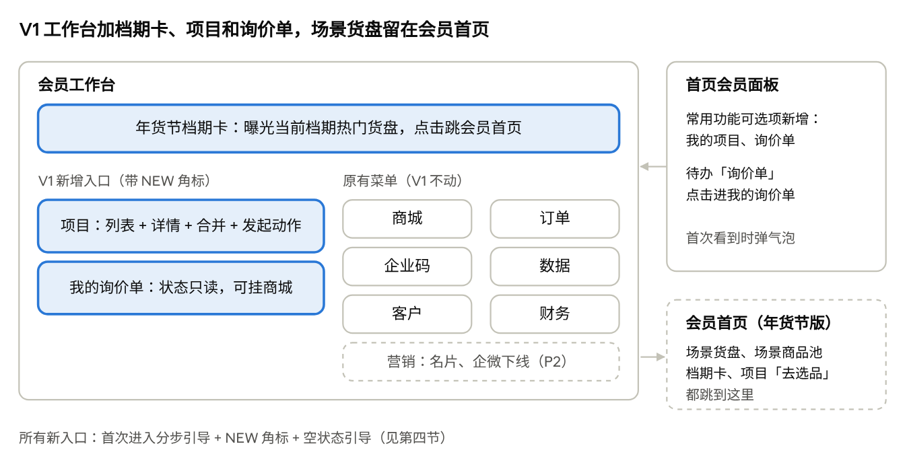

# 采发发会员工作台 V1 产品说明书

Nov 9, 2026 · @sanyuan

## 一、版本信息与目标

V1 在 11/20 上线，对工作台做轻量调整：只新增入口，不动老菜单和路由。服务商可以在一个地方按项目看商城、询价单、订单和经营数据，从项目发起询价、选品和建商城。场景货盘在会员首页（即年货节版场景运营首页）；工作台保留档期卡，给当前档期热门货盘增加曝光。

| 项         | 内容                                                                    |
|------------|-------------------------------------------------------------------------|
| 版本       | V1 · 年货节存量增长版，2026-11-20 上线                                  |
| 端         | 会员端 PC 工作台、首页会员面板；新运营管理后台（权限与统计）            |
| 面向       | 服务商（管理员与业务员子账号）                                          |
| 解决的问题 | 工作台没有「项目」，一个甲方的商城、询价、订单分在多个菜单              |
| 业务价值   | 服务商按项目看账、从项目发起动作；项目信息开始积累                      |
| 对应任务   | V1-5 工作台轻量调整、V1-4 项目关系、V1-3 按项目看经营、V1-10 权限与脱敏 |

**本版做**：年货节档期卡、项目列表与详情、合并项目、从项目发起动作、我的询价单、首页会员面板同步、新手指引、名片与企微下线（P2）。

**本版不做**：栏目完整重组与订单合并（V3）、项目报备独立入口、报价单（后续版本）、AI 选品开通（V2）、项目供货价（V4）、新建看板。

## 二、入口与栏目变化

V1 工作台入口 · 档期卡 + 2 处新增 + 首页面板同步 + 会员首页衔接

蓝色为 V1 新增，灰色为原有菜单，虚线框为会员首页（不属于工作台）；栏目完整重组在 V3，见「采发发会员工作台调整方案」。

## 三、功能说明

### 3.1 年货节档期卡（P0）

- 目的：给当前档期的热门货盘增加曝光，把工作台流量引到会员首页。

- 工作台顶部通栏：档期名 + 距节日 N 天 + 热门货盘（最多 3 个，运营指定）+「去选货」；点货盘跳会员首页对应场景。

- 只展示对会员可见且生效中的场景，没有时不显示；可收起，换档期后重新展开。

- 场景货盘和商品池本身在会员首页（年货节版场景运营首页），工作台不放货盘列表；版本规划 V1-9.2 按此调整。

### 3.2 项目列表（P0）

服务商按甲方项目看全局，不用在几个菜单间来回切。

| 列           | 说明                                 |
|--------------|--------------------------------------|
| 项目名称     | 存量商城自动生成的项目默认用商城名称 |
| 商城数       | 挂在本项目下的商城数                 |
| 询价中       | 状态为待跟进或跟进中的询价单数       |
| 交易额、利润 | 复用现有经营概览口径                 |
| 操作         | 查看详情、建商城、去选品、发起询价   |

- 存量商城上线时自动生成项目：一个商城对应一个项目，无需服务商确认。客户类型按商城名称推断，无法判断的留空，服务商可在项目详情里修改。

- 未关联项目的商城和询价单在列表上方单独提示。

- 「新增项目」按钮：填项目名称、项目类型（采购 / 集采）、客户类型、预算类型、预算金额，只有名称必填。

- 「合并项目」（V1 做）：同一甲方有多个商城时，服务商勾选多个项目合并为一个；合并时选择保留哪个项目的名称和项目信息，商城、询价单、订单全部归到合并后的项目，经营数据按合并后重新汇总。

### 3.3 项目详情（P0）

一页聚合本项目的已有数据，不新增业务逻辑。

| 区块     | 内容                                                                                                       |
|----------|------------------------------------------------------------------------------------------------------------|
| 项目信息 | 项目类型、客户类型、预算类型、预算金额、归属方、创建时间，可编辑；兑换价格带按商城实际订单自动计算，不可填 |
| 经营数据 | 订单数、交易额、利润、兑换价格带，复用现有口径                                                             |
| 商城     | 本项目下的商城，点击跳商城运营中心                                                                         |
| 询价单   | 本项目的询价单及状态                                                                                       |
| 订单     | 本项目商城的订单，点击跳现有订单详情                                                                       |

编辑项目信息时显示报备提示：项目信息用于经营管理数据统计，本版不提供给任何第三方；已报备项目的集采询价优先跟进。不承诺项目保护。

### 3.4 从项目发起动作（P0）

| 动作     | 跳转               | 自动带上                       |
|----------|--------------------|--------------------------------|
| 建商城   | 现有建商城流程     | 新商城挂到本项目               |
| 去选品   | 会员首页场景商品池 | 上架时默认选中本项目的商城     |
| 发起询价 | 询价表单           | 商城、客户类型、预算预填，可改 |

### 3.5 我的询价单（P0）

- 询价表单必填「选商城」（可选「还没建商城」）、「客户类型」「预算」，写入所选商城对应的项目；场景首页 Spec 的询价表单同步补上这三项。

- 列表字段：询价单号、商品、所属商城（未选显示「未关联」）、提交人、提交时间、状态。

- 状态：待跟进 → 跟进中 → 已关闭（带关闭原因）；会员端只读。

- 「未关联」的询价单可在详情里挂到商城；建商城时也会提示挂上。

### 3.6 首页会员面板同步（P0）

- 常用功能由用户自己选择。V1 把「我的项目」「询价单」加入可选列表，不改用户已选的功能。

- 待办中「询价单（待处理）」点击进「我的询价单」。

### 3.7 名片、企微营销下线（P2）

- 下线前拉近 90 天访问量，确认无人使用。

- 「客户」下的企微好友、企微客户群不动，跟 Q1 CRM 改版走。

## 四、新手指引（P0）

V1 的入口都是新加的，存量服务商的习惯还在老菜单里。新手指引和功能同版上线，确保他们找得到入口。

| 形式                 | 触发                                       | 内容                                                                                                           | 关闭与再次查看                           |
|----------------------|--------------------------------------------|----------------------------------------------------------------------------------------------------------------|------------------------------------------|
| 分步引导（蒙层高亮） | 每个账号上线后首次进入工作台               | 不超过 4 步：年货节档期卡 → 项目 → 我的询价单 → 新功能指引（随时重看）；每步一句话说清「这里能做什么」         | 可跳过；工作台右上角「新功能指引」可重看 |
| 新入口标记           | 入口没被点击过                             | 项目、我的询价单入口加「NEW」角标                                                                              | 点击一次消失；最长保留 30 天             |
| 首页会员面板气泡     | 上线后首次进入首页                         | 指向常用功能的「编辑」：「新增「我的项目」「询价单」，可加入常用」                                             | 关闭后不再出现                           |
| 空状态引导           | 列表为空                                   | 项目为空：「先建一个商城，项目会自动生成」；询价单为空：「在场景货盘或搜索里点「询价」即可发起」，都带跳转按钮 | —                                        |
| 老入口提示           | 老菜单中已有等价新入口的页面（如我的商城） | 页面顶部轻提示「现在也可以在「项目」里按甲方查看」                                                             | 可关闭，关闭后不再出现                   |

- 指引状态按账号记录（不按浏览器），子账号各自看一遍。

- 指引文案讲「能帮你做什么」，不讲功能名。

- 指引组件做成通用能力，V2、V3 新增或重构入口时复用。

## 五、权限与数据安全

项目视图上线后运营后台就能看到项目明细，所以权限和脱敏必须同版上线（V1-10）。

| 规则                                                                                        | 优先级 |
|---------------------------------------------------------------------------------------------|--------|
| 服务商只看自己的项目；子账号沿用原「商城管理」「代发」权限映射                              | P0     |
| 不存终端企业联系人和联系方式；通知只发给服务商账号                                          | P0     |
| 运营后台默认只看汇总；看单个项目明细需特定角色权限                                          | P0     |
| 客户名称加密存储，运营后台显示脱敏名称（如「某央企国企·北京」）；含客户名称的明细不支持导出 | P0     |
| 运营查看、导出项目明细留痕                                                                  | P1     |
| 运营后台涉及项目和客户信息的页面加明水印                                                    | P1     |

## 六、埋点与上线门槛

用埋点判断服务商是否找到了新入口，用门槛判断是否可以进入下一版。

| 事件                                             | 属性                                          |
|--------------------------------------------------|-----------------------------------------------|
| 新手指引曝光、每步完成、跳过、重看               | 步骤、账号类型                                |
| 入口点击：档期卡（含热门货盘）、项目、我的询价单 | 来源（工作台 / 首页会员面板 / 气泡 / 空状态） |
| 项目详情浏览、编辑项目信息                       | 编辑的字段                                    |
| 从项目发起动作                                   | 建商城 / 选品 / 询价                          |

**门槛**（沿用版本规划 V1，目标值待与运营商定）：存量交易 GMV、货盘上架商城数、自助询价数、带客户类型和预算的项目占比（按 GMV 覆盖率计）。另加一项入口发现率：上线 2 周内点过「项目」或「我的询价单」的活跃服务商占比。

## 七、待确认问题

- [ ] 新手指引组件由哪个前端工程承载（老菜单含 iframe 页面，蒙层高亮可能覆盖不到）。

- [ ] 合并项目后能否拆分、是否需要撤销。
