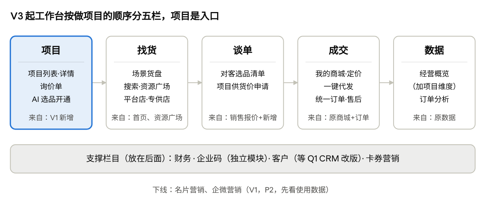

# 采发发会员工作台调整方案

Nov 9, 2026 · @sanyuan

会员工作台改成以「项目」为主线：V1（11/20）只新增项目视图、货盘入口和询价单，老菜单不动；V3 按「项目 → 找货 → 谈单 → 成交 → 数据」一次重组，和订单全货源统一同步做，不改两遍。

依据：买家侧产品形态与版本规划 v1.0（11/03）、11/06 工作台决策、现有工作台菜单（知识库 06）、11/07 自有供应商与店铺连接器讨论会。

## 一、现状问题

现有工作台 7 个一级菜单（商城、订单、企业码、数据、营销、客户、财务）是按老系统模块和渠道拼起来的，不是按服务商做项目的顺序。

| 问题           | 表现                                                                            |
|----------------|---------------------------------------------------------------------------------|
| 没有项目       | 商城、询价、订单、经营数据分在 4 个菜单；一个甲方开几个商城，服务商只能自己汇总 |
| 订单按渠道拆   | 商城订单、猫超代发、猫超集采各一组，得先知道货从哪来才知道去哪找                |
| 找货不在工作台 | 资源广场、模板广场、场景首页都在工作台外；运营货盘还靠线下表格转发              |
| 无用栏目       | 名片营销、企微营销占着菜单位                                                    |

## 二、调整原则

1.  **项目是主线**：商城、询价单、订单都挂在项目下，建商城、选品上架、询价都从项目发起。

2.  **V1 只加不搬，V3 一次重组**：老菜单含大量 iframe 和微应用，搬一次成本高；重组与 V3 购物车、订单全货源统一一起做，不改两遍。

3.  **按任务分组，不按渠道**：V3 起订单不再分猫超代发、猫超集采，货源只是筛选条件。

4.  **边界不变**：企业码保持独立模块；财务不做 AI；客户（CRM）AI 改版在 Q1，这轮不动。

5.  **新增和重构都带新手指引**：每一版只要新增入口或调整栏目位置，都要同版上线新手指引，避免用户找不到入口。内容包括：首次进入的分步引导（可跳过、可重看）、新入口 NEW 角标、空状态引导；重构时加一项「旧入口去哪了」提示，老位置保留一段时间的跳转。指引做成通用组件，V1 建好，后续版本复用。

## 三、分版本调整

四个版本里，工作台只在 V1 和 V3 有结构变化，V2、V4 只在项目和谈单里加功能。

| 版本                           | 工作台改什么                                                                                                                                                                                                                                                                                      | 带来的价值                   | 对应任务          |
|--------------------------------|---------------------------------------------------------------------------------------------------------------------------------------------------------------------------------------------------------------------------------------------------------------------------------------------------|------------------------------|-------------------|
| **V1 · 11/20** 轻量调整        | 年货节档期卡（曝光当前档期热门货盘）；新增「项目」入口（列表 + 详情，详情一页聚合商城、询价单、订单和经营数据）；从项目发起建商城、选品上架、询价；新增「我的询价单」（场景货盘在会员首页，工作台只保留档期卡引流）；项目数据权限；下线名片、企微（P2）；新手指引（分步引导 + NEW 角标 + 空状态） | 按项目看账；询价进度有地方查 | V1-5、V1-4、V1-10 |
| **V2 · ~12/4** 小补            | 项目详情加「申请开通 AI 选品」，可看本项目 AI 用量和带来的兑换；按钮加 NEW 角标和气泡提示                                                                                                                                                                                                         | AI 按项目可控开通            | V2-6.4            |
| **V3 · 商品库上线后** 完整重构 | 栏目按「项目 → 找货 → 谈单 → 成交 → 数据」重组；「我的商品」纳入平台商家商品；订单、售后合成全货源统一入口；谈单栏目新增对客选品清单；新手指引（含旧入口去向提示和老位置跳转）                                                                                                                    | 按做项目的顺序工作           | V3-6、V3-2、V3-7  |
| **V4 · 12/31 前** 补全         | 谈单栏目加「项目供货价申请」，自动带项目四项信息；项目详情显示按项目供货价成交的订单；新入口加 NEW 角标和气泡提示                                                                                                                                                                                 | 凭数据拿到项目成本价         | V4-1、V4-2.2      |

## 四、V3 目标栏目

V3 工作台目标栏目 · 5 栏 + 支撑栏目

服务商从项目进入，沿找货、谈单、成交、数据往右走；每栏底部注明内容从现有哪个菜单迁来。专供店和自有供应商管理的位置见第五节第 1 条。

## 五、需要补进版本规划的事项

1.  **按 11/07 结论更新 V3**：自有供应商保留并做强，所有供给以店铺（平台店 / 专供店）出现。「找货」要同时容纳两类店铺；服务商管理自有供应商（绑定、账期、差异价）放哪个栏目，等卖家侧店铺方案后定，先写为待定。

2.  **V3 顺延时，工作台重构改到 V4**：重构（V3-6）基本不依赖商品库，而 V4 的项目供货价需要谈单栏目，不应跟着 V3 整版推到 Q1。

3.  **首页会员面板同步改**：常用功能由用户自己选择，V1 把「我的项目」「询价单」加入可选列表，并用气泡提示用户加入，不改用户已选的功能。

4.  **下线名片、企微前看数据**：拉近 90 天访问量确认无人使用。「客户」下的企微好友、企微客户群跟 Q1 CRM 改版走，这次不动。
